# MXB109 Introductory Operations Research: Complete Revision Guide

> **One unit, one idea: linear programming.** Every problem in MXB109 is an LP: decision variables, a linear objective, linear constraints.
> What changes from week to week is the **structure** of that LP, and the structure tells you which method to use.
> **Exam skill #1:** identify the kind of problem. **Exam skill #2:** run the right procedure and show the working. **Exam skill #3:** interpret the answer in words.

This README is the **whole unit compressed into one file**. Each section links to a detailed note with worked examples, diagrams and self-check questions.

---

## Contents

0. [How to use these notes](#0-how-to-use-these-notes)
1. [The decision map: which method?](#1-the-decision-map-which-method)
2. [Formulation and standard form](#2-formulation-and-standard-form)
3. [Slack, excess and artificial variables](#3-slack-excess-and-artificial-variables)
4. [Graphical method](#4-graphical-method)
5. [Simplex method](#5-simplex-method)
6. [Big M and the special cases](#6-big-m-and-the-special-cases)
7. [Sensitivity: shadow prices and reduced costs](#7-sensitivity-shadow-prices-and-reduced-costs)
8. [Duality](#8-duality)
9. [Transportation problems](#9-transportation-problems)
10. [Game theory](#10-game-theory)
11. [Networks](#11-networks)
12. [Glossary](#12-glossary)
13. [Common mistakes that lose marks](#13-common-mistakes-that-lose-marks)
14. [Exam-day checklist](#14-exam-day-checklist)
15. [Revision plan](#15-revision-plan)

---

## 0. How to use these notes

| File | Topic | Lecture | Must-know for exam |
|---|---|---|---|
| [00_START_HERE.md](notes/00_START_HERE.md) | Map, cue words, resource sheet | Wk 13 revision | ✅ |
| [01_Formulation_and_Standard_Form.md](notes/01_Formulation_and_Standard_Form.md) | Formulating, standard form, slack/excess/artificial | Wks 1–2 | ✅ |
| [02_Graphical_Method.md](notes/02_Graphical_Method.md) | Feasible region, isoprofit, corner theorem, coefficient range | Wk 3 | ✅ |
| [03_Simplex_Method.md](notes/03_Simplex_Method.md) | Basic/non-basic, tableau, ratio test, pivot | Wks 5–6 | ✅✅ |
| [04_BigM_and_Special_Cases.md](notes/04_BigM_and_Special_Cases.md) | Big M, infeasible / unbounded / multiple optima | Wk 7 | ✅✅ |
| [05_Sensitivity_Shadow_Price_Reduced_Cost.md](notes/05_Sensitivity_Shadow_Price_Reduced_Cost.md) | Shadow price, reduced cost, ranges, Solver report | Wk 8 | ✅✅✅ |
| [06_Duality.md](notes/06_Duality.md) | Dual, weak/strong duality, complementary slackness | Wk 9 | ✅✅ |
| [07_Transportation.md](notes/07_Transportation.md) | NW corner, u/v, reduced costs, loops | Wk 11 | ✅✅ |
| [08_Game_Theory.md](notes/08_Game_Theory.md) | Dominance, saddle point, mixed LP | Wk 12 | ✅✅ |
| [09_Networks.md](notes/09_Networks.md) | Shortest path, MST | Wk 13 | ✅ |

**Practice exams** (60 marks each, 2 hours, every topic, in the style of the PST and revision pracs):

| Exam | Paper | Solutions |
|---|---|---|
| 1 | [Practice_Exam_1.md](practice_exams/Practice_Exam_1.md) | [Practice_Exam_1_Solutions.md](practice_exams/Practice_Exam_1_Solutions.md) |
| 2 | [Practice_Exam_2.md](practice_exams/Practice_Exam_2.md) | [Practice_Exam_2_Solutions.md](practice_exams/Practice_Exam_2_Solutions.md) |

**Viewing:** in VS Code press `Cmd+Shift+V`. Diagrams are PNGs in [`notes/img/`](notes/img/). Flowcharts are Mermaid and need the extension **"Markdown Preview Mermaid Support"** (GitHub and Obsidian render them automatically).

---

## 1. The decision map: which method?

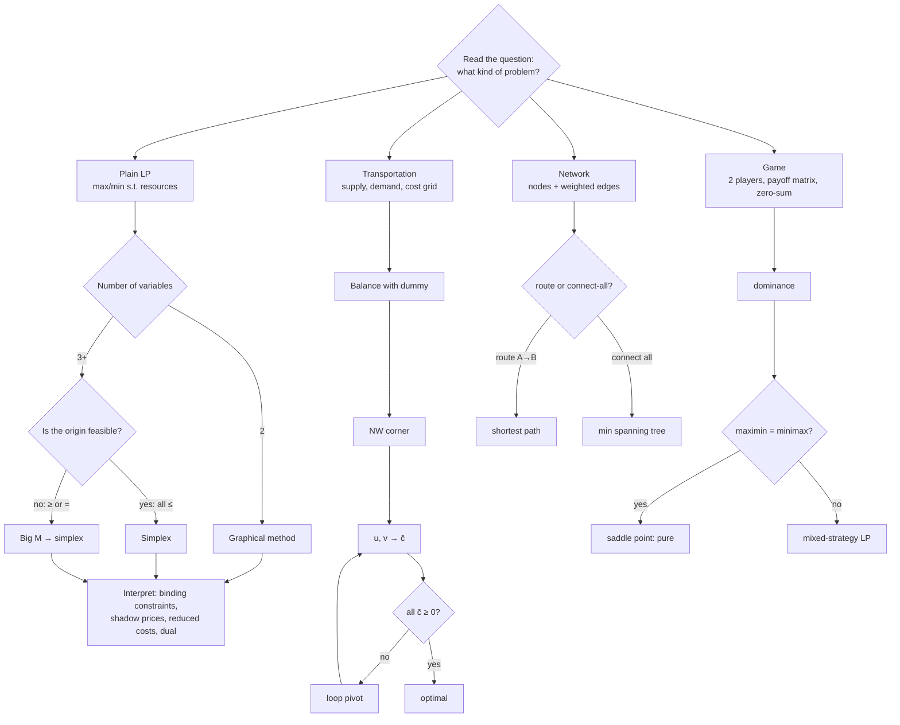

### Cue words

| The question says… | Method |
|---|---|
| "maximise / minimise … subject to …", resources | formulate → graphical / simplex |
| "at least", "minimum requirement", "exactly" | ≥ / = constraints → **Big M** |
| "one more unit", "worth", "how much would you pay", "binding" | **shadow price** |
| "not produced", "how much must its profit rise" | **reduced cost** |
| "by how much can the profit change before the plan changes" | **objective coefficient range** |
| "partner problem", "bound", "buyer of your resources", "smallest offer you can't refuse", "certify optimal" | **duality** |
| "supply", "demand", "depots", "routes", cost table | **transportation** |
| "opponent", "zero-sum", "payoff", "simultaneously" | **game** |
| "quickest / shortest route from A to B" | **shortest path** |
| "connect all", "least cable / pipe / fibre" | **minimum spanning tree** |

---

## 2. Formulation and standard form

→ Details: [01_Formulation_and_Standard_Form.md](notes/01_Formulation_and_Standard_Form.md)

**Five-step translation:** (1) list measurable quantities with units, (2) split into *chosen* (decision variables) vs *follows* (objective and constraints), (3) objective as a sentence, (4) each constraint as "used ≤ available" or "provided ≥ required", (5) swap in symbols, then **check the units on both sides**.

**Farmer (week 1):**

```
P = ha pineapples, B = ha bananas
max z = 100P + 30B
s.t.  P +  B ≤ 7     land (ha)
     10P + 4B ≤ 40    labour (h)
          10B ≥ 30    café contract (kg)
       P, B ≥ 0
Optimum: P = 2.8, B = 3, z = $370   (labour and contract binding)
```

**Standard form:** RHS ≥ 0 (multiply by −1 if needed, which flips the inequality), all equalities, all variables ≥ 0.
**Minimise** by maximising z′ = −z, then flip the sign back at the end.

---

## 3. Slack, excess and artificial variables

| Constraint | Add | Meaning | Value 0 at the optimum ⇒ | Value > 0 ⇒ |
|---|---|---|---|---|
| `≤` | **+ s** (slack) | resource **left over** | binding: scarce resource, shadow price usually ≠ 0 | non-binding: shadow price **0** |
| `≥` | **− e** (excess / surplus) **+ a** | amount **over** the requirement | binding: requirement costs you | non-binding: shadow price **0** |
| `=` | **+ a** | nothing real | (must be 0) | **infeasible** if a > 0 at the end |

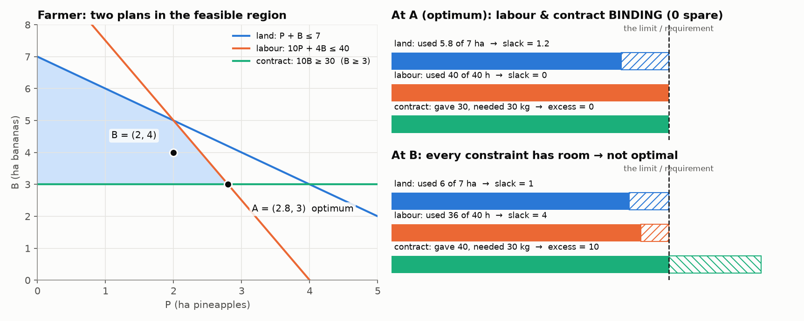

> **Geometry:** slack/excess = 0 ⇔ the point lies **on** that constraint's line.
> **Slack and excess are real quantities you report. Artificials are scaffolding for the method only.**

---

## 4. Graphical method

→ Details: [02_Graphical_Method.md](notes/02_Graphical_Method.md)

1. Plot each constraint line, shade the allowed side; the overlap is the **feasible region**.
2. Draw an **isoprofit line** c₁x₁ + c₂x₂ = z and **slide it parallel** in the improving direction.
3. The last point touched is a **corner**. Solve its two binding lines simultaneously.
   (Or: list all feasible corners, evaluate z at each, pick the best.)

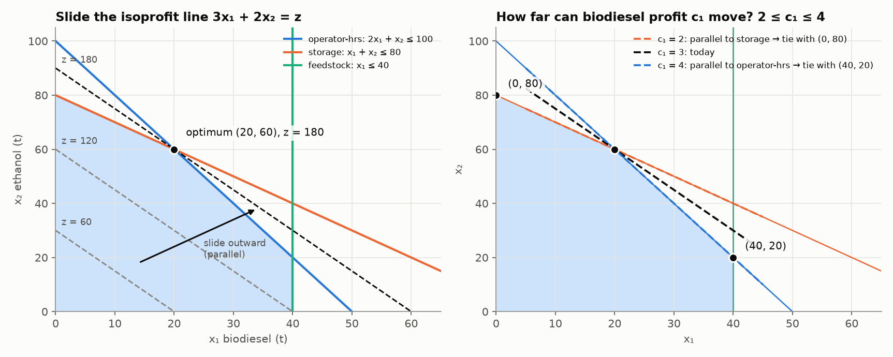

**Fundamental theorem:** the optimum is always at a **corner**. If the objective is parallel to an edge, the whole edge is optimal.

**Objective coefficient range:** the current corner stays optimal while the objective slope **−c₁/c₂** lies between the slopes (−a/b) of the two binding constraints.
Biofuel: −2 ≤ −c₁/2 ≤ −1 ⇒ **2 ≤ c₁ ≤ 4**. Inside the range, the plan doesn't change; only z changes.

---

## 5. Simplex method

→ Details: [03_Simplex_Method.md](notes/03_Simplex_Method.md)

* **Corner = basic feasible solution.** n variables, m equations: set **n − m** variables to 0 (**non-basic**) and solve for the m **basic** ones.
* Neighbouring corners differ by **one swap** (enter / leave).

| Step | Rule |
|---|---|
| Start | standard form; basis = slacks (the origin) |
| Entering | **most negative** entry in the z row |
| Leaving | **ratio test**: RHS ÷ (positive) pivot-column entry, smallest wins |
| Pivot | make the pivot 1, clear the rest of the column (z row included) |
| Stop | **no negatives** in the z row |

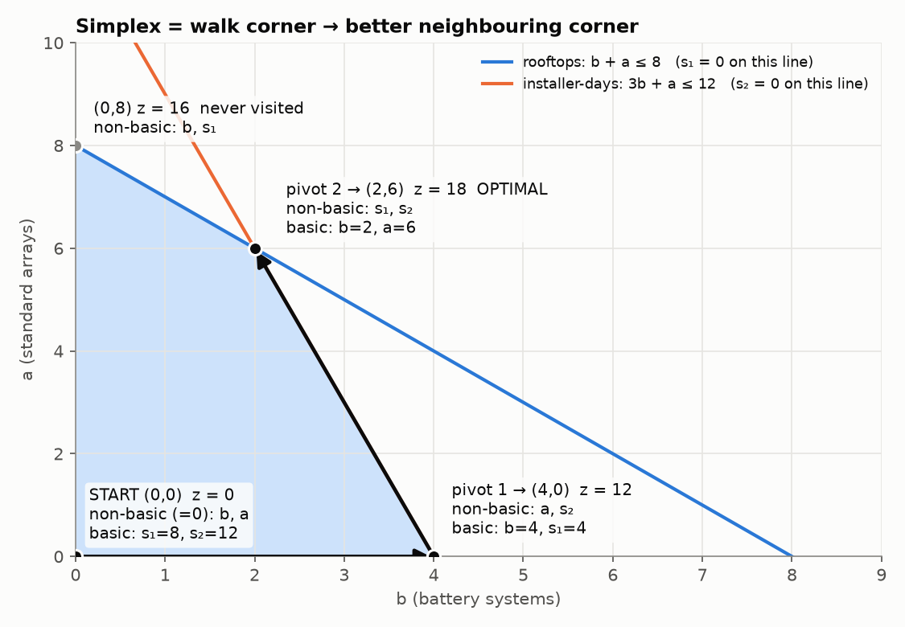

**Co-op final tableau** (max 3b + 2a, b + a ≤ 8, 3b + a ≤ 12):

| Basis | b | a | s₁ | s₂ | RHS |
|---|---|---|---|---|---|
| a | 0 | 1 | 3/2 | −1/2 | 6 |
| b | 1 | 0 | −1/2 | 1/2 | 2 |
| z | 0 | 0 | 3/2 | 1/2 | 18 |

→ b = 2, a = 6, z = 18. Shadow prices: rooftops **3/2**, installer-days **1/2**.

---

## 6. Big M and the special cases

→ Details: [04_BigM_and_Special_Cases.md](notes/04_BigM_and_Special_Cases.md)

**Big M procedure:**
1. Substitute the origin. Every constraint it violates gets an artificial.
2. Penalise: for a max, **−Maᵢ** in the objective. For a min, **+Maᵢ** (or convert to max z′ = −z and use −Maᵢ).
3. ⚠️ **Clear the M's from the z row** (Rz − M × each artificial row) **before** looking for negatives.
4. Run simplex. Compare M-expressions by their M coefficient first.

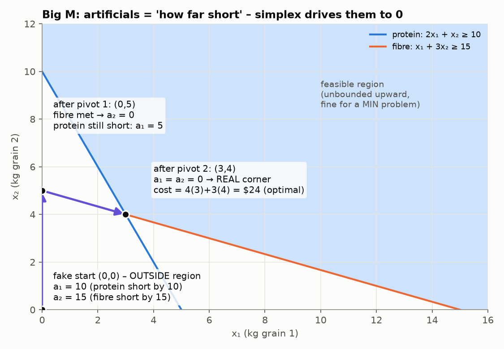

| Situation | **Tell in the tableau** | Report |
|---|---|---|
| Infeasible | artificial **still basic, > 0** at the end | constraints contradict each other |
| Unbounded | entering column has **no positive entry** | a constraint is missing |
| Alternative optima | **0 under a non-basic** variable at the optimum | pivot it in; the whole edge between the corners is optimal |
| Normal | none of the above | read off the RHS |

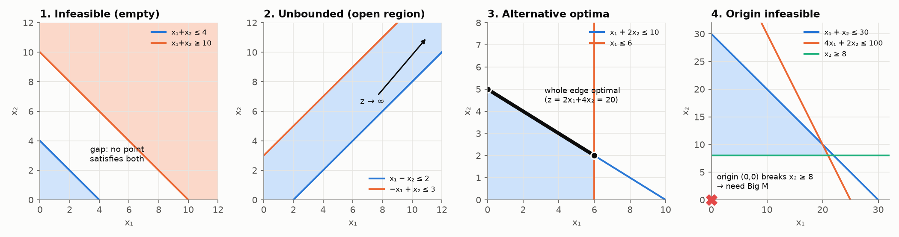

---

## 7. Sensitivity: shadow prices and reduced costs

→ **Full visual explanation:** [05_Sensitivity_Shadow_Price_Reduced_Cost.md](notes/05_Sensitivity_Shadow_Price_Reduced_Cost.md)

> At the optimum, the z-row entry under a non-basic variable = **how much z falls if that variable is pushed up by 1**.

| z-row entry under… | Name | Meaning |
|---|---|---|
| a basic variable | – | always 0 |
| non-basic **slack sᵢ** | **shadow price** of constraint i | +1 unit of resource i changes z by this amount |
| non-basic **excess eᵢ** | shadow price = **−(entry)** for a max | +1 unit of requirement **lowers** z |
| non-basic **decision xⱼ** | **reduced cost** | z drops by this much per unit forced in; its profit must rise by this much to be worth making |
| basic slack (sᵢ > 0) | shadow price **0** | resource not used up |

**Resource-sheet definition:** shadow price = (new optimal z) − (old optimal z) when the RHS goes up by 1. **When unsure, re-solve.**

### Binding vs non-binding

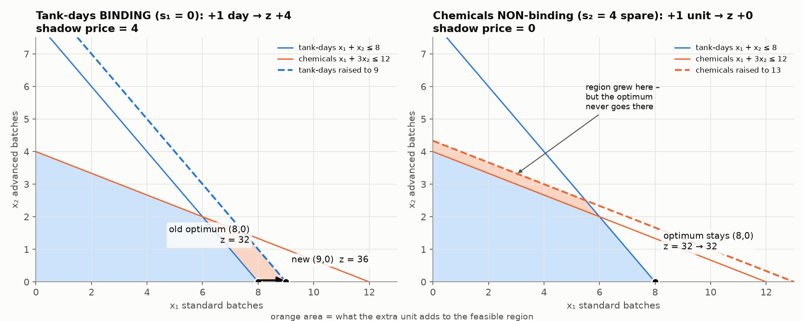

### A shadow price is a slope, valid over a range

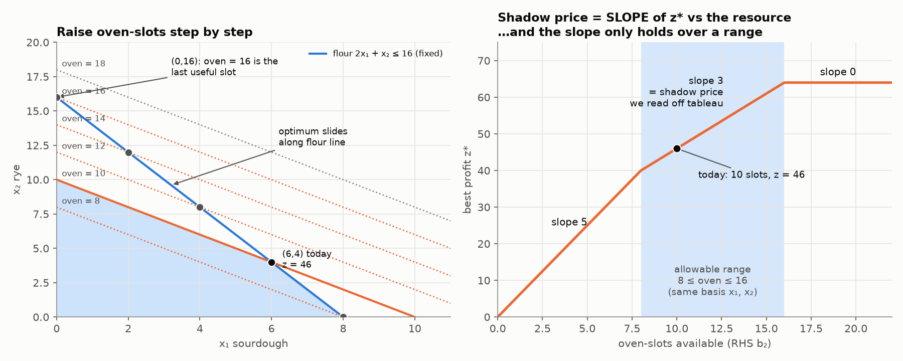

Bakery: oven-slot shadow price **$3**, valid for **8 ≤ oven-slots ≤ 16** (same constraints binding). Inside the range: new z = old z + Δ × shadow price. Outside it, you must re-solve.
Range from the tableau: new RHS = old RHS + Δ × (slack column); every basic value must stay ≥ 0.

### ≥ requirements have negative shadow prices (max problems)

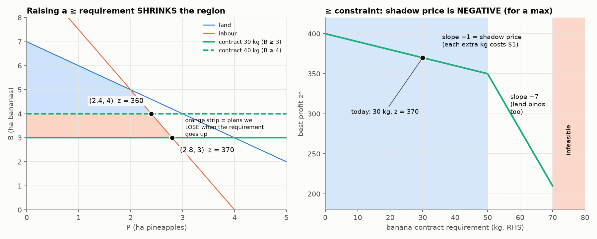

| Problem | Binding constraint | Shadow price sign |
|---|---|---|
| max | ≤ | ≥ 0 |
| max | ≥ | ≤ 0 |
| min | ≥ | ≥ 0 (cost rises) |
| min | ≤ | ≤ 0 |
| any | non-binding | 0 |

### Reduced cost

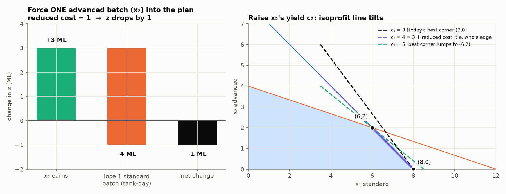

**Reduced cost of xⱼ = (resources one unit uses × shadow prices) − (its profit).**
Water works: advanced batch = 1 tank-day × 4 + 3 chem × 0 − 3 = **1**.

### RHS change vs coefficient change

| Change | Plan | z |
|---|---|---|
| RHS (within range) | corner slides, same binding constraints | + shadow price × Δ |
| objective coefficient (within range) | **unchanged** | + Δ × xⱼ |

---

## 8. Duality

→ Details: [06_Duality.md](notes/06_Duality.md)

**The dual is the problem of finding the tightest upper bound on the primal.**

```
PRIMAL                                DUAL
max 5x₁ + 4x₂                         min 10y₁ + 14y₂
s.t. 2x₁ +  x₂ ≤ 10   (y₁)            s.t. 2y₁ +  y₂ ≥ 5   (x₁)
      x₁ + 2x₂ ≤ 14   (y₂)                  y₁ + 2y₂ ≥ 4   (x₂)
     x ≥ 0                                  y ≥ 0
optimum (2, 6), z = 34                optimum (2, 1), w = 34
```

| Primal (max, ≤) | Dual (min, ≥) |
|---|---|
| m constraints | m variables |
| n variables | n constraints |
| RHS b | objective coefficients |
| objective c | RHS |
| columns of A | rows of the dual |

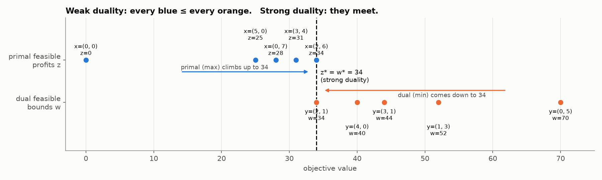

* **Weak duality:** any primal-feasible z ≤ any dual-feasible w.
* **Strong duality:** z* = w*. Equal values certify that both are optimal.
* **Dual variables = shadow prices** (they appear in the primal's final z row under the slacks).
* **Complementary slackness:** slack resource ⇒ yᵢ = 0. Product not made ⇒ its dual constraint is slack by its reduced cost.
* Solve the dual (Big M, since it's a min with ≥) when it's smaller: few resources, many products.

---

## 9. Transportation problems

→ Details: [07_Transportation.md](notes/07_Transportation.md)

1. **Balance**: if supply ≠ demand, add a dummy row or column at cost 0.
2. **NW corner**: fill from the top-left, min(supply left, demand left). Gives **m + n − 1** occupied cells.
3. **Prices**: u₁ = 0, then uᵢ + vⱼ = cᵢⱼ on each **occupied** cell.
4. **Reduced costs**: c̄ᵢⱼ = cᵢⱼ − uᵢ − vⱼ on each **empty** cell. All ≥ 0 means **optimal** (a 0 means alternative optima).
5. **Improve**: the most negative c̄ enters. Trace the **+ − + − loop** through occupied cells. θ = smallest − cell; that cell leaves. New cost = old + θ × c̄.

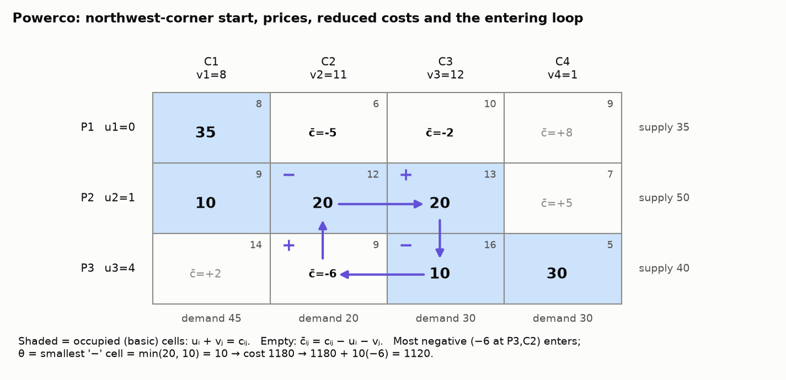

Powerco: 1180 (NW) → 1120 → 1070 → **1020** (optimal).

---

## 10. Game theory

→ Details: [08_Game_Theory.md](notes/08_Game_Theory.md)

1. **Dominance**: delete a row that's ≤ another row everywhere. Delete a column that's ≥ another column everywhere (the column player wants small numbers).
2. **Saddle point test**: maximin (max of row minima) vs minimax (min of column maxima). If they're **equal**, that's a pure strategy and the value of the game.
3. **Otherwise mixed**:

```
max v
s.t. Σᵢ aᵢⱼ xᵢ ≥ v    for every column j of the opponent
     Σ xᵢ = 1,  xᵢ ≥ 0
```

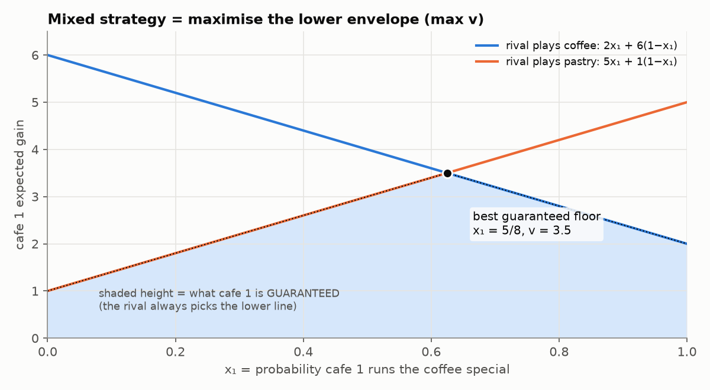

2×2 shortcut: set the two column expressions equal. Cafe game: x = (5/8, 3/8), **v = 3.5**.
The row and column players' LPs are **duals**, so v = w = the value of the game.

---

## 11. Networks

→ Details: [09_Networks.md](notes/09_Networks.md)

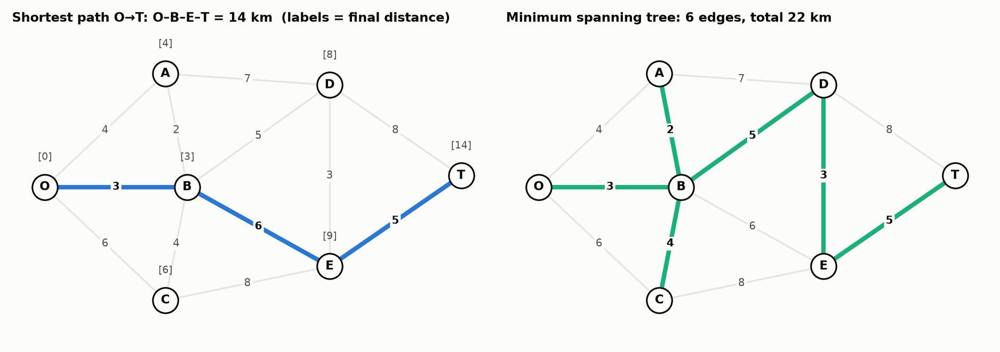

| | **Shortest path** | **Minimum spanning tree** |
|---|---|---|
| Question | quickest route A → B | connect **every** node, least total |
| Algorithm | label-setting: box the unboxed node with the smallest label, update its neighbours, repeat | greedy: add the cheapest edge reaching a **new** node, repeat |
| Result (Seervada) | O–B–E–T = **14** | 6 edges, total **22** |
| Output | one path (trace back through "via") | n − 1 edges, no loops |

LP underneath: **conservation of flow** (flow out − flow in = +1 at the source, −1 at the sink, 0 elsewhere).

---

## 12. Glossary

| Term | Meaning |
|---|---|
| Feasible solution | satisfies every constraint |
| Feasible region | the set of all feasible solutions |
| Optimal solution | the feasible solution with the best objective value |
| Binding / active | LHS = RHS at the optimum (slack/excess = 0) |
| Non-binding | strict inequality at the optimum |
| Slack (s) | unused amount of a ≤ resource |
| Excess / surplus (e) | amount above a ≥ requirement |
| Artificial (a) | made-up starting variable for ≥ / = rows; must end at 0 |
| Basic variable | solved for in the current corner (in the basis) |
| Non-basic variable | set to 0 at the current corner |
| BFS | basic feasible solution = a corner |
| Pivot column / row / element | entering variable / leaving row / their intersection |
| Ratio test | RHS ÷ positive pivot-column entry; the smallest decides who leaves |
| Shadow price | Δ optimal z per +1 RHS of a constraint (= dual variable) |
| Reduced cost | penalty per unit of forcing a non-basic variable in |
| Opportunity cost | value of the best alternative given up |
| Allowable range | interval where the shadow price / plan stays valid |
| Dual | partner LP; its optimum gives the tightest bound |
| Complementary slackness | slack resource ⇔ zero price; unmade product ⇔ slack dual constraint |
| Balanced (transportation) | total supply = total demand |
| Dummy | zero-cost row or column added to balance |
| Zero-sum | one player's gain = the other's loss |
| Saddle point | row minimum and column maximum at the same cell; maximin = minimax |
| Mixed strategy | probabilities over actions |
| Value of the game (v) | guaranteed expected payoff under optimal play |
| MST | minimum spanning tree: n − 1 edges connecting all nodes at minimum total weight |

---

## 13. Common mistakes that lose marks

1. **Forgetting to clear M** from the z row in Big M, then calling the tableau "optimal" too early.
2. **Ratio test with a zero or negative entry.** Skip those rows.
3. **Taking the most negative from the RHS** instead of from the variable columns.
4. **Reading a shadow price under a basic slack.** That constraint is non-binding, so its shadow price is 0.
5. **Sign of a ≥ constraint's shadow price.** For a max it's ≤ 0. Re-solve with RHS + 1 if unsure.
6. **Using a shadow price outside its range.** The binding constraints change, so you must re-solve.
7. **Wrong dominance direction for columns.** The column player prefers **smaller** numbers.
8. **Not checking m + n − 1** occupied cells in transportation.
9. **Loop corners on empty cells.** Apart from the entering cell, every corner of the loop must be an occupied cell.
10. **MST vs shortest path mix-up.** Read the question: route vs connect-all.
11. **Not translating back.** Always finish with a sentence in the problem's language and units.
12. **Negative RHS left in standard form.** Multiply by −1 and flip the inequality.

---

## 14. Exam-day checklist

- [ ] For each question, **write the family first**: "This is a … problem because …"
- [ ] Define every decision variable **with units**
- [ ] Standard form: slack (≤), excess + artificial (≥), artificial (=), RHS ≥ 0
- [ ] Before simplex: is the origin feasible? If not, Big M, and **clear the M's**
- [ ] Show the **entering / leaving** choice and the **row operations** at each pivot
- [ ] Check RHS ≥ 0 after each pivot
- [ ] At the end: check for the tells (stuck artificial, no positive entry, zero under a non-basic)
- [ ] Sensitivity: name the binding constraints, read the shadow prices, state the range caveat
- [ ] Dual: one variable per constraint, one constraint per variable, max ↔ min, ≤ ↔ ≥, check z* = w*
- [ ] Transportation: balanced? m + n − 1 cells? u₁ = 0, c̄ on all empty cells, θ from the − cells
- [ ] Games: dominance → maximin/minimax → saddle point or LP
- [ ] Networks: right algorithm, show the table of labels/edges, give the route/tree **and its total**
- [ ] **Final answer in words**

---

## 15. Revision plan

| Session | Do this | Practice from |
|---|---|---|
| 1 | Read notes 01–02. Redo the farmer and biofuel problems by hand | Wk 1–3 pracs |
| 2 | Note 03. Do two full simplex solves without looking | Revision prac Q5, Q7 |
| 3 | Note 04. Big M grain problem; match the tells to the special cases | Wk 6 prac, revision Q4, Q6, Q8, Q9 |
| 4 | **Note 05.** For each tableau: name every z-row entry; compute one shadow price by re-solving; find one range | Wk 8 prac (bakery, Part E) |
| 5 | Note 06. Write duals for 3 problems; verify strong duality | Wk 9 prac, revision Q2, Q10 |
| 6 | Notes 07–09 | Revision prac 2 (all) |
| 7 | **Mixed practice:** take random questions and name the family before solving | PST questions, both revision pracs |
| 8 | **Timed:** Practice Exam 1 (2 h), then mark it with the solutions | [practice_exams/](practice_exams/) |
| 9 | Revisit weak topics, then Practice Exam 2 (2 h) | [practice_exams/](practice_exams/) |

> *"You came in able to solve equations. You leave able to model a decision."* (week 13 revision lecture)
>
> Good luck! 🍀
