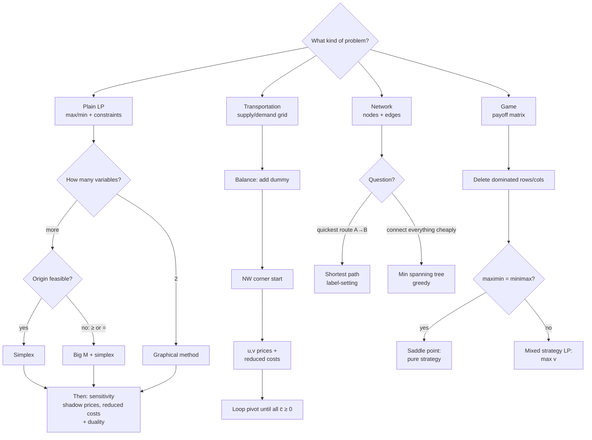

# MXB109 – Revision Notes: Start Here

> Built from your lecture slides (weeks 1–13), practical solutions, both revision pracs, and the exam **resource sheet**.
> Same examples and notation as the lectures, so it should all look familiar.

## How to view these notes

* **VS Code:** open a file and press `Cmd+Shift+V` (Markdown preview). The PNG diagrams in `img/` render straight away.
* **Mermaid flowcharts** (the ` ```mermaid ` blocks) need the free VS Code extension **"Markdown Preview Mermaid Support"** (by Matt Bierner). GitHub and Obsidian render them with no setup.

## Files (read in order)

| # | File | Lecture topic | Priority for you |
|---|------|---------------|------------------|
| 1 | [01_Formulation_and_Standard_Form.md](01_Formulation_and_Standard_Form.md) | Building LPs, **slack / excess / artificial** | ⭐⭐⭐ (excess explained visually) |
| 2 | [02_Graphical_Method.md](02_Graphical_Method.md) | Feasible region, isoprofit line, corners, coefficient ranges | ⭐⭐ |
| 3 | [03_Simplex_Method.md](03_Simplex_Method.md) | Basic/non-basic, tableau, ratio test, pivot | ⭐⭐⭐ |
| 4 | [04_BigM_and_Special_Cases.md](04_BigM_and_Special_Cases.md) | Big M, infeasible, unbounded, multiple optima | ⭐⭐⭐ |
| 5 | [05_Sensitivity_Shadow_Price_Reduced_Cost.md](05_Sensitivity_Shadow_Price_Reduced_Cost.md) | **Shadow price, reduced cost, ranges** | ⭐⭐⭐⭐ (**the one you asked for**) |
| 6 | [06_Duality.md](06_Duality.md) | Dual, weak/strong duality, complementary slackness | ⭐⭐⭐ |
| 7 | [07_Transportation.md](07_Transportation.md) | NW corner, u/v prices, reduced costs, loop pivot | ⭐⭐⭐ |
| 8 | [08_Game_Theory.md](08_Game_Theory.md) | Dominance, saddle point, mixed-strategy LP | ⭐⭐⭐ |
| 9 | [09_Networks.md](09_Networks.md) | Shortest path, minimum spanning tree | ⭐⭐ |

---

## The one big idea of the unit

> **Every problem is a linear program.** What changes is the *structure*, and the structure tells you which method to use.
> In the exam, the first skill is **naming the family**. After that it's a known procedure.



## Cue words → method (from the week-13 revision lecture)

| If the question says… | Reach for… |
|---|---|
| "maximise/minimise … subject to", resources | formulate + simplex / graphical |
| "one more unit", "worth", "binding", "how much would you pay" | **shadow price / sensitivity** |
| "not produced", "how much would profit need to rise" | **reduced cost** |
| "partner problem", "bound the optimum", "buyer of your resources", "smallest offer you can't refuse" | **duality** |
| "supply", "demand", cost grid | transportation |
| "zero-sum", "payoff", 2 players | game theory |
| "quickest / shortest route" | shortest path |
| "connect every…, least cable" | minimum spanning tree |

## The extra variables, all in one table

**This table is the key to most of the unit.** Every other note refers back to it.

| Constraint | What you add | Name | Real meaning | At the optimum… |
|---|---|---|---|---|
| `≤` (resource limit) | `+ s` | **slack** | resource **left over / unused** | `s = 0` → binding (resource scarce, shadow price usually > 0). `s > 0` → non-binding (shadow price = 0) |
| `≥` (requirement) | `− e + a` | **excess** (surplus) + **artificial** | `e` = how much you **went over** the requirement | `e = 0` → binding (requirement is costing you). `e > 0` → non-binding (shadow price = 0) |
| `=` | `+ a` | **artificial** only | nothing real; it's scaffolding | `a` **must** be 0, otherwise the problem is **infeasible** |

> Slack and excess are **part of the problem**: real quantities you would report.
> Artificials are **part of the method**: a device to start simplex, and gone by the end.

## Resource sheet (given in the exam)

You get these, so don't memorise them. Know **when** to use each one.

* General LP: max/min z = c₁x₁ + … + cₙxₙ s.t. constraints with ≤, =, ≥ and xⱼ ≥ 0
* Row operations: Rᵢ′ = mRᵢ, Rᵢ′ = Rᵢ + nRⱼ
* Slope of ax + by = c is **−a/b**
* **Shadow price = (new optimal value) − (old optimal value)** when that constraint's RHS goes up by **one**
* **Big M:** for a max, subtract Maᵢ for each artificial. For a min, add Maᵢ.
* Transportation: a basic feasible solution uses **m + n − 1** cells. uᵢ + vⱼ = cᵢⱼ on occupied cells. Reduced cost c̄ᵢⱼ = cᵢⱼ − uᵢ − vⱼ. θ = smallest allocation among the losing (−) cells.
* Networks: at every node except source and sink, flow in = flow out.

## How marks are given

* **Name the method and say why** ("this is a transportation problem because…"). Marks go to the right method applied clearly.
* **Always translate back** into words: "Make 20 deluxe and 20 regular cards for $1400; every machine hour is used."
