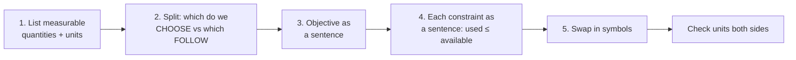
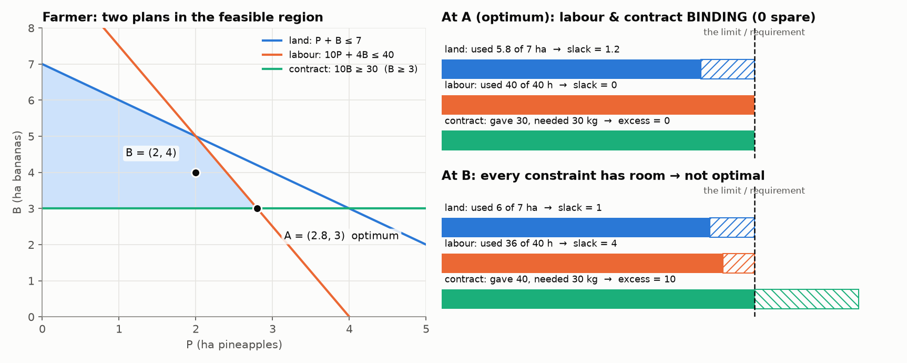

# 1. Formulation and Standard Form (Slack, Excess, Artificial)

## 1.1 Every LP has three parts

| Part | Question to ask | Farmer example |
|---|---|---|
| **Decision variables** | What can I actually control? | P = ha pineapples, B = ha bananas |
| **Objective** | What does "better" mean? | max z = 100P + 30B |
| **Constraints** | What limits me? | land, labour, café contract, non-negativity |

Plus **sign restrictions** (usually xᵢ ≥ 0). Everything must be **linear**: no x₁x₂, no x², no eˣ, no log x.

## 1.2 The five-step translation (from the week 2 lecture)



* What we **choose** becomes the decision variables.
* What **follows** from those choices (profit, hours used, casings used) becomes the objective and constraints.
* If you find yourself trying to "choose the profit", you've gone wrong.
* **Unit check:** `x₁ + x₂ ≤ 40` has casings on both sides ✓. If one side is hours and the other is casings, the constraint is wrong.
* **Pick variables that can be fractional** (days of operation, not number of vans), so a value like 4.5 still means something.

**Two shapes of problem:**

| Shape | Objective | Constraints | Example |
|---|---|---|---|
| Resource allocation | **max** profit | mostly `≤` (limits) | farmer, computer chips |
| Coverage / diet / blending | **min** cost | mostly `≥` (requirements) | mobile clinics, seed mix, grain |

## 1.3 Standard form

The course's standard form needs three things:

1. every RHS **non-negative** (if one is negative, multiply that row by −1, which **flips** the inequality)
2. every constraint an **equality**
3. every variable **≥ 0**

To turn inequalities into equalities, add the extra variables:

| Original | Becomes | Why |
|---|---|---|
| `A ≤ 100` | `A + s = 100` | add slack to the **smaller** side |
| `G ≥ 5` | `G − e = 5`  (then `+ a` for Big M) | subtract excess from the **larger** side |
| `H = 7` | `H + a = 7` (Big M only) | nothing to add for standard form itself |

### The negative-RHS trap (week 2 lecture example)

```
−x₁ + x₂ ≤ −2      RHS is negative ✗
×(−1):  x₁ − x₂ ≥ 2    now a ≥ constraint
→  x₁ − x₂ − e₂ = 2     (and it needs an artificial for Big M)
```

### Minimisation

`min z = max(−z)`. Set z′ = −z, maximise z′, and flip the sign at the end.

---

## 1.4 What slack and excess actually *look like*

This is the part lectures usually only state in words. Use the farmer problem:

```
max z = 100P + 30B
s.t.   P +  B ≤ 7      land       → P + B + s₁ = 7
     10P + 4B ≤ 40     labour     → 10P + 4B + s₂ = 40
          10B ≥ 30     contract   → 10B − e₃ = 30
       P, B ≥ 0
```



**Read the picture:**

* **Left:** the feasible region. Plan **A** is the optimum (2.8, 3). Plan **B** = (2, 4) is feasible but not optimal.
* **Right:** for each constraint, a bar shows what the plan **uses** (or supplies) against the limit (dashed line).
  * **Slack (≤)** = the hatched gap **before** the limit: resource you didn't use.
  * **Excess (≥)** = the hatched bit **beyond** the requirement: how much you over-delivered.

| | At A (2.8, 3) optimum | At B (2, 4) |
|---|---|---|
| land: s₁ = 7 − (P + B) | 7 − 5.8 = **1.2** (spare land) | 7 − 6 = 1 |
| labour: s₂ = 40 − (10P + 4B) | 40 − 40 = **0** (binding) | 40 − 36 = 4 |
| contract: e₃ = 10B − 30 | 30 − 30 = **0** (binding) | 40 − 30 = 10 kg extra bananas |

### The geometric meaning

```
slack or excess = 0   ⇔   the point sits ON that constraint's line   ⇔   BINDING (active)
slack or excess > 0   ⇔   the point is strictly inside that side     ⇔   NON-BINDING (inactive)
```

* At A, the labour line and the contract line cross, so **labour and contract are binding**. Land is not.
* This is why **corners matter**: a corner is exactly where some slack/excess variables are switched to 0. In 2D you need two of them at 0 (see [03_Simplex_Method.md](03_Simplex_Method.md)).

### Why this matters later (preview of shadow prices)

* **Land has slack 1.2**, so you already have spare land. Getting **one more hectare is worth $0** (shadow price 0).
* **Labour has slack 0**, so labour is the bottleneck. One more hour **is** worth money: **$10** (see note 5).
* **Contract has excess 0**, so the requirement is pushing you around. Raising it would **cost you** **$1 per kg** (shadow price **−1**).

> **Slack tells you where the pressure in the problem is.** A resource with slack is not what's holding you back.

---

## 1.5 Artificial variables (the scaffolding)

**Problem:** simplex starts at the origin (all decision variables = 0). For a `≥` constraint that fails:

```
10B − e₃ = 30, at the origin B = 0  →  e₃ = −30   ✗ (variables can't be negative)
```

**Fix:** invent `a₃ ≥ 0` so that `10B − e₃ + a₃ = 30`. At the origin, `a₃ = 30`, which is legal.

* **Meaning at the start:** a₃ = "how far short of the requirement we are" (30 kg short).
* It has **no real meaning** in the problem, so it **must be 0** in the final answer.
* We force that with a huge penalty: max z = … **− M a₃** (for a min problem, **+ M a₃**).
* Full method and picture: [04_BigM_and_Special_Cases.md](04_BigM_and_Special_Cases.md)

**Quick test for "do I need an artificial?"** Substitute the origin (0, 0, …) into each constraint. **Every constraint the origin violates gets an artificial.** In practice that means every `≥` with a positive RHS and every `=`.

### Worked standard-form conversion (revision prac Q3)

```
min z = 5x₁ + 2x₂ + 4x₃
s.t. 3x₁ +  x₂ + 2x₃ ≥ 12
      x₁ + 2x₂       = 8
            x₂ + 4x₃ ≤ 20
```

```
max z′ = −5x₁ − 2x₂ − 4x₃              (z′ = −z)
s.t. 3x₁ +  x₂ + 2x₃ − e₁ + a₁ = 12     ≥ : excess + artificial
      x₁ + 2x₂            + a₂ = 8      = : artificial only
            x₂ + 4x₃ + s₃      = 20     ≤ : slack
     all variables ≥ 0
```

(For Big M you'd then subtract M a₁ + M a₂ in the objective.)

---

## Quick self-check

<details><summary>1. A constraint reads x₁ + 2x₂ ≥ 10 and at the optimum x₁ = 4, x₂ = 5. What is the excess, and is it binding?</summary>

4 + 10 = 14, so e = 14 − 10 = **4**. Since 4 > 0 it's **non-binding**, and its shadow price is 0.
</details>

<details><summary>2. Why does an "=" constraint get an artificial but no slack or excess?</summary>

There's no gap to measure (LHS must equal RHS exactly), so there's no slack or excess. But at the origin the LHS is 0 ≠ RHS, so it still needs an artificial to give simplex a starting value.
</details>

<details><summary>3. What does "s₂ = 0 at the optimum" tell a manager?</summary>

Resource 2 is completely used up. It is a bottleneck (binding), and getting more of it would probably increase profit (positive shadow price).
</details>
