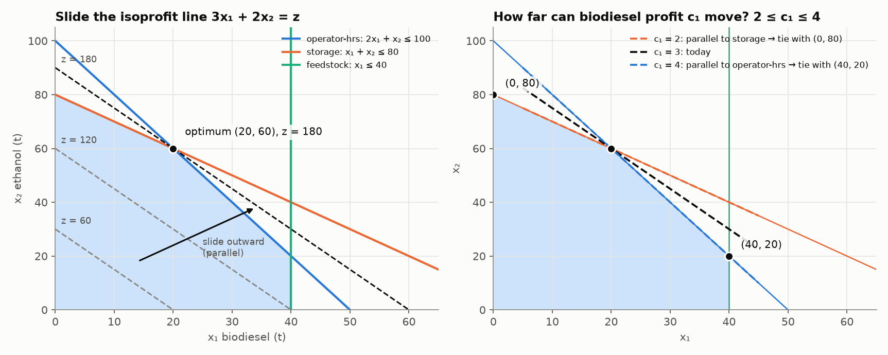
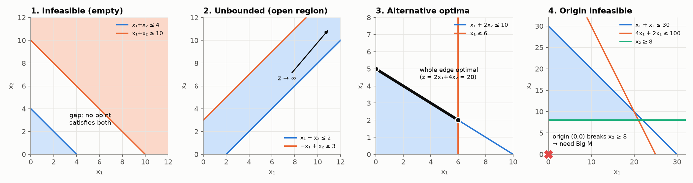

# 2. The Graphical Method (2 variables)

> **In one sentence:** with only two variables you can draw every allowed plan as a shape on a graph, and the best plan is always at one of its corners.

---

## 2.1 The big idea

* Each constraint is a **line** on the graph. One side of the line is allowed and the other isn't.
* The area that is allowed by **every** constraint at once is the **feasible region**, the set of all plans you're allowed to choose.
* The best plan is always at a **corner** of that region.

So the method is: draw the region, find its corners, and pick the best corner.

---

## 2.2 Worked example: biofuel plant (week 3 lecture)

```
x₁ = tonnes of biodiesel, x₂ = tonnes of ethanol, profit in $k

max z = 3x₁ + 2x₂
s.t. 2x₁ +  x₂ ≤ 100   operator-hours
      x₁ +  x₂ ≤ 80    storage
      x₁       ≤ 40    waste-oil feedstock
      x₁, x₂ ≥ 0
```

### Step 1: draw each constraint line

Treat each `≤` as `=` and find **two points**. The easiest are where the line crosses each axis: put x₁ = 0 to get one point, then x₂ = 0 to get the other.

| Constraint | Set x₁ = 0 | Set x₂ = 0 | Line through |
|---|---|---|---|
| 2x₁ + x₂ = 100 | x₂ = 100 | x₁ = 50 | (0, 100) and (50, 0) |
| x₁ + x₂ = 80 | x₂ = 80 | x₁ = 80 | (0, 80) and (80, 0) |
| x₁ = 40 | – | – | a vertical line at x₁ = 40 |

### Step 2: shade the allowed side

Test the point (0, 0) in each constraint. If it's true, the side containing (0, 0) is allowed.
* 2(0) + 0 ≤ 100 ✓, so shade **towards** the origin. The other two are the same.
* x₁, x₂ ≥ 0 means you stay in the top-right quarter.

The area shaded by **all** the constraints is the **feasible region**.

### Step 3: find the corners

Each corner is where two lines meet. Solve the two equations together.

| Corner | Which lines meet | Point |
|---|---|---|
| A | x₁ = 0 and x₂ = 0 | (0, 0) |
| B | x₂ = 0 and x₁ = 40 | (40, 0) |
| C | x₁ = 40 and 2x₁ + x₂ = 100 | x₂ = 100 − 80 = 20 → (40, 20) |
| D | 2x₁ + x₂ = 100 and x₁ + x₂ = 80 | subtract: x₁ = 20, then x₂ = 60 → (20, 60) |
| E | x₁ + x₂ = 80 and x₁ = 0 | (0, 80) |

### Step 4: work out the profit at each corner and pick the best

| Corner | z = 3x₁ + 2x₂ |
|---|---|
| A (0, 0) | 0 |
| B (40, 0) | 120 |
| C (40, 20) | 120 + 40 = 160 |
| **D (20, 60)** | 60 + 120 = **180** ← best |
| E (0, 80) | 160 |

**Answer:** make **20 t of biodiesel and 60 t of ethanol** for **$180k** profit.

**Which limits are binding?** D is where the operator-hours and storage lines meet, so those two are **used up**. Feedstock: we use 20 of 40, so 20 t is spare (**non-binding**).

---

## 2.3 The other way: sliding the profit line



Instead of checking every corner, you can draw a **profit line** (also called an isoprofit line) and slide it.

1. Pick any profit, e.g. z = 60. Draw 3x₁ + 2x₂ = 60. It goes through (20, 0) and (0, 30). Every plan on this line earns exactly $60k.
2. Higher profits give **parallel** lines further from the origin (z = 120, z = 180…).
3. Slide the line outwards, keeping it parallel, until it's about to leave the region.
4. The last point it touches is the best corner, here **D**.

**Reading the left picture:** the dashed lines z = 60, 120, 180 are parallel. The z = 180 line just touches the region at D.

Both methods give the same answer. The corner list is safer in an exam. The sliding line is what you need for the next section.

---

## 2.4 Why the answer is always at a corner

The profit gets bigger as you move in one direction (outwards, for this problem). In the middle of the region you can always keep moving that way and earn more. The only thing that stops you is hitting the edge, and if you keep sliding along an edge you end up at a corner.

> **The best plan is always at a corner.**
> If the profit line is exactly parallel to an edge, every point on that **edge** ties for best.

There are only a few corners, so you only need to check corners. **That's the whole reason the simplex method works** (note 3).

---

## 2.5 How much can a price change before the plan changes?

*"The biodiesel profit is $3k per tonne. How far can it move before we should change the plan?"*

**The idea:** changing a price **tilts** the profit line. Tilt it a little and it still touches the region last at corner D. Tilt it too far and a different corner becomes the best one.

D is held in place by its two binding lines. The profit line has to stay **between their steepnesses** (slopes).

**Slope of the line ax + by = c is −a/b** (on the resource sheet).

| Line | Slope |
|---|---|
| storage: x₁ + x₂ = 80 | −1/1 = −1 |
| profit: c₁x₁ + 2x₂ = z | −c₁/2 |
| operator-hours: 2x₁ + x₂ = 100 | −2/1 = −2 |

The profit slope must sit between the two:
```
−2 ≤ −c₁/2 ≤ −1
multiply by −2 (flips both ≤):  4 ≥ c₁ ≥ 2
⇒  2 ≤ c₁ ≤ 4
```

**Reading it:** as long as biodiesel earns between $2k and $4k per tonne, the best plan stays **(20, 60)**. The profit z changes, but the plan doesn't.

* **c₁ = 2:** the profit line is parallel to storage, so D and E (0, 80) tie. Below 2, switch to E: make only ethanol.
* **c₁ = 4:** the profit line is parallel to operator-hours, so D and C (40, 20) tie. Above 4, switch to C: more biodiesel.

**Exam recipe:**
1. Find the two binding lines at the best corner.
2. Write their slopes, −a/b.
3. Make the profit slope −c₁/c₂ sit between them, and solve for the price that's changing.

---

## 2.6 When things go wrong



| Case | What the picture looks like | What it means in real life |
|---|---|---|
| **Infeasible** | the shaded areas don't overlap at all | the requirements contradict each other. No plan works |
| **Unbounded** | the region is open in the direction profit increases | the profit can grow forever, which means a limit is missing from the model |
| **Alternative optima** | the profit line is parallel to an edge of the region | every point on that edge is equally good. You get a free choice |
| **Origin not allowed** | (0, 0) is outside the region | fine for drawing, but simplex will need **Big M** (note 4) |

An open region is only a problem if profit increases in the open direction. **Minimising** cost over an open region is fine: the cheapest point is still at a corner.

---

## 2.7 Bridge to simplex

A corner is where two lines meet. Being **on** a line means that line's slack is 0, and being on the x₁ = 0 axis means x₁ = 0. So:

> **A corner = a point where two of the variables are 0.**

This needs no picture, so it works for 3, 10 or 1000 variables. Simplex uses this idea. Next: [03_Simplex_Method.md](03_Simplex_Method.md)

---

## Common mistakes

1. Shading the wrong side. Always test (0, 0).
2. Reading a corner off the graph by eye. Solve the two equations to get it exactly.
3. Including a corner that breaks another constraint. Check every corner against **all** constraints.
4. Getting the slope sign wrong. The slope of ax + by = c is **−a/b**.

---

## Check yourself

<details><summary>Seed mix: min 30x₁ + 20x₂ s.t. 4x₁ + x₂ ≥ 20, x₁ + 2x₂ ≥ 12, x ≥ 0. Find the cheapest plan.</summary>

Both constraints are `≥`, so the allowed side is **away** from the origin and the region is open. That's fine because we're minimising.

Corners:
* On the x₂ axis: 4(0) + x₂ = 20 → (0, 20). Check: 0 + 40 ≥ 12 ✓
* On the x₁ axis: x₁ + 0 = 12 → (12, 0). Check: 48 ≥ 20 ✓
* Where both lines meet: from the second line x₁ = 12 − 2x₂, so 4(12 − 2x₂) + x₂ = 20, which gives 48 − 7x₂ = 20, x₂ = 4, x₁ = 4 → (4, 4)

Costs: (0, 20) → 400; (12, 0) → 360; **(4, 4) → 200**.
**Cheapest: 4 kg of each seed for $200.** Both requirements are exactly met (binding).
</details>

<details><summary>Biofuel: the ethanol profit stays at 2. Biodiesel profit rises to 5. Does the plan change?</summary>

5 is outside the range 2 ≤ c₁ ≤ 4, so **yes**. The profit line is now steeper than the operator-hours line, so the best corner moves to **C (40, 20)**: z = 5(40) + 2(20) = 240. (Check D: 5(20) + 120 = 220, which is less.)
</details>
