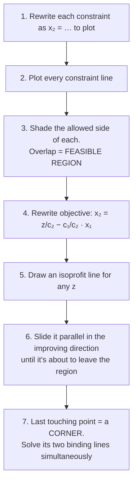

# 2. The Graphical Method (2 variables)

## 2.1 Steps



**Biofuel plant (week 3 lecture):**

```
max z = 3x₁ + 2x₂            (x₁ = t biodiesel, x₂ = t ethanol, $k)
s.t. 2x₁ +  x₂ ≤ 100   operator-hours
      x₁ +  x₂ ≤ 80    storage
      x₁       ≤ 40    waste-oil feedstock
      x₁, x₂ ≥ 0
```


* **Left:** isoprofit lines z = 60, 120, 180 are all parallel (same slope −3/2). Only the intercept changes.
* The last point touched is the corner where **operator-hours and storage** cross:
  `2x₁ + x₂ = 100` and `x₁ + x₂ = 80`. Subtracting gives **x₁ = 20, x₂ = 60, z = 180**.
* **Binding:** operator-hours and storage (slack 0). **Non-binding:** feedstock (uses 20 of 40, slack 20).

> **Corner-point shortcut** (used in the revision solutions): list every corner, discard the infeasible ones, evaluate z at each, pick the best. That's fine for 2 variables.

## 2.2 Fundamental theorem: why corners?

The objective is a **flat plane**: no peak in the middle. From any interior point you can always go "uphill". The only thing that stops you is a constraint, and you end at a **corner**. If the objective is parallel to an edge, you get the **whole edge**.

> **The optimum of an LP is always at a corner** (or along an edge joining two optimal corners).
> There are finitely many corners, so we only need to check corners. That's the basis of simplex.

* **Binding / active** constraint: LHS = RHS at the optimum (the lines that meet at the optimal corner)
* **Non-binding / inactive**: still a strict inequality at the optimum

## 2.3 Sensitivity of an objective coefficient (graphical)

*"How much can the biodiesel profit c₁ change before the plan changes?"* (right panel above)

The optimal corner stays optimal **as long as the isoprofit slope sits between the slopes of the two binding constraints**.

| Line | Slope (−a/b) |
|---|---|
| storage x₁ + x₂ = 80 | −1 |
| isoprofit c₁x₁ + 2x₂ = z | −c₁/2 |
| operator 2x₁ + x₂ = 100 | −2 |

```
−2 ≤ −c₁/2 ≤ −1   ⇒   2 ≤ c₁ ≤ 4
```

* At c₁ = 2 the isoprofit line is parallel to storage, so (0, 80) ties. Below 2, the plan jumps to (0, 80): make **only ethanol**.
* At c₁ = 4 it's parallel to operator-hours, so (40, 20) ties. Above 4, the plan jumps to (40, 20): make **more biodiesel**.
* Inside the range, **the plan (x values) does not change**. Only z changes (z = 20c₁ + 120).

**Recipe for exam questions:**

1. Find the two binding constraints at the optimum.
2. Write their slopes, −a/b.
3. Require the objective slope −c₁/c₂ to lie between them, and solve for the coefficient that's changing.

## 2.4 When things go wrong


| Case | Picture | Meaning in real life |
|---|---|---|
| **Infeasible** | no overlap at all | contradictory requirements (promised more than resources allow) |
| **Unbounded** | region open in the improving direction | a constraint is **missing** from the model |
| **Alternative optima** | objective parallel to a binding edge | free choice: any point on the edge is equally good |
| **Origin infeasible** | (0, 0) not in the region | not a problem for the graphical method, but simplex needs **Big M** |

Note: an open region is only "unbounded" if the objective pushes you that way. **Minimising** over an open region (like the grain problem) is fine.

## 2.5 Bridge to simplex

A corner = where two constraint lines meet = **two variables equal to zero** (slacks, excesses or decision variables). So "find corners" becomes "set some variables to 0 and solve the equations", which works in any number of dimensions. Next: [03_Simplex_Method.md](03_Simplex_Method.md)

---

## Quick self-check

<details><summary>Seed-mix: min 30x₁ + 20x₂ s.t. 4x₁ + x₂ ≥ 20, x₁ + 2x₂ ≥ 12. Find the optimum.</summary>

The corners of the (unbounded) region are (0, 20), (12, 0), and where both bind: 4x₁ + x₂ = 20, x₁ + 2x₂ = 12. Then x₁ = 12 − 2x₂, so 48 − 8x₂ + x₂ = 20 and x₂ = 4, x₁ = 4.
Costs: (0, 20) → 400; (12, 0) → 360; (4, 4) → 200. **Cheapest: 4 kg of each, $200**. Both requirements are binding (excess 0).
</details>
