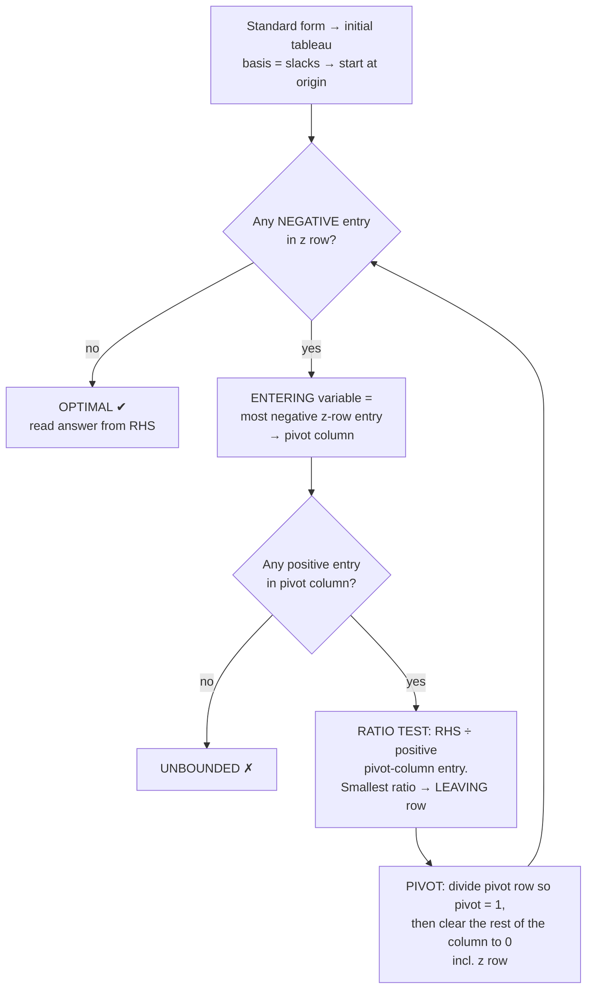

# 3. The Simplex Method

## 3.1 Corners without a picture: basic and non-basic

After standard form: **n variables** (decision + slack/excess) and **m equations**.

* Set **n − m** variables to 0. These are the **non-basic** variables (they put you *on* their lines).
* Solve for the other m. These are the **basic** variables (the **basis**, the corner's coordinates).
* That's a **basic solution** = a corner. If every value is ≥ 0, it's a **basic feasible solution (BFS)**.

> **Corners of the feasible region = basic feasible solutions.**
> Neighbouring corners differ by **one swap**: one variable enters the basis, one leaves.

Checking every corner is hopeless (C(40, 20) ≈ 137 billion). Simplex **walks uphill** from corner to neighbouring corner instead.


Notice at each corner: **non-basic = the lines you're sitting on.** At (2, 6) you're on both constraint lines, so s₁ = s₂ = 0.

## 3.2 The algorithm



**Why each rule (intuition):**

| Rule | Meaning |
|---|---|
| Most negative in z row | the z row is `z − 3b − 2a = 0`, so −3 means "each unit of b adds 3 to z". That's the steepest climb. |
| Ratio test, smallest | as the entering variable grows, basic variables shrink. The first to hit 0 stops you. Going further would make it negative, i.e. leave the region. |
| Skip zero/negative entries in the ratio test | those rows never hit 0, so they don't limit you |
| Stop when no negatives | every move would decrease z, so you're at the top |

## 3.3 Full worked example: community energy co-op (week 6 lecture)

```
max z = 3b + 2a                    b = battery systems, a = standard arrays
s.t.  b + a ≤ 8    rooftops    →   b + a + s₁ = 8
     3b + a ≤ 12   installer-days → 3b + a + s₂ = 12
```

**Tableau 0** (origin: b = a = 0)

| Basis | b | a | s₁ | s₂ | RHS | Ratio |
|---|---|---|---|---|---|---|
| s₁ | 1 | 1 | 1 | 0 | 8 | 8/1 = 8 |
| s₂ | **3** | 1 | 0 | 1 | 12 | 12/3 = **4** ← |
| z | **−3** ↑ | −2 | 0 | 0 | 0 | |

b enters (−3), s₂ leaves (ratio 4), pivot element = 3.
`R₂′ = R₂/3`, `R₁′ = R₁ − R₂′`, `Rz′ = Rz + 3R₂′`

**Tableau 1** (corner (4, 0), z = 12)

| Basis | b | a | s₁ | s₂ | RHS | Ratio |
|---|---|---|---|---|---|---|
| s₁ | 0 | **2/3** | 1 | −1/3 | 4 | 4 ÷ 2/3 = **6** ← |
| b | 1 | 1/3 | 0 | 1/3 | 4 | 4 ÷ 1/3 = 12 |
| z | 0 | **−1** ↑ | 0 | 1 | 12 | |

a enters (−1), s₁ leaves (ratio 6), pivot element = 2/3.
`R₁′ = (3/2)R₁`, `R₂′ = R₂ − (1/3)R₁′`, `Rz′ = Rz + R₁′`

**Tableau 2** (corner (2, 6), z = 18), **optimal**

| Basis | b | a | s₁ | s₂ | RHS |
|---|---|---|---|---|---|
| a | 0 | 1 | 3/2 | −1/2 | 6 |
| b | 1 | 0 | −1/2 | 1/2 | 2 |
| z | 0 | 0 | **3/2** | **1/2** | **18** |

No negatives, so this is optimal. **Install 2 battery systems and 6 standard arrays for 18 MWh/yr.** Both slacks are non-basic (= 0), so rooftops and installer-days are **fully used**.

## 3.4 How to read ANY tableau

| Where | What it tells you |
|---|---|
| Basis column + RHS | values of basic variables (everything else = 0) |
| z-row RHS | current objective value |
| z-row entry under a **basic** variable | always 0 |
| z-row entry under a **non-basic slack sᵢ** (at the optimum) | **shadow price** of constraint i (here: rooftop = 3/2, installer-day = 1/2) |
| z-row entry under a **non-basic decision variable** (at the optimum) | **reduced cost** (how much z drops per unit if you force it in) |
| z-row entry **0 under a non-basic** variable at the optimum | **alternative optima** |

The bottom two rows are covered properly in [05_Sensitivity_Shadow_Price_Reduced_Cost.md](05_Sensitivity_Shadow_Price_Reduced_Cost.md).

### Pivot arithmetic tips

* Do the **pivot row first** (divide by the pivot element), then use the **new** pivot row to clear every other row: `Rᵢ′ = Rᵢ − (entry in pivot column) × R_pivot′`.
* **Check:** the entering column should become a unit column (1 in its row, 0 elsewhere including the z row).
* **Check:** every RHS (except z) must stay ≥ 0. If one goes negative, your ratio test was wrong.
* z should never go down between iterations (for a max problem).

---

## Quick self-check (revision prac Q5)

<details><summary>max z = 3x₁ + 5x₂ s.t. x₁ ≤ 4, 2x₂ ≤ 12, 3x₁ + 2x₂ ≤ 18. Which variable enters first, which leaves, and what is the final answer?</summary>

x₂ enters (−5). Ratios: row 1 has 0 in that column (skip), 12/2 = 6, 18/2 = 9, so s₂ leaves.
Next x₁ enters (−3). Ratios 4/1 = 4 and 6/3 = 2, so s₃ leaves.
Final: **x₁ = 2, x₂ = 6, z = 36**, with z row (0, 0, 0, 3/2, 1). s₁ = 2 is basic, so constraint 1 is not binding (shadow price 0).
</details>
