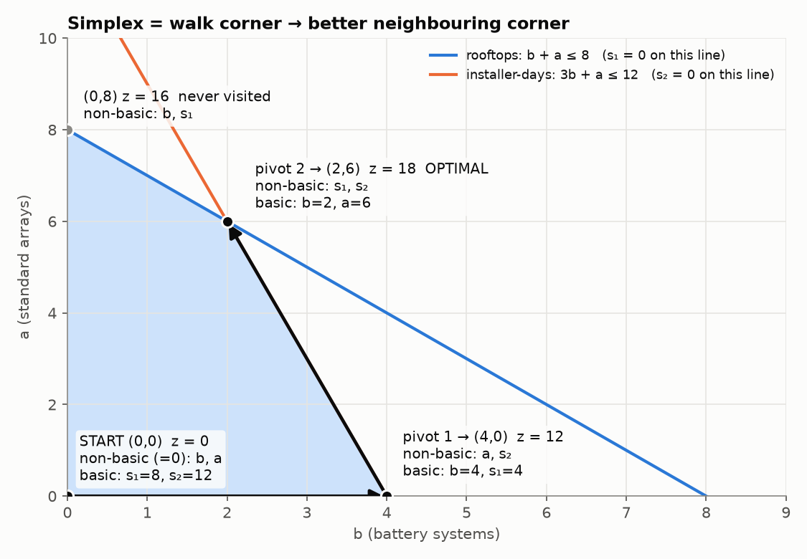

# 3. The Simplex Method

> **In one sentence:** simplex starts at one corner, keeps stepping to a better neighbouring corner, and stops when no neighbour is better. The table is just a record of which corner you're at.

---

## 3.1 The big idea: walking uphill between corners

From note 2: **the best plan is always at a corner.** With two variables you can draw the corners. With many variables there can be billions of them, so checking them all isn't possible.

Simplex does this instead:

1. Start at one corner (usually (0, 0)).
2. Look at the neighbouring corners. Is one of them better?
3. If yes, step there. If no, **stop**: this is the best corner.

It's like walking uphill: keep stepping to a higher neighbour until there isn't one.

---

## 3.2 How a corner looks without a picture

We'll use the **community energy co-op** (week 6 lecture) all the way through this note:

```
b = number of battery systems, a = number of standard arrays

max z = 3b + 2a                 (MWh per year)
s.t.  b + a ≤ 8                 rooftops
     3b + a ≤ 12                installer-days
     b, a ≥ 0
```

Add slacks (note 1): s₁ = rooftops not used, s₂ = installer-days not used.
```
 b + a + s₁      = 8
3b + a      + s₂ = 12
```

The region has 4 corners. Here are **all four numbers** at each one:

| Corner | b | a | s₁ | s₂ | z = 3b + 2a |
|---|---|---|---|---|---|
| A (0, 0) | **0** | **0** | 8 | 12 | 0 |
| B (4, 0) | 4 | **0** | 4 | **0** | 12 |
| C (2, 6) | 2 | 6 | **0** | **0** | **18** ← best |
| D (0, 8) | **0** | 8 | **0** | 4 | 16 |

⭐ **The key idea: at every corner, exactly 2 of the 4 numbers are 0.** Which two are zero tells you which corner you're at.

* The ones that are **0** are called **non-basic**.
* The ones that **aren't 0** are called **basic**. These are the ones listed in the **Basis** column of a simplex table.

Why 2? There are 2 equations. Set 2 variables to 0 and you can solve the equations for the other 2.

### Moving to a neighbouring corner = one swap

Compare A and B:
* At A the zeros are **b, a**.
* At B the zeros are **a, s₂**.

To move from A to B:
* b stops being 0 (we start installing batteries). **"b enters."**
* s₂ becomes 0 (installer-days run out). **"s₂ leaves."**
* a was 0 and is still 0. We only change one thing per step.

> **Every pivot is one swap: one zero variable becomes non-zero (enters), and one non-zero variable becomes zero (leaves).** That's one step to a neighbouring corner, along one edge of the region.

---

## 3.3 What each part of the method decides

| Part of the method | What it decides | Co-op, first step |
|---|---|---|
| **z row**: most negative entry | which zero variable is worth making non-zero (**enters**) | −3 under b: each battery adds 3 MWh. That's the best rate, so b enters |
| **Ratio test**: smallest ratio | how far you can go before something runs out (**leaves**) | installer-days run out at b = 4, before rooftops (which would allow 8), so s₂ leaves |
| **Pivot** (row operations) | rewrites the table for the new corner | the table now describes corner B |
| **Stop rule**: no negatives in the z row | no neighbour is better | at C, stop |

---

## 3.4 Full dry run: the energy co-op

### Step 0: build the starting table

The z row comes from moving everything in the objective to one side:
z = 3b + 2a → **z − 3b − 2a = 0**. That's why the rates show up as **negatives**.

**Table 0**

| Basis | b | a | s₁ | s₂ | RHS |
|---|---|---|---|---|---|
| s₁ | 1 | 1 | 1 | 0 | 8 |
| s₂ | 3 | 1 | 0 | 1 | 12 |
| z | −3 | −2 | 0 | 0 | 0 |

**Reading it:** s₁ and s₂ are in the Basis column, so s₁ = 8 and s₂ = 12 (read the RHS). b and a aren't, so they're **0**.
→ We're at **corner A (0, 0)**, z = **0**. Nothing is installed, and every rooftop and installer-day is unused.

---

### Step 1: is there a better neighbour? (z row)

The negatives are −3 under b and −2 under a.
A negative means "increasing this variable raises z by this much per unit":
* one battery system: +3 MWh
* one array: +2 MWh

Pick the **most negative**: **b enters**. We start adding batteries, and a stays at 0 for this step.

### Step 2: how far can we go? (ratio test)

Divide each RHS by the number in the **b column**:

| Row | Ratio | Meaning |
|---|---|---|
| s₁ (rooftops) | 8 ÷ 1 = 8 | rooftops would run out at 8 batteries |
| s₂ (installer-days) | 12 ÷ 3 = **4** ← smallest | installer-days run out at 4 batteries |

**Why the smallest?** Write each row as an equation for its basic variable, with a still 0:
* s₁ = 8 − b
* s₂ = 12 − 3b

| b | s₁ = 8 − b | s₂ = 12 − 3b | Allowed? |
|---|---|---|---|
| 0 | 8 | 12 | ✅ |
| **4** | 4 | **0** | ✅ s₂ just hits 0 |
| 5 | 3 | **−3** | ❌ you'd need 3 installer-days you don't have |

We want b as big as possible, but s₂ can't go negative, so we **stop at b = 4**. s₂ hit 0 first, so **s₂ leaves**.

**Skip rows with 0 or a negative number** in the entering column. Those rows never hit 0 as the variable grows, so they never stop you.

The **pivot** is where the b column meets the s₂ row: the **3**.

### Step 3: pivot (rewrite the table for the new corner)

**Goal:** make the b column look like a basis column: **1** in the pivot row and **0** in every other row (z row included).

**a) Make the pivot 1.** Divide the s₂ row by 3. This row now belongs to b:
`R₂′ = R₂ ÷ 3` → `1, 1/3, 0, 1/3 | 4`

**b) Clear the 1 above it.** Rooftop row minus the new row:
`R₁′ = R₁ − R₂′` → `0, 2/3, 1, −1/3 | 4`

**c) Clear the −3 in the z row.** z row plus 3 × the new row:
`Rz′ = Rz + 3R₂′` → `0, −1, 0, 1 | 12`

**Table 1**

| Basis | b | a | s₁ | s₂ | RHS |
|---|---|---|---|---|---|
| s₁ | 0 | 2/3 | 1 | −1/3 | 4 |
| b | 1 | 1/3 | 0 | 1/3 | 4 |
| z | 0 | **−1** | 0 | 1 | 12 |

**Reading it:** b = 4 and s₁ = 4. a and s₂ aren't in the Basis column, so they're 0.
→ We're at **corner B (4, 0)**, z = **12**: 4 batteries, 4 rooftops spare, and all installer-days used.

---

### Step 4: is there a better neighbour? (again)

The z row still has **−1 under a**, so arrays are still worth adding. But only +1 per array now, not +2. Why?

Installer-days are all used. One array needs 1 installer-day, so to free one up we must give up 1/3 of a battery (a battery takes 3 days).
* gain: +2 MWh (the array)
* loss: −1 MWh (1/3 battery × 3 MWh)
* net: **+1** ✓ (that's the −1 in the z row)

Still a gain, so **a enters**.

### Step 5: ratio test (a column)

| Row | Ratio | Meaning |
|---|---|---|
| s₁ | 4 ÷ 2/3 = **6** ← smallest | spare rooftops run out at 6 arrays |
| b | 4 ÷ 1/3 = 12 | batteries would hit 0 at 12 arrays |

Rooftops run out first, so **s₁ leaves**. The pivot is the **2/3** in the s₁ row.

### Step 6: pivot

**a) Make the pivot 1.** Multiply the s₁ row by 3/2. It now belongs to a:
`R₁′ = (3/2)R₁` → `0, 1, 3/2, −1/2 | 6`

**b) Clear the 1/3 in the b row:**
`R₂′ = R₂ − (1/3)R₁′` → `1, 0, −1/2, 1/2 | 2`

**c) Clear the −1 in the z row:**
`Rz′ = Rz + R₁′` → `0, 0, 3/2, 1/2 | 18`

**Table 2**

| Basis | b | a | s₁ | s₂ | RHS |
|---|---|---|---|---|---|
| a | 0 | 1 | 3/2 | −1/2 | 6 |
| b | 1 | 0 | −1/2 | 1/2 | 2 |
| z | 0 | 0 | 3/2 | 1/2 | **18** |

**Reading it:** a = 6 and b = 2. s₁ and s₂ aren't in the Basis column, so they're 0.
→ We're at **corner C (2, 6)**, z = **18**.

### Step 7: stop?

No negatives in the z row, so no neighbour is better. **This is the best plan.**

**Answer in words:** install **2 battery systems and 6 standard arrays** for **18 MWh per year**. Both slacks are 0, so every rooftop and every installer-day is used.

---

### The walk, summarised



| Table | Corner | Zeros (non-basic) | z | What happened |
|---|---|---|---|---|
| 0 | A (0, 0) | b, a | 0 | start |
| 1 | B (4, 0) | a, s₂ | 12 | b in, s₂ out: add batteries until installer-days run out |
| 2 | C (2, 6) | s₁, s₂ | 18 | a in, s₁ out: swap some batteries for arrays until rooftops run out |

Each table is one corner, each pivot is one step to a neighbouring corner, and z goes up every time. Simplex never visited D. It didn't need to.

---

## 3.5 How to read ANY table

| Where to look | What it tells you |
|---|---|
| Basis column + RHS | the values of the basic variables |
| Variables **not** in the Basis column | they're **0** |
| z row, RHS | the current z |
| z row, under a basic variable | always **0** |
| z row, any negative | not finished: that variable would improve z |

At the **final** table, the z row also has meaning (note 5):

| z-row entry at the final table, under… | Name | Co-op |
|---|---|---|
| a slack that isn't basic | **shadow price**: what one more unit of that resource is worth | rooftop 3/2 MWh, installer-day 1/2 MWh |
| a decision variable that isn't basic | **reduced cost**: how much z drops per unit if you force it in | – |
| a non-basic variable, with entry **0** | there's another equally good plan (**alternative optima**, note 4) | – |

---

## 3.6 Pivot arithmetic tips

* Do the **pivot row first** (divide by the pivot). Then use that **new** row to clear the others:
  `new row = old row − (its number in the pivot column) × new pivot row`
* **Check 1:** the entering column should end up as a 1 with 0s everywhere else, z row included.
* **Check 2:** every RHS (except z) must be ≥ 0. If one is negative, the ratio test was wrong.
* **Check 3:** z should never go down from one table to the next (for a max).
* Keep fractions as fractions (2/3, not 0.67), so rounding errors don't creep in.

## The rules on one card

| Step | Rule |
|---|---|
| Start | standard form; the slacks are the basis, so you're at (0, 0) |
| Enter | the **most negative** number in the z row (variable columns only, not the RHS) |
| Leave | ratio test: RHS ÷ entering-column number, **positive numbers only**, smallest wins |
| Pivot | make the pivot 1, then clear the rest of its column, z row included |
| Stop | **no negatives** in the z row |
| Special | no positive number to do the ratio test with → **unbounded** (note 4) |

---

## Check yourself (revision prac Q5)

<details><summary>max z = 3x₁ + 5x₂ s.t. x₁ ≤ 4, 2x₂ ≤ 12, 3x₁ + 2x₂ ≤ 18. Do the full simplex.</summary>

**Table 0** (corner (0, 0), z = 0)

| Basis | x₁ | x₂ | s₁ | s₂ | s₃ | RHS |
|---|---|---|---|---|---|---|
| s₁ | 1 | 0 | 1 | 0 | 0 | 4 |
| s₂ | 0 | 2 | 0 | 1 | 0 | 12 |
| s₃ | 3 | 2 | 0 | 0 | 1 | 18 |
| z | −3 | −5 | 0 | 0 | 0 | 0 |

**Enter:** x₂ (−5 is the most negative).
**Ratio test:** s₁ row has 0 in the x₂ column, so skip it. s₂: 12 ÷ 2 = **6**. s₃: 18 ÷ 2 = 9. **s₂ leaves**, pivot = 2.
**Pivot:** R₂′ = R₂ ÷ 2; R₃′ = R₃ − 2R₂′; Rz′ = Rz + 5R₂′.

**Table 1** (corner (0, 6), z = 30)

| Basis | x₁ | x₂ | s₁ | s₂ | s₃ | RHS |
|---|---|---|---|---|---|---|
| s₁ | 1 | 0 | 1 | 0 | 0 | 4 |
| x₂ | 0 | 1 | 0 | 1/2 | 0 | 6 |
| s₃ | 3 | 0 | 0 | −1 | 1 | 6 |
| z | −3 | 0 | 0 | 5/2 | 0 | 30 |

**Enter:** x₁ (−3).
**Ratio test:** s₁: 4 ÷ 1 = 4. x₂ row: 0, so skip. s₃: 6 ÷ 3 = **2**. **s₃ leaves**, pivot = 3.
**Pivot:** R₃′ = R₃ ÷ 3; R₁′ = R₁ − R₃′; Rz′ = Rz + 3R₃′.

**Table 2** (corner (2, 6), z = 36)

| Basis | x₁ | x₂ | s₁ | s₂ | s₃ | RHS |
|---|---|---|---|---|---|---|
| s₁ | 0 | 0 | 1 | 1/3 | −1/3 | 2 |
| x₂ | 0 | 1 | 0 | 1/2 | 0 | 6 |
| x₁ | 1 | 0 | 0 | −1/3 | 1/3 | 2 |
| z | 0 | 0 | 0 | 3/2 | 1 | 36 |

No negatives, so this is optimal: **x₁ = 2, x₂ = 6, z = 36**.
s₁ = 2 is basic, so constraint 1 has 2 spare and its shadow price is 0. Constraints 2 and 3 are binding, with shadow prices 3/2 and 1.
</details>

<details><summary>In Table 1 of the co-op, why is the ratio for the b row 12 and not something smaller?</summary>

The b row says b = 4 − (1/3)a (with s₂ still 0). As a grows, b shrinks by 1/3 per array, so b hits 0 when a = 4 ÷ 1/3 = 12. The s₁ row hits 0 sooner (at a = 6), so s₁ leaves, not b.
</details>
