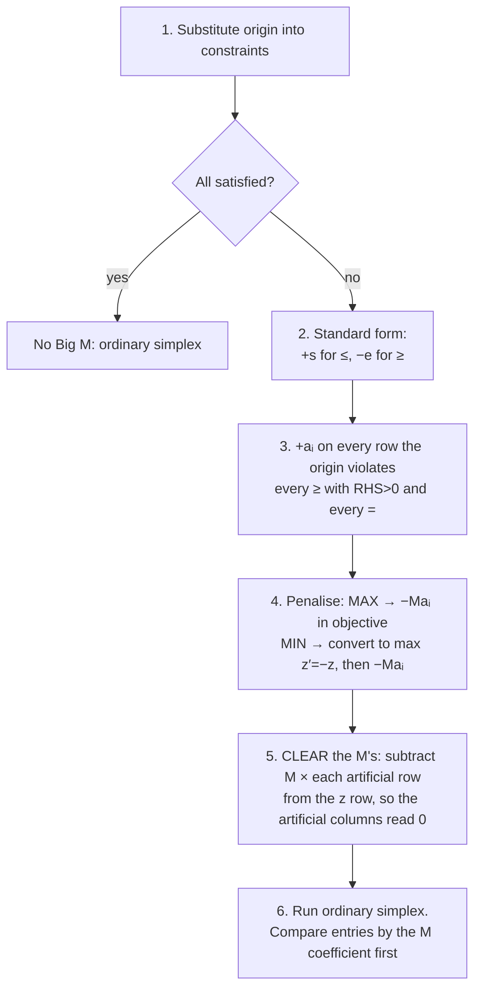

# 4. Big M Method and the Special Cases

## 4.1 Why Big M exists

Simplex must **start at a feasible corner**. Normally that's the origin with all slacks basic. But if the origin breaks a `≥` or `=` constraint, there's no starting corner.

**Big M:** build a **fake** starting corner using artificial variables, then make keeping them so expensive that simplex walks away from them.


**Picture:** the grain problem (min cost, two "at least" constraints). The origin is **outside** the feasible region.

* At the start, a₁ = 10 and a₂ = 15 measure **how short** of each requirement you are.
* Pivot 1 satisfies fibre (a₂ → 0). Pivot 2 satisfies protein (a₁ → 0).
* Once both artificials are 0, you're at a **real** corner, and simplex carries on normally.

## 4.2 Procedure



> ⚠️ **Step 5 is where people lose marks.** Before clearing, the z row has +M under the artificials and may show *no negatives*. That's **not** optimal: the tableau isn't in proper form yet, because a basic variable must have 0 in the z row.

**Comparing M expressions:** M is huge, so compare the M coefficients first: `3 − 4M` is more negative than `4 − 3M`.

## 4.3 Worked: grain problem (revision prac Q4)

```
min z = 4x₁ + 3x₂
s.t. 2x₁ +  x₂ ≥ 10   (protein)
      x₁ + 3x₂ ≥ 15   (fibre)
```

Max z′ = −4x₁ − 3x₂ − Ma₁ − Ma₂, so the z′ row is `z′ + 4x₁ + 3x₂ + Ma₁ + Ma₂ = 0`.
Clear the M's with `Rz′ − M·R₁ − M·R₂`:

| Basis | x₁ | x₂ | e₁ | e₂ | a₁ | a₂ | RHS |
|---|---|---|---|---|---|---|---|
| a₁ | 2 | 1 | −1 | 0 | 1 | 0 | 10 |
| a₂ | 1 | **3** | 0 | −1 | 0 | 1 | 15 |
| z′ | 4 − 3M | **3 − 4M** | M | M | 0 | 0 | −25M |

x₂ enters (3 − 4M is the most negative). Ratios: 10/1 = 10 and 15/3 = **5**, so **a₂ leaves**.

| Basis | x₁ | x₂ | e₁ | e₂ | a₁ | a₂ | RHS |
|---|---|---|---|---|---|---|---|
| a₁ | **5/3** | 0 | −1 | 1/3 | 1 | −1/3 | 5 |
| x₂ | 1/3 | 1 | 0 | −1/3 | 0 | 1/3 | 5 |
| z′ | **3 − 5M/3** | 0 | M | 1 − M/3 | 0 | −1 + 4M/3 | −15 − 5M |

x₁ enters. Ratios: 5 ÷ 5/3 = **3** and 5 ÷ 1/3 = 15, so **a₁ leaves**.

| Basis | x₁ | x₂ | e₁ | e₂ | a₁ | a₂ | RHS |
|---|---|---|---|---|---|---|---|
| x₁ | 1 | 0 | −3/5 | 1/5 | 3/5 | −1/5 | 3 |
| x₂ | 0 | 1 | 1/5 | −2/5 | −1/5 | 2/5 | 4 |
| z′ | 0 | 0 | **9/5** | **2/5** | * | * | −24 |

Optimal: z′ = −24, so **minimum cost z = $24 at x₁ = 3, x₂ = 4**.
Bonus: 9/5 and 2/5 under the excess columns are the **shadow prices**. Each extra unit of protein required adds **$1.80** to the cost, and each extra unit of fibre adds **$0.40** (see note 5).

## 4.4 The four ways a problem misbehaves, and their tableau "tells"

| # | Situation | **Tell in the tableau** | What to report |
|---|---|---|---|
| 1 | Origin infeasible | origin violates a `≥` or `=` row | use Big M |
| 2 | **Infeasible** (empty region) | simplex stops but an **artificial is still basic with value > 0** | "no plan satisfies all constraints: they contradict each other" |
| 3 | **Unbounded** | an entering column has **no positive entry**, so the ratio test is impossible | "no finite optimum; a constraint is missing from the model" |
| 4 | **Alternative optima** | at the optimum, a **0 in the z row under a NON-basic variable** | "pivot it in to get the other corner; every point on the edge between them is optimal" |
| – | Normal | all z-row entries ≥ 0, no artificial left, no zero under a non-basic | read off the answer |


**Examples from the lectures and practicals:**

*Infeasible:* x₁ + x₂ ≤ 4 and x₁ + x₂ ≥ 10. Final tableau:

| Basis | x₁ | x₂ | s₁ | e₂ | a₂ | RHS |
|---|---|---|---|---|---|---|
| x₁ | 1 | 1 | 1 | 0 | 0 | 4 |
| **a₂** | 0 | 0 | −1 | −1 | 1 | **6** ← artificial stuck at 6 |
| z | 0 | 1 | M+5 | M | 0 | · |

*Unbounded:* after one pivot, x₂ wants to enter (−5), but its column is (−1, 0), with nothing positive:

| Basis | x₁ | x₂ | s₁ | s₂ | RHS |
|---|---|---|---|---|---|
| x₁ | 1 | **−1** | 1 | 0 | 2 |
| s₂ | 0 | **0** | 1 | 1 | 5 |
| z | 0 | −5 | 3 | 0 | 6 |

*Alternative optima:* max 2x₁ + 4x₂, x₁ + 2x₂ ≤ 10, x₁ ≤ 6:

| Basis | x₁ | x₂ | s₁ | s₂ | RHS |
|---|---|---|---|---|---|
| x₂ | 1/2 | 1 | 1/2 | 0 | 5 |
| s₂ | 1 | 0 | 0 | 1 | 6 |
| z | **0** | 0 | 2 | 0 | 20 |

x₁ is non-basic but has 0 in the z row. Pivoting it in gives (6, 2), also z = 20, so **all points from (0, 5) to (6, 2) are optimal**.

> In real life a tie is good news: it's a free choice you can make on grounds the model doesn't capture.

---

## Quick self-check

<details><summary>Which of these needs Big M? (a) x₁ + x₂ ≤ 8, x₁ ≤ 5 (minimise) (b) 3x₁ + 2x₂ ≤ 12, x₁ + x₂ ≥ 2</summary>

(a) The origin satisfies both, so **no Big M** (minimising only changes the objective row).
(b) 0 ≥ 2 is false, so **Big M** with one artificial, on the ≥ row.
</details>

<details><summary>Final tableau: no negatives in z row, but a₂ is basic with value 5. Conclusion?</summary>

**Infeasible.** The artificial couldn't be driven out, so there is no genuine feasible point.
</details>
