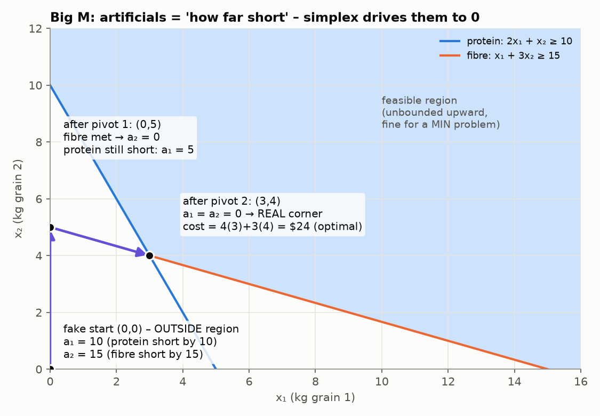
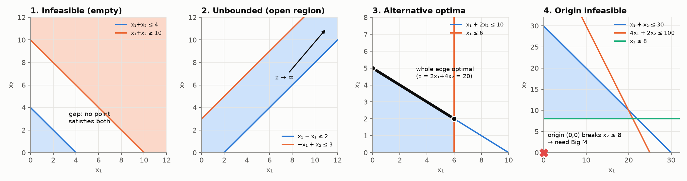

# 4. Big M and the Special Cases

> **In one sentence:** when (0, 0) isn't an allowed plan, simplex has nowhere to start, so we give it a fake starting point (artificial variables) and charge a huge penalty (M) until it walks away to a real corner.

---

## 4.1 The big idea

Simplex always starts at (0, 0), using the slacks as the basis (note 3). That works when every constraint is `≤`, because each `≤` row has a slack that can "hold" the row at the start.

A `≥` row (or an `=` row) doesn't have one:

| Constraint | Standard form | At (0, 0) | Can it start? |
|---|---|---|---|
| x₁ + x₂ ≤ 8 | x₁ + x₂ + s₁ = 8 | s₁ = 8 | ✅ |
| 2x₁ + x₂ ≥ 10 | 2x₁ + x₂ − e₁ = 10 | e₁ = **−10** | ❌ variables can't be negative |
| x₁ + 2x₂ = 8 | x₁ + 2x₂ = 8 | 0 = 8 | ❌ nothing can hold the row |

**The fix, in two parts:**

1. **Artificial variable:** add a made-up aᵢ ≥ 0 to each broken row. At (0, 0) it holds the row (e.g. a₁ = 10). Think of it as **"how far short of the requirement we are"**.
2. **Big M penalty:** aᵢ isn't real, so it has to end at 0. Charge a **huge** cost M for every unit of it. Simplex then gets rid of the artificials first, because they're so expensive. Once they're all 0, you're at a real corner and simplex carries on as normal.

In table terms: an artificial is **one extra column** with a 1 in its row, and **M** under it in the z row.

---

## 4.2 The procedure

1. **Test (0, 0)** in every constraint. Every row that breaks gets an artificial: every `≥` with a positive RHS, and every `=`.
2. **Standard form:** + s for `≤`, − e for `≥`, then + a on the broken rows.
3. **Penalise:** 
   * **max** problem: subtract **Maᵢ** in the objective
   * **min** problem: add **Maᵢ** (resource sheet). These notes turn the min into max z′ = −z first, and then subtract Maᵢ. Both give the same answer.
4. **Write the z row.** It has +M under each artificial.
5. ⚠️ **Clear the M's:** subtract **M × each artificial row** from the z row. Now the artificial columns read 0 in the z row.
6. **Run ordinary simplex.** To compare entries with M in them, compare the **number in front of M** first.

### Why step 5 matters

Every basic variable must have **0** in the z row, otherwise the table gives the wrong z. Before clearing, the artificials are basic but have M under them, so the table is **lying**. It may even show no negatives and look "optimal" when it isn't. **This is the step people lose marks on.**

### Comparing things with M in them

M is enormous. If you're not sure which is more negative, **put in M = 1000**:
* 3 − 4M = 3 − 4000 = −3997
* 4 − 3M = 4 − 3000 = −2996

So **3 − 4M is more negative**. Rule: bigger number in front of −M wins. Only if those tie do you compare the plain numbers.

---

## 4.3 Full dry run: grain problem (revision prac Q4)

```
x₁, x₂ = kg of each grain

min z = 4x₁ + 3x₂            cost
s.t. 2x₁ +  x₂ ≥ 10          protein, at least 10
      x₁ + 3x₂ ≥ 15          fibre, at least 15
      x₁, x₂ ≥ 0
```

### Step 1: does (0, 0) work?

* protein: 0 ≥ 10 ✗
* fibre: 0 ≥ 15 ✗

Both rows break, so **both need an artificial**.

### Step 2: standard form + penalty

Turn min into max: **max z′ = −4x₁ − 3x₂**. Then add the penalty:
```
max z′ = −4x₁ − 3x₂ − Ma₁ − Ma₂
s.t. 2x₁ +  x₂ − e₁      + a₁      = 10
      x₁ + 3x₂      − e₂      + a₂ = 15
```
Meaning at the start: **a₁ = 10** (10 short on protein) and **a₂ = 15** (15 short on fibre).

### Step 3: the z′ row, before clearing

Move everything to one side: **z′ + 4x₁ + 3x₂ + Ma₁ + Ma₂ = 0**

| Basis | x₁ | x₂ | e₁ | e₂ | a₁ | a₂ | RHS |
|---|---|---|---|---|---|---|---|
| a₁ | 2 | 1 | −1 | 0 | 1 | 0 | 10 |
| a₂ | 1 | 3 | 0 | −1 | 0 | 1 | 15 |
| z′ | 4 | 3 | 0 | 0 | **M** | **M** | 0 |

**Reading it:** no negatives, so it looks finished. **It isn't.** a₁ and a₂ are basic but have M (not 0) in the z′ row. The RHS says z′ = 0, but really z′ = −M(10) − M(15) = −25M. We have to clear first.

### Step 4: clear the M's

`Rz′ − M·R₁ − M·R₂`, column by column:

| Column | Calculation | Result |
|---|---|---|
| x₁ | 4 − 2M − 1M | 4 − 3M |
| x₂ | 3 − 1M − 3M | **3 − 4M** |
| e₁ | 0 − M(−1) | M |
| e₂ | 0 − M(−1) | M |
| a₁ | M − M | 0 ✓ |
| a₂ | M − M | 0 ✓ |
| RHS | 0 − 10M − 15M | −25M ✓ |

**Table 0**

| Basis | x₁ | x₂ | e₁ | e₂ | a₁ | a₂ | RHS |
|---|---|---|---|---|---|---|---|
| a₁ | 2 | 1 | −1 | 0 | 1 | 0 | 10 |
| a₂ | 1 | 3 | 0 | −1 | 0 | 1 | 15 |
| z′ | 4 − 3M | **3 − 4M** | M | M | 0 | 0 | −25M |

**Reading it:** x₁ = x₂ = 0. We're at the fake starting point (0, 0), 10 short on protein and 15 short on fibre.

---

### Pivot 1

**Enter:** 3 − 4M is the most negative (it has −4M, against −3M for x₁). **x₂ enters.**
Why x₂? Each kg of x₂ adds 3 fibre and 1 protein, so it cuts the total shortfall fastest.

**Ratio test** (x₂ column):

| Row | Ratio |
|---|---|
| a₁ | 10 ÷ 1 = 10 |
| a₂ | 15 ÷ 3 = **5** ← smallest |

**a₂ leaves.** At x₂ = 5, fibre is exactly met (5 × 3 = 15), so the fibre shortfall a₂ hits 0. Pivot = 3.

**Row operations:**
* `R₂′ = R₂ ÷ 3` → `1/3, 1, 0, −1/3, 0, 1/3 | 5`
* `R₁′ = R₁ − R₂′` → `5/3, 0, −1, 1/3, 1, −1/3 | 5`
* `Rz′′ = Rz′ − (3 − 4M)R₂′`

**Table 1**

| Basis | x₁ | x₂ | e₁ | e₂ | a₁ | a₂ | RHS |
|---|---|---|---|---|---|---|---|
| a₁ | **5/3** | 0 | −1 | 1/3 | 1 | −1/3 | 5 |
| x₂ | 1/3 | 1 | 0 | −1/3 | 0 | 1/3 | 5 |
| z′ | **3 − 5M/3** | 0 | M | 1 − M/3 | 0 | −1 + 4M/3 | −15 − 5M |

**Reading it:** x₂ = 5, x₁ = 0. Fibre is met (a₂ = 0). Protein: 2(0) + 5 = 5, so we're **still 5 short** (a₁ = 5). Not a real plan yet.

---

### Pivot 2

**Enter:** the only negative is 3 − 5M/3 under x₁. **x₁ enters.**

**Ratio test** (x₁ column):

| Row | Ratio |
|---|---|
| a₁ | 5 ÷ 5/3 = **3** ← smallest |
| x₂ | 5 ÷ 1/3 = 15 |

**a₁ leaves.** Pivot = 5/3.

**Row operations:**
* `R₁′ = (3/5)R₁` → `1, 0, −3/5, 1/5, 3/5, −1/5 | 3`
* `R₂′ = R₂ − (1/3)R₁′` → `0, 1, 1/5, −2/5, −1/5, 2/5 | 4`
* `Rz′′ = Rz′ − (3 − 5M/3)R₁′`

**Table 2**

| Basis | x₁ | x₂ | e₁ | e₂ | a₁ | a₂ | RHS |
|---|---|---|---|---|---|---|---|
| x₁ | 1 | 0 | −3/5 | 1/5 | 3/5 | −1/5 | 3 |
| x₂ | 0 | 1 | 1/5 | −2/5 | −1/5 | 2/5 | 4 |
| z′ | 0 | 0 | **9/5** | **2/5** | * | * | −24 |

(* = entries with M in them. Ignore the artificial columns once the artificials have left.)

**Reading it:** both artificials have left, so this is a **real** plan: x₁ = 3, x₂ = 4. Check: protein 2(3) + 4 = 10 ✓, fibre 3 + 3(4) = 15 ✓.

### Step 5: stop?

No negatives (ignoring the artificial columns), so this is optimal. z′ = −24, so **minimum cost z = $24**.

**Answer in words:** use **3 kg of grain 1 and 4 kg of grain 2**, costing **$24**. Both requirements are met exactly.

**Bonus (note 5):** 9/5 and 2/5 under the excess columns are the **shadow prices**. Requiring one more unit of protein would add **$1.80** to the cost, and one more unit of fibre **$0.40**.

---

### The walk, summarised



| Table | Point | a₁ (protein short) | a₂ (fibre short) | Real plan? |
|---|---|---|---|---|
| 0 | (0, 0) | 10 | 15 | ❌ fake start |
| 1 | (0, 5) | 5 | 0 | ❌ still short on protein |
| 2 | (3, 4) | 0 | 0 | ✅ real corner, and the best |

**Reading the picture:** (0, 0) is **outside** the allowed region. Each pivot removes one shortfall. Once both are 0, you're inside at a real corner.

---

## 4.4 When things go wrong: the four "tells"

Sometimes the problem has no answer, or more than one answer. The final table always shows it. Learn these four.



| Situation | The tell in the table | What to write |
|---|---|---|
| **Origin not allowed** | (0, 0) breaks a `≥` or `=` row | "use Big M" |
| **Infeasible** (no plan works) | simplex stops, but an **artificial is still in the Basis column with a value > 0** | "no plan meets every constraint; they contradict each other" |
| **Unbounded** (z grows forever) | the entering column has **no positive number**, so you can't do the ratio test | "no finite best; a limit is missing from the model" |
| **Alternative optima** (ties) | at the final table, a **0 in the z row under a variable that is NOT in the Basis column** | "pivot it in to get another best corner; every point between them is equally good" |
| Normal | none of the above | read off the answer |

### Infeasible: an artificial gets stuck

```
max z = 5x₁ + 4x₂
s.t. x₁ + x₂ ≤ 4
     x₁ + x₂ ≥ 10
```
You can't have x₁ + x₂ be at most 4 **and** at least 10. Simplex stops at:

| Basis | x₁ | x₂ | s₁ | e₂ | a₂ | RHS |
|---|---|---|---|---|---|---|
| x₁ | 1 | 1 | 1 | 0 | 0 | 4 |
| **a₂** | 0 | 0 | −1 | −1 | 1 | **6** |
| z | 0 | 1 | M + 5 | M | 0 | 20 − 6M |

**Reading it:** no negatives, so simplex has stopped. But **a₂ = 6 is still in the Basis column**: we're still 6 short of the "at least 10" requirement, and there's no way to fix it. **Infeasible.**

### Unbounded: nothing stops you

```
max z = 3x₁ + 2x₂
s.t.  x₁ − x₂ ≤ 2
     −x₁ + x₂ ≤ 3
```
After one pivot:

| Basis | x₁ | x₂ | s₁ | s₂ | RHS |
|---|---|---|---|---|---|
| x₁ | 1 | **−1** | 1 | 0 | 2 |
| s₂ | 0 | **0** | 1 | 1 | 5 |
| z | 0 | −5 | 3 | 0 | 6 |

**Reading it:** x₂ wants to enter (−5), but its column is (−1, 0): **no positive number**, so there's no ratio test.
In equations: x₁ = 2 + x₂ and s₂ = 5. As x₂ grows, x₁ grows **too** and s₂ stays the same. Nothing ever hits 0, and z rises by 5 per unit, forever. **Unbounded.** In real life, a limit is missing from the model.

### Alternative optima: a tie

```
max z = 2x₁ + 4x₂
s.t. x₁ + 2x₂ ≤ 10
     x₁       ≤ 6
```
Final table:

| Basis | x₁ | x₂ | s₁ | s₂ | RHS |
|---|---|---|---|---|---|
| x₂ | 1/2 | 1 | 1/2 | 0 | 5 |
| s₂ | 1 | 0 | 0 | 1 | 6 |
| z | **0** | 0 | 2 | 0 | 20 |

**Reading it:** the plan is (0, 5) with z = 20. x₁ is **not** in the Basis column but has **0** in the z row. That means bringing x₁ in changes z by 0: a tie.
Pivot it in (ratio test: 5 ÷ 1/2 = 10, 6 ÷ 1 = **6**, so s₂ leaves): you get (6, 2), also z = 20. **Every point on the edge from (0, 5) to (6, 2) is optimal.**
Why: the profit 2x₁ + 4x₂ is exactly 2 × (x₁ + 2x₂), so the profit line is parallel to that constraint's edge.

> In real life a tie is good news: the manager gets a free choice, and can decide on things the model doesn't include.

---

## Common mistakes

1. **Not clearing the M's** before the first pivot, then saying "no negatives, optimal".
2. Wrong sign on the penalty. Max → **−Ma** in the objective (so +M in the z row before clearing).
3. Comparing M-expressions wrongly. Put in M = 1000 if unsure.
4. Forgetting to flip z′ back to z for a min problem.
5. Missing the tells: always check the final table for a stuck artificial, a column with no positive number, or a 0 under a non-basic variable.

---

## Check yourself

<details><summary>1. Which needs Big M? (a) min, with x₁ + x₂ ≤ 8, x₁ ≤ 5 (b) 3x₁ + 2x₂ ≤ 12, x₁ + x₂ ≥ 2</summary>

(a) (0, 0) satisfies both, so **no Big M**. Minimising only changes the objective row.
(b) 0 ≥ 2 is false, so **Big M**, with one artificial on the `≥` row.
</details>

<details><summary>2. Final table: no negatives in the z row, but a₂ is basic with value 5. What's the conclusion?</summary>

**Infeasible.** The artificial couldn't be pushed out. We're still 5 short of a requirement, and no real plan meets every constraint.
</details>

<details><summary>3. Which is more negative: −2 − 3M or 5 − 3M?</summary>

Both have −3M, so compare the plain numbers: −2 < 5, so **−2 − 3M** is more negative.
</details>

<details><summary>4. Why is the M placed under the artificials in the z row as +M (before clearing), for a max problem?</summary>

The objective is max z = … − Ma. Moving it to one side gives z − … + Ma = 0, so the z row shows **+M** under a.
</details>
