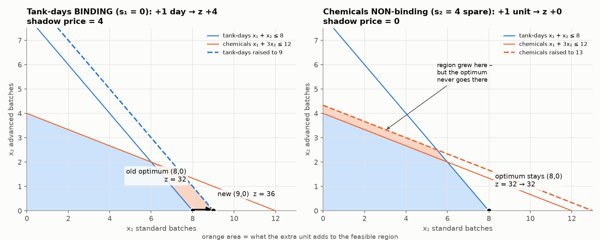
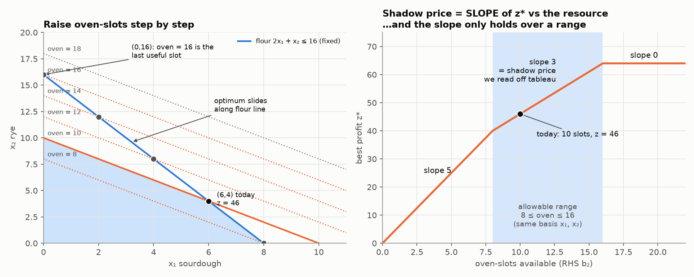
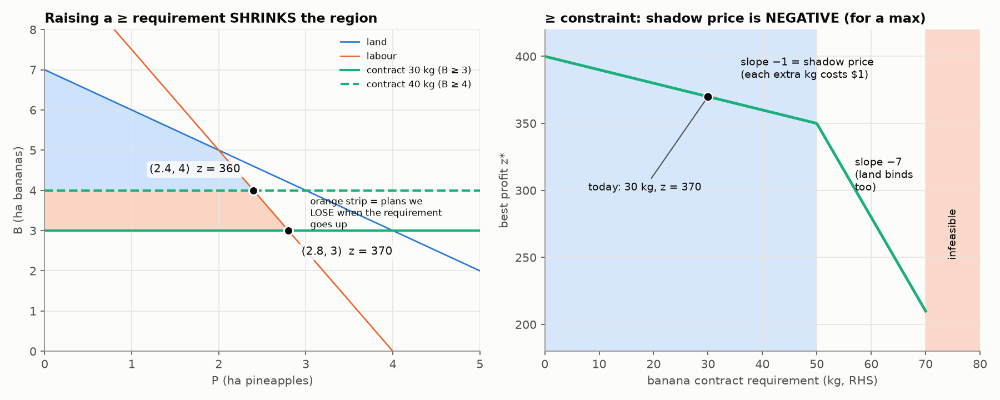
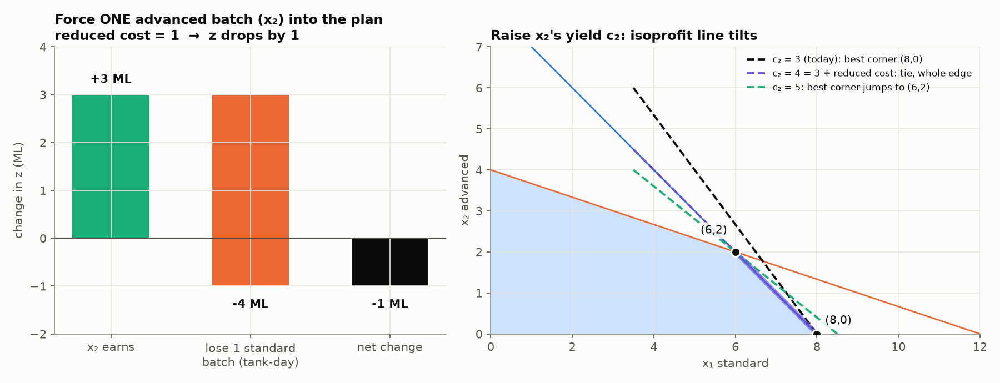

# 5. Sensitivity: Shadow Prices, Reduced Costs and Ranges

> **In one sentence:** once you have the best plan, the numbers in the final z row answer the manager's "what if" questions: what is one more unit of a resource worth (**shadow price**), and why aren't we making product X (**reduced cost**)?

---

## 5.1 The big idea

You've found the best plan. Now the manager asks:

* "If I could get **one more** hour of labour, how much more profit would I make?" → **shadow price**
* "Why aren't we making the advanced product? How much better would it need to be?" → **reduced cost**
* "Over what range does that answer stay true?" → **range**

You don't need to re-solve the problem. **The final z row already holds these answers.**

> **Every number in the final z row says how much z would drop if you forced that variable up by 1.**

| z-row number under… | What it's called | Plain meaning |
|---|---|---|
| a variable in the Basis column | – | always 0 |
| a **slack** (not in the basis) | **shadow price** | what one more unit of that resource is worth |
| an **excess** (not in the basis) | shadow price, **with the sign flipped** (for a max) | what one more unit of that requirement costs you |
| a **decision variable** (not in the basis) | **reduced cost** | how much z drops per unit if you force that product in |
| a slack that **is** in the basis | shadow price = **0** | there's some of that resource left over, so more is worth nothing |

The rest of this note explains each row of this table with an example.

**If you're ever unsure, use the resource-sheet definition. It always works:**
> **Shadow price = (new best z) − (old best z) when that constraint's RHS goes up by 1.**

---

## 5.2 Shadow price: what is one more unit worth?

### Water treatment works (week 8 lecture)

```
x₁ = standard batches, x₂ = advanced batches, z = ML of clean water

max z = 4x₁ + 3x₂
s.t.  x₁ +  x₂ ≤ 8      tank-days
      x₁ + 3x₂ ≤ 12     chemical units
```

Final table:

| Basis | x₁ | x₂ | s₁ | s₂ | RHS |
|---|---|---|---|---|---|
| x₁ | 1 | 1 | 1 | 0 | 8 |
| s₂ | 0 | 2 | −1 | 1 | 4 |
| z | 0 | **1** | **4** | **0** | 32 |

**Reading it:** the plan is x₁ = 8 standard batches, x₂ = 0, giving 32 ML.
* **s₁ is not in the basis** (= 0): every tank-day is used, so tank-days are **binding**. The **4** under s₁ is the shadow price: **one more tank-day is worth 4 ML**.
* **s₂ is in the basis** (= 4): 4 chemical units are left over, so chemicals are **non-binding**. Shadow price **0**: more chemicals would just sit unused.
* **x₂ is not in the basis:** we make no advanced batches. The **1** under it is its **reduced cost** (section 5.6).

### Why 4? Think it through

Every tank-day is in use, and each one runs a standard batch that makes 4 ML. One extra tank-day → one more standard batch → **+4 ML**. The table says exactly that.

### See it



* **Left (tank-days, binding):** push the tank-days line out by 1. The region grows **right where the best corner is**, so the corner slides from (8, 0) to (9, 0) and z goes from 32 to **36**. **+4.**
* **Right (chemicals, non-binding):** push the chemicals line out by 1. The region grows in a place the best plan never goes. The best plan stays at (8, 0) and z stays 32. **+0.**

> **Rule:** spare resource (slack > 0) ⇒ shadow price = 0. Only binding constraints can have a shadow price that isn't zero.

### Check by re-solving

Change tank-days from 8 to 9 and re-solve. You do exactly the same pivots, and only the RHS changes:

| | tank-days = 8 | tank-days = 9 |
|---|---|---|
| x₁ | 8 | 9 |
| s₂ | 4 | 3 |
| z | 32 | **36** |

36 − 32 = **4** ✓. That's the resource-sheet definition.

---

## 5.3 A shadow price only holds over a range

### Bakery (week 8 prac)

```
x₁ = sourdough, x₂ = rye

max z = 5x₁ + 4x₂
s.t. 2x₁ + x₂ ≤ 16     flour (kg)
      x₁ + x₂ ≤ 10     oven-slots
```

Final table:

| Basis | x₁ | x₂ | s₁ (flour) | s₂ (oven) | RHS |
|---|---|---|---|---|---|
| x₁ | 1 | 0 | 1 | −1 | 6 |
| x₂ | 0 | 1 | −1 | 2 | 4 |
| z | 0 | 0 | **1** | **3** | 46 |

**Reading it:** make 6 sourdough and 4 rye for $46. Both resources are binding.
* Flour shadow price **$1** per kg.
* Oven-slot shadow price **$3** per slot.

If you can only expand one, expand **oven capacity**: it's worth 3 times as much per unit.

### What happens with one more oven-slot?

Flour is still all used: 2x₁ + x₂ = 16. Oven is now x₁ + x₂ = 11. Solve: x₁ = 5, x₂ = 6, z = 25 + 24 = **49**. That's 49 − 46 = **+3** ✓.

Notice what happened: **one fewer sourdough, two more rye**. Flour can't increase, so the extra slot is only useful if you swap a flour-heavy sourdough for flour-light rye.

**The table already says this.** Look at the **s₂ column**: (−1, 2). Each extra oven-slot changes x₁ by **−1** and x₂ by **+2**.

### Why there's a limit

You can keep doing this swap, but only while you still have sourdough to swap. Each extra slot takes 1 sourdough away, and you start with 6. After 6 extra slots (oven = 16) you have no sourdough left, and more slots are useless.



**Reading the right picture:** best profit against the number of oven-slots. It's made of straight pieces:

| Oven-slots | What's going on | Extra profit per slot |
|---|---|---|
| below 8 | only the oven is binding; all sourdough | $5 |
| **8 to 16** | both binding; the swap above | **$3** ← what the table says |
| above 16 | only flour binding; oven-slots spare | $0 |

> **The shadow price is the slope of that graph.** It only stays the same while the **same constraints stay binding**. Past the edge of the range, a different corner takes over and the slope changes.

### Finding the range from the table

Change the oven RHS by Δ. Each basic variable changes by **Δ × its number in the s₂ column**. Every basic variable must stay **≥ 0**:

```
x₁ = 6 − 1Δ ≥ 0   →  Δ ≤ 6
x₂ = 4 + 2Δ ≥ 0   →  Δ ≥ −2
⇒  −2 ≤ Δ ≤ 6   ⇒   oven between 8 and 16 slots   ✓ matches the graph
```

Flour, using the s₁ column (1, −1): x₁ = 6 + Δ ≥ 0, x₂ = 4 − Δ ≥ 0 ⇒ −6 ≤ Δ ≤ 4 ⇒ **flour between 10 and 20 kg**.

### Using it

* **Inside the range:** new z = old z + Δ × shadow price. Oven = 14: 46 + 4 × 3 = **58** ✓.
* **Outside the range:** the formula gives the **wrong** answer. Oven = 20: 46 + 10 × 3 = 76 ✗. The real answer is 64, because above 16 the oven isn't binding any more. **Re-solve.**

---

## 5.4 The tricky one: shadow price of a `≥` requirement

### Farmer (week 1)

```
max z = 100P + 30B
s.t.   P +  B ≤ 7     land
     10P + 4B ≤ 40    labour
          10B ≥ 30    café contract (kg)
```

Final table (artificial column left out):

| Basis | P | B | s₁ (land) | s₂ (labour) | e₃ (contract) | RHS |
|---|---|---|---|---|---|---|
| s₁ | 0 | 0 | 1 | −0.1 | 0.06 | 1.2 |
| P | 1 | 0 | 0 | 0.1 | 0.04 | 2.8 |
| B | 0 | 1 | 0 | 0 | −0.1 | 3 |
| z | 0 | 0 | **0** | **10** | **1** | 370 |

**Reading it:** 2.8 ha pineapples and 3 ha bananas for $370.
* **Land:** s₁ is in the basis (1.2 ha spare), so shadow price **$0**.
* **Labour:** s₂ is not in the basis, so shadow price **+$10 per hour**.
* **Contract:** e₃ is not in the basis (binding). The z-row number is **1**, but the shadow price is **−1**. Here's why.

### Why the sign flips

A **limit** (`≤`) and a **requirement** (`≥`) work in opposite directions:

* Raise a `≤` limit (more labour) → **more freedom** → the region grows → profit can only go **up**.
* Raise a `≥` requirement (café wants more bananas) → **less freedom** → the region shrinks → profit can only go **down**.



**Check by re-solving:** contract 30 → 31 kg. B = 3.1, and labour: 10P = 40 − 4(3.1) = 27.6, so P = 2.76.
z = 100(2.76) + 30(3.1) = 276 + 93 = **369**. New − old = **−1**.
**Each extra kg the café demands costs the farmer $1.** More bananas use labour that would have gone to the more profitable pineapples.

**Reading the right picture:** best profit against the contract size. The slope is −1 up to 50 kg, then steeper (land runs out too), and above 70 kg it's impossible.

### The rule

The z-row number always means "how much z drops if this variable goes up by 1":
* **s₂ up by 1** = one labour hour **unused** = like having one **fewer** hour → z drops 10. So one **more** hour → z **rises** 10. **Shadow price = +10.**
* **e₃ up by 1** = over-deliver 1 kg = like the requirement going **up** 1 → z drops 1. **Shadow price = −1.**

> **For a max problem:**
> `≤` constraint: shadow price = **+** (number under its slack)
> `≥` constraint: shadow price = **−** (number under its excess)
> **Unsure in the exam? Re-solve with RHS + 1 and take new − old.**

---

## 5.5 Minimisation problems

For a min, the shadow price is about **cost**. Grain problem (note 4): the final z′ row had **9/5 under e₁** (protein) and **2/5 under e₂** (fibre).

* Protein 10 → 11: re-solving gives (3.6, 3.8), cost 4(3.6) + 3(3.8) = 25.80. New − old = **+$1.80**.
* Fibre: **+$0.40** per extra unit.

That makes sense: a tougher requirement can only make the cheapest plan **more expensive**.

### All the sign cases in one table

| Problem | Binding constraint | RHS + 1 does… | Shadow price |
|---|---|---|---|
| max | `≤` limit | gives more freedom | **≥ 0** (profit up) |
| max | `≥` requirement | takes freedom away | **≤ 0** (profit down) |
| min | `≥` requirement | takes freedom away | **≥ 0** (cost up) |
| min | `≤` limit | gives more freedom | **≤ 0** (cost down) |
| any | non-binding | nothing useful | **0** |

---

## 5.6 Reduced cost: the product you don't make

Back to the water works: advanced batches (x₂) aren't made, and the z-row number under x₂ is **1**.



### Why exactly 1? Think it through

All 8 tank-days are used by standard batches. To make **one** advanced batch:
1. it needs 1 tank-day. None are spare, so **drop one standard batch: −4 ML**
2. gain the advanced batch: **+3 ML**
3. net: **−1 ML**. That's the **reduced cost**.

Making advanced batches loses water, so the best plan doesn't make any.

### Calculating it from shadow prices

This always works and is a good check:
```
reduced cost = (what the resources it uses are worth, at shadow prices) − (its own profit)

advanced batch: 1 tank-day × 4 + 3 chemicals × 0 = 4;   4 − 3 = 1 ✓
baguette (bakery prac): 2 flour × 1 + 2 oven × 3 = 8;   8 − 6 = 2 ✓
```

### Two ways to say what it means

1. **If forced in:** if a rule says you must make some advanced batches, each one costs 1 ML of output.
2. **How much better must it be?** Its yield must rise by the reduced cost, from 3 to **4**, before it's worth making.
   * At exactly 4 there's a tie between (8, 0) and (6, 2).
   * Above 4 the best plan **switches** to (6, 2), and advanced batches come into the plan.

**Small reduced cost** (like 1) = "only just not worth it". A small price change could put it in the plan.
**Large reduced cost** = "nowhere near worth it".

> **Products you DO make always have reduced cost 0.** They're already in the plan because they're worth making.

### A brand-new product: should we make it? (practice exam 1, Q4c)

Ceramics studio: best plan is 6 mugs ($3) + 6 bowls ($2) = $30, using all 18 kiln hours and all 12 kg clay; shadow prices kiln **$1**, clay **$1**, glaze **$0**. A new **vase** uses 1 kiln hour + 1 kg clay, no glaze, earns **$2.50**.

**Slow way: just make one and see.** Kiln and clay are full, so mugs and bowls now get 17 kiln hours and 11 kg clay: 2x₁ + x₂ = 17, x₁ + x₂ = 11 → x₁ = 6, x₂ = 5.

| Plan | Mugs ($3) | Bowls ($2) | Vases ($2.50) | Kiln (of 18) | Clay (of 12) | Glaze (of 10) | Profit |
|---|---|---|---|---|---|---|---|
| Current | 6 | 6 | 0 | 12+6 = 18 | 6+6 = 12 | 6 | 18+12 = **$30** |
| +1 vase | 6 | 5 | 1 | 12+5+1 = 18 | 6+5+1 = 12 | 5 | 18+10+2.50 = **$30.50** |

Reading it: fitting one vase in costs one bowl (**−$2**), the vase earns **+$2.50**, net **+$0.50**. Make vases.

**Shortcut: shadow prices give that $2 directly.**
```
1 kiln × $1 + 1 clay × $1 + 0 glaze × $0 = $2     (what its resources earn in the current plan)
reduced cost = $2 − $2.50 = −$0.50                 (negative in a max ⇒ worth making)
```

**Why this is allowed: it's duality.** The shadow prices y = (1, 1, 0) are the dual solution, and the dual has one rule per product: *its resources, valued at y, must be worth at least its profit* (note 6, §6.2).

| Product | Uses (kiln, clay, glaze) | Value at y = (1, 1, 0) | Profit | Dual rule OK? |
|---|---|---|---|---|
| Mug | (2, 1, 0) | 2 + 1 + 0 = 3 | 3 | 3 ≥ 3 ✓ (equal → made) |
| Bowl | (1, 1, 1) | 1 + 1 + 0 = 2 | 2 | 2 ≥ 2 ✓ (equal → made) |
| **Vase (new)** | (1, 1, 0) | 1 + 1 + 0 = **2** | **2.50** | 2 ≥ 2.50 ✗ **broken** |

Reading it: a new product adds a new dual rule. If the current prices break it, they're no longer valid dual values, so the current plan is no longer optimal, and the new product should come in.

> Shadow prices say **whether** to make it, not **how many**. Re-solving gives (6 mugs, 0 bowls, 6 vases), $33. Bowls disappear completely, because a vase uses the same kiln hour and clay as a bowl, needs no glaze, and earns more.

---

## 5.7 Opportunity cost: the idea behind both numbers

> *"The real cost of using something scarce is what you give up by not using it on the next best thing."*

* **Shadow price** = what a **resource** is really worth to you. A tank-day is worth 4 ML because that's what you'd lose without it. It's the **most you should pay** for one more unit.
* **Reduced cost** = the same idea from a **product's** point of view: what you give up by making it instead of the current plan.

---

## 5.8 Two kinds of "what if": don't mix them up

| What changes | What it does to the picture | Plan (x values) | z |
|---|---|---|---|
| **RHS** (amount of a resource) | a constraint line **moves** (stays parallel) | **changes**: the corner slides, but the same constraints stay binding inside the range | changes by **shadow price × Δ** |
| **Objective coefficient** (profit per unit) | the profit line **tilts** | **stays the same** inside its range (note 2, §2.5) | changes by **Δ × that variable's value** |
| Profit of a product **not made** | tilt | stays the same until the increase passes the **reduced cost** | unchanged |

---

## 5.9 Reading an Excel Solver sensitivity report

**Variable Cells**

| Column | Meaning |
|---|---|
| Final Value | the best value of each variable |
| Reduced Cost | for a product not made: the loss per unit if forced in. Solver shows it as **negative** for a max (−1 means z drops 1). 0 for products you do make |
| Objective Coefficient | its profit per unit |
| Allowable Increase / Decrease | how far that profit can move with **the same plan** |

**Constraints**

| Column | Meaning |
|---|---|
| Final Value | how much of the resource the plan uses (compare with the RHS to get the slack) |
| **Shadow Price** | change in z per +1 of the RHS |
| Constraint R.H. Side | the amount available / required |
| Allowable Increase / Decrease | the **range** where that shadow price holds |

Bakery: oven shadow price 3, RHS 10, allowable increase **6** (up to 16), allowable decrease **2** (down to 8). The sourdough profit of 5 can move between **4 and 8** without changing the plan (−c₁/4 must stay between −2 and −1).

---

## 5.10 Exam answer templates

* **Shadow price (binding):** "The shadow price of oven-slots is $3. Each extra oven-slot increases the maximum profit by $3, valid between 8 and 16 slots. Oven-slots are a binding (scarce) resource."
* **Shadow price (non-binding):** "Chemicals have 4 units of slack at the optimum, so their shadow price is 0. Extra chemicals would not increase output."
* **`≥` requirement:** "The contract is binding with shadow price −$1 per kg. Each extra kg the café requires lowers profit by $1."
* **Reduced cost:** "Advanced treatment has reduced cost 1 ML. Forcing in one batch reduces output by 1 ML, and its yield would need to rise from 3 to at least 4 ML per batch before it's worth making."
* **Which resource to buy:** the one with the **largest shadow price**, as long as it costs less than that.

---

## Common mistakes

1. Reading a shadow price under a slack that's **in the basis**. That resource has spare, so its shadow price is 0.
2. Forgetting to flip the sign for a `≥` constraint in a max problem.
3. Using a shadow price **outside its range**. Re-solve instead.
4. Mixing up RHS changes (plan moves) with profit changes (plan stays).

---

## Check yourself (week 8 prac, Part E)

<details><summary>1. max 5x₁ + 3x₂ s.t. x₁ + x₂ ≤ 8, x₁ + 2x₂ ≤ 10. The final z row is (0, 2, 5, 0 | 40) and the basis is x₁ = 8, s₂ = 2. Explain every number.</summary>

* Plan: x₁ = 8, x₂ = 0, z = 40.
* Under x₂: **2 = reduced cost**. Each x₂ forced in costs 2, and its profit must rise from 3 to 5 to be worth making.
* Under s₁: **5 = shadow price** of constraint 1, which is binding.
* Under s₂: **0**. s₂ is in the basis at 2 (2 units spare), so constraint 2 is non-binding.
* Check the reduced cost: x₂ uses 1 of resource 1 (× 5) + 2 of resource 2 (× 0) = 5. Minus its profit 3 = **2** ✓.
</details>

<details><summary>2. Co-op final z row is (0, 0, 3/2, 1/2 | 18). Someone offers 2 extra installer-days in exchange for 1.2 MWh. Worth it?</summary>

Installer-days have shadow price 1/2, so 2 extra days add about 1 MWh (if we stay in range). Giving up 1.2 to get 1 is **not worth it**. Rooftops, at 3/2 each, are the more valuable resource.
</details>

<details><summary>3. Bakery oven shadow price is 3, with range 8–16. Predict z at 14 slots and at 20 slots.</summary>

14 is inside the range: 46 + 4 × 3 = **58** ✓.
20 is outside: 46 + 10 × 3 = 76 is **wrong**. Above 16 the oven stops being binding, so the real z = **64**.
</details>
