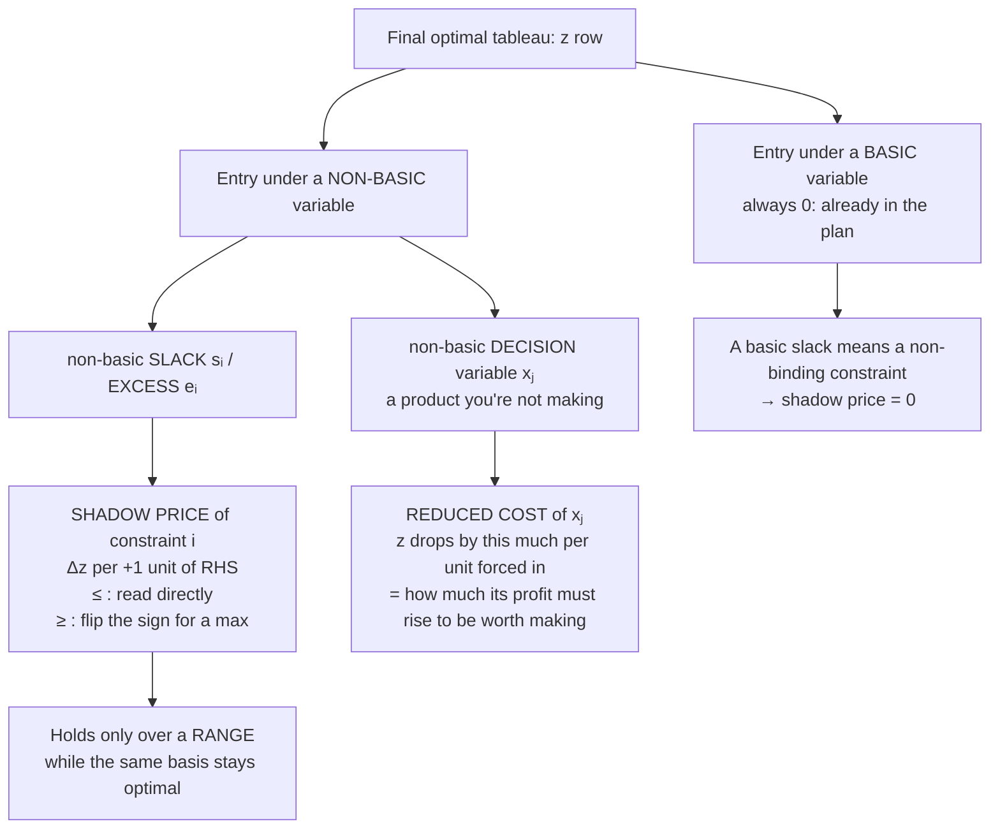

# 5. Sensitivity Analysis: Shadow Prices, Reduced Costs and Ranges (with pictures)

> **The whole topic in two sentences:**
> At the optimum, every number in the **bottom (z) row** says how much z would change if you pushed that variable up by one unit.
> Under a **slack/excess** it's called a **shadow price** (the value of one more unit of a *resource*). Under a **decision variable** it's called a **reduced cost** (the penalty for making one unit of a *product you aren't making*).

## 5.0 Map of the topic



**Formula-sheet definition** (use this whenever in doubt; re-solving always works):

> **Shadow price = (new optimal z) − (old optimal z) when that constraint's RHS is increased by 1.**

---

## 5.1 Shadow price of a binding vs a non-binding constraint

**Water treatment works (week 8 lecture)**

```
max z = 4x₁ + 3x₂          (ML of water; x₁ = standard batches, x₂ = advanced)
s.t.  x₁ +  x₂ ≤ 8     tank-days
      x₁ + 3x₂ ≤ 12    chemical units
```

Final tableau:

| Basis | x₁ | x₂ | s₁ | s₂ | RHS |
|---|---|---|---|---|---|
| x₁ | 1 | 1 | 1 | 0 | 8 |
| s₂ | 0 | 2 | −1 | 1 | 4 |
| z | 0 | **1** | **4** | **0** | 32 |

* s₁ is **non-basic** (= 0): tank-days are used up, so tank-days are **binding**. The entry **4** is the **shadow price**.
* s₂ is **basic** (= 4): 4 chemical units are left over, so chemicals are **non-binding**. The entry **0** is the shadow price.
* x₂ is non-basic: we make no advanced batches. The entry **1** is the **reduced cost** (section 5.5).

### See it


* **Left (binding):** push the tank-days line out by 1. The region grows **right where the optimum is**, so the optimal corner slides from (8, 0) to (9, 0) and z goes 32 → **36**. **+4 per tank-day.**
* **Right (non-binding):** push the chemicals line out by 1. The region grows **somewhere the optimum never goes**, so the optimum stays at (8, 0) and z stays 32. **+0.**

> **Rule:** slack > 0 ⇒ shadow price = 0. Only **binding** constraints can have non-zero shadow prices.
> (This is half of *complementary slackness*, see [06_Duality.md](06_Duality.md).)

### Why the tableau "knows" the shadow price without re-solving

Change tank-days 8 → 9 and re-run simplex. You do **exactly the same pivots**, and only the RHS column changes:

| | original | tank-days = 9 |
|---|---|---|
| x₁ | 8 | 9 |
| s₂ | 4 | 3 |
| z | 32 | **36** |

Same basis, same coefficients, only the RHS moved. So each extra tank-day repeats the same trade and adds the same 4. **The shadow price is a fixed rate as long as the basis doesn't change.**

---

## 5.2 A shadow price is a SLOPE, and it only holds over a RANGE

**Bakery (week 8 prac):** max 5x₁ + 4x₂ s.t. 2x₁ + x₂ ≤ 16 (flour), x₁ + x₂ ≤ 10 (oven-slots). Optimum (6, 4), z = 46.

| Basis | x₁ | x₂ | s₁ (flour) | s₂ (oven) | RHS |
|---|---|---|---|---|---|
| x₁ | 1 | 0 | 1 | −1 | 6 |
| x₂ | 0 | 1 | −1 | 2 | 4 |
| z | 0 | 0 | **1** | **3** | 46 |

Shadow prices: **flour $1, oven-slot $3**. If you can expand only one resource, expand **oven capacity**: it's worth 3× more at the margin.


**Left:** as oven-slots rise, the optimal corner slides **along the flour line**. Each slot swaps sourdough for rye and adds $3.
**Right:** plot best profit z* against the oven-slot RHS. You get a **piecewise-linear** graph:

| Oven-slots | Best plan | z* | Slope = shadow price |
|---|---|---|---|
| < 8 | (b₂, 0), only oven binds | 5b₂ | 5 |
| **8 – 16** | on both lines, basis {x₁, x₂} | 46 + 3(b₂ − 10) | **3** ← what the tableau says |
| > 16 | (0, 16), only flour binds | 64 | 0 (oven-slots now spare) |

> **The shadow price is the slope of z* vs that RHS.** It stays constant only while **the same constraints stay binding** (same basis). Past the range edge a different corner takes over and the slope changes.
> Re-solve check (week 8 prac Q3): oven 10 → 11 gives (5, 6), z = 49. 49 − 46 = **3** ✓.

### Finding the range (two ways)

**Way 1, re-solve / think geometrically:** increase the RHS until a basic variable hits 0 (the corner runs into an axis or another constraint). In the bakery, x₁ hits 0 when oven = 16.

**Way 2, from the final tableau** (handy for checking, and it's exactly what Solver's *Allowable Increase/Decrease* is):
If a `≤` constraint's RHS changes by Δ, the new RHS column = old RHS + **Δ × (that constraint's slack column)**. All basic values must stay ≥ 0.

```
Oven (s₂ column = [−1, 2]):   x₁ = 6 − Δ ≥ 0  → Δ ≤ 6
                               x₂ = 4 + 2Δ ≥ 0 → Δ ≥ −2
⇒  −2 ≤ Δ ≤ 6   ⇒   8 ≤ oven-slots ≤ 16          ✓ matches the graph

Flour (s₁ column = [1, −1]):  x₁ = 6 + Δ ≥ 0, x₂ = 4 − Δ ≥ 0  ⇒  10 ≤ flour ≤ 20
```

Inside the range: **new z = old z + Δ × shadow price** (e.g. oven = 14 gives 46 + 4 × 3 = 58 ✓).
Outside the range: the prediction is **wrong**. You must re-solve, because the binding constraints changed. (The case-study assignment asks exactly this.)

---

## 5.3 Excess variables: the shadow price of a "≥" requirement

This is the confusing one. **Farmer:** max 100P + 30B, land P + B ≤ 7, labour 10P + 4B ≤ 40, contract **10B ≥ 30**. Optimum (2.8, 3), z = $370.

Final tableau (artificial column omitted):

| Basis | P | B | s₁ (land) | s₂ (labour) | e₃ (contract) | RHS |
|---|---|---|---|---|---|---|
| s₁ | 0 | 0 | 1 | −0.1 | 0.06 | 1.2 |
| P | 1 | 0 | 0 | 0.1 | 0.04 | 2.8 |
| B | 0 | 1 | 0 | 0 | −0.1 | 3 |
| z | 0 | 0 | **0** | **10** | **1** | 370 |

* Land: s₁ basic (1.2 ha spare), so **shadow price 0**.
* Labour: s₂ non-basic, so **shadow price +$10 per hour**.
* Contract: e₃ non-basic (excess 0, binding). The entry is **1**, but the **shadow price is −1**. Here's why:

### See it


* For a `≤` resource, raising the RHS **loosens** the constraint, so the region **grows** and z can only improve.
* For a `≥` requirement, raising the RHS **tightens** the constraint, so the region **shrinks** (orange strip lost) and z can only **get worse**.
* Contract 30 → 31 kg: the optimum moves to (2.76, 3.1), z = 369. **New − old = −1.** Each extra kg the café demands **costs the farmer $1**. (More bananas means less labour for the more profitable pineapples.)
* The right graph is the same "slope with a range" idea: slope −1 up to 50 kg, then −7 (land binds too), and **infeasible** above 70 kg.

### Why the tableau entry is +1 but the shadow price is −1

The z-row entry under **any** non-basic variable = **how much z falls if that variable is pushed up by 1**.

* Push **s₂** up by 1 ⇒ use one *less* labour hour ⇒ like having one *fewer* hour ⇒ z falls by 10. So one *more* hour **raises** z by 10. **Shadow price = +entry.**
* Push **e₃** up by 1 ⇒ over-deliver 1 kg ⇒ same effect as the requirement going **up** by 1 ⇒ z falls by 1. **Shadow price = −entry = −1.**

> **Rule of thumb (maximisation):**
> `≤` constraint: shadow price = **+** (z-row entry under its slack) ≥ 0
> `≥` constraint: shadow price = **−** (z-row entry under its excess) ≤ 0
> If you're unsure in the exam, **re-solve with RHS + 1 and take new − old.** That's the formula-sheet definition, and it can't be wrong.

### Minimisation problems

Signs are about the **cost**. In the grain problem (min cost, two `≥` requirements) the final z′ row (z′ = −z) had **9/5 under e₁ and 2/5 under e₂**:

* Protein requirement 10 → 11: re-solve gives (3.6, 3.8), cost 25.80. **New − old = +1.80.** Each extra unit of protein required costs **$1.80 more**.
* Fibre: **+$0.40** per extra unit.
* Makes sense: a tighter requirement can only make the minimum cost **higher**.

| Problem | Constraint type (binding) | Effect of RHS + 1 | Shadow price sign (new − old) |
|---|---|---|---|
| max | `≤` resource | region grows | **≥ 0** |
| max | `≥` requirement | region shrinks | **≤ 0** |
| min | `≥` requirement | region shrinks | **≥ 0** (cost rises) |
| min | `≤` capacity | region grows | **≤ 0** (cost falls) |
| any | non-binding (slack/excess > 0) | irrelevant part of region | **0** |

---

## 5.4 Opportunity cost: the intuition behind both numbers

> *"The real cost of using a scarce thing is what you give up by not using it on the next best option."*

* **Shadow price** = the opportunity cost of a **resource**: a tank-day is worth 4 ML because that's the water you'd lose without it.
* **Reduced cost** = the opportunity cost of a **product**, seen from the product's side (next section).
* Practical reading: the shadow price is the **most you should pay for one extra unit** of that resource (on top of what's already in your profit figures).

---

## 5.5 Reduced cost: the product you don't make

Back to the water works: x₂ (advanced) is non-basic with z-row entry **1**.


**Left: why exactly 1 ML?** All 8 tank-days are already used by standard batches. To make one advanced batch:

1. it needs 1 tank-day, and none are spare, so **drop one standard batch: −4 ML**
2. gain the advanced batch: **+3 ML**
3. net **−1 ML**. That's the **reduced cost**.

**Calculating it from shadow prices** (always works, and it's a great check):

```
reduced cost of xⱼ = (resources one unit uses, valued at shadow prices) − (its profit)

advanced batch: 1 tank-day × $4  +  3 chem × $0  =  4 ;   4 − 3 = 1  ✓
baguette (bakery prac): 2 flour × $1 + 2 oven × $3 = 8 ;  8 − 6 = 2  ✓
```

**Right: two ways to read it.**

1. **Forced in:** if a regulation demands some advanced batches, each one costs 1 ML of output.
2. **How much must it improve?** Its profit must rise by the reduced cost (3 → **4**) before it's worth making.
   * At c₂ = 4 the isoprofit line is parallel to the tank-days edge, so (8, 0) and (6, 2) tie (alternative optima).
   * Above 4 the optimum **jumps** to (6, 2) and x₂ enters the plan.

**Size = confidence:** a small reduced cost (1) means the decision not to make it is **fragile**. A large one means it's safe.

> **Basic (produced) variables always have reduced cost 0.** They're in the plan because they're worth making, so forcing in one more neither gains nor loses at the margin.

---

## 5.6 Two kinds of "what if": don't mix them up

| What changes | Picture | Plan (x values) | z |
|---|---|---|---|
| **RHS** of a constraint (resource amount) | a constraint line **shifts parallel** | **changes** (corner slides), but the *same constraints stay binding* within the range | changes by **shadow price × Δ** |
| **Objective coefficient** (profit per unit) | the isoprofit line **tilts** | **stays the same** within its range (see [02_Graphical_Method.md](02_Graphical_Method.md) §2.3) | changes by Δ × (that variable's value) |
| Coefficient of a **non-basic** variable | tilt | stays the same until the increase exceeds the **reduced cost** | unchanged |

---

## 5.7 Reading an Excel Solver sensitivity report

**Variable cells**

| Column | Meaning |
|---|---|
| Final Value | optimal xⱼ |
| Reduced Cost | for non-basic xⱼ, the penalty per unit forced in (Solver shows it **negative** for a max: −1 = "z drops 1"). 0 for basic variables. |
| Objective Coefficient | cⱼ |
| Allowable Increase / Decrease | how far cⱼ can move with the **same plan** (graphical range) |

**Constraints**

| Column | Meaning |
|---|---|
| Final Value | LHS used at the optimum (compare with RHS to get slack) |
| **Shadow Price** | Δz per +1 RHS |
| Constraint R.H. Side | bᵢ |
| Allowable Increase / Decrease | the **range** over which the shadow price holds |

Bakery: oven shadow price 3, RHS 10, allowable increase **6** (to 16), allowable decrease **2** (to 8). Sourdough coefficient 5 can move between **4 and 8** (−c₁/4 must stay between −2 and −1) without changing the plan.

---

## 5.8 Exam answer templates (write it like this)

* **Shadow price (binding):** "The shadow price of oven-slots is $3. Each additional oven-slot increases maximum profit by $3, valid from 8 to 16 slots. Oven-slots are a binding (scarce) resource."
* **Shadow price (non-binding):** "Chemicals have slack of 4 units at the optimum, so their shadow price is 0. Extra chemicals would not increase output."
* **≥ requirement:** "The contract constraint is binding with shadow price −$1/kg. Each extra kg the café requires reduces profit by $1."
* **Reduced cost:** "Advanced treatment has reduced cost 1 ML. Forcing one batch reduces output by 1 ML, and its yield would need to rise from 3 to at least 4 ML per batch before it becomes worth producing."
* **Which resource to buy more of:** the one with the **largest shadow price** (if the extra unit costs less than that).

---

## Quick self-check (week 8 prac, Part E)

<details><summary>Q10: max 5x₁ + 3x₂, x₁ + x₂ ≤ 8, x₁ + 2x₂ ≤ 10. Final z row = (0, 2, 5, 0 | 40), basis x₁ = 8, s₂ = 2. Interpret every number.</summary>

* Plan: x₁ = 8, x₂ = 0, z = 40.
* Under x₂: **2 = reduced cost**. Each x₂ forced in costs $2, and its profit must rise from 3 to 5 to be worth making.
* Under s₁: **5 = shadow price** of constraint 1 (binding).
* Under s₂: **0**. s₂ is basic at 2 (2 spare units), so it's non-binding with shadow price 0.
* Check the reduced cost: x₂ uses 1 of resource 1 (× $5) + 2 of resource 2 (× $0) = 5, minus profit 3, gives **2** ✓.
</details>

<details><summary>Co-op final z row is (0, 0, 3/2, 1/2 | 18). An installer offers 2 extra installer-days for 1.2 MWh total. Worth it?</summary>

The shadow price of installer-days is 1/2 MWh per day, so 2 days add ≈ 1 MWh (assuming you stay in range). 1.2 > 1, so **not worth it**. Rooftops, at 3/2 each, are the more valuable resource.
</details>

<details><summary>The bakery's oven-slot shadow price is 3 (range 8–16). Predict z at 14 slots and at 20 slots.</summary>

14 is inside the range: 46 + 4 × 3 = **58** ✓.
20 is outside: the naive prediction 46 + 10 × 3 = 76 is **wrong**. Above 16 oven-slots stop binding, so the true z = **64**.
</details>
