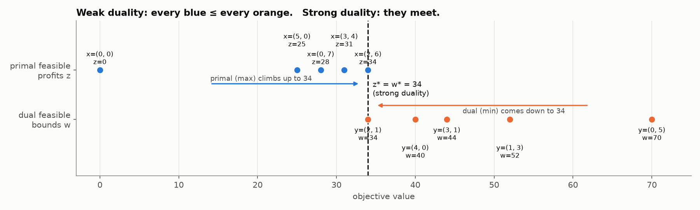

# 6. Duality

> Every LP has a **partner problem** (the dual). The dual's variables **are the shadow prices**.
> Its optimum is exactly the primal's optimum.

## 6.1 Where the dual comes from: finding the best upper bound

**Smoothie bar:** max z = 5x₁ + 4x₂ s.t. 2x₁ + x₂ ≤ 10 (fruit), x₁ + 2x₂ ≤ 14 (blender-minutes).

*Before solving it, how big could the profit possibly be?*

1. Multiply each constraint by a weight y₁, y₂ ≥ 0 (non-negative, so the ≤ doesn't flip) and add them:
   `(2y₁ + y₂)x₁ + (y₁ + 2y₂)x₂ ≤ 10y₁ + 14y₂`
2. If each combined coefficient **covers** the profit coefficient (2y₁ + y₂ ≥ 5 and y₁ + 2y₂ ≥ 4), then
   `profit = 5x₁ + 4x₂ ≤ (2y₁+y₂)x₁ + (y₁+2y₂)x₂ ≤ 10y₁ + 14y₂`
3. So every valid (y₁, y₂) gives an **upper bound** on the profit. **The best bound is the smallest one.** That is an LP:

```
DUAL:  min w = 10y₁ + 14y₂
       s.t. 2y₁ +  y₂ ≥ 5     (covers x₁'s profit)
             y₁ + 2y₂ ≥ 4     (covers x₂'s profit)
             y₁, y₂ ≥ 0
```

| (y₁, y₂) | valid? | bound |
|---|---|---|
| (0, 5) | ✓ | 70 (loose) |
| (3, 1) | ✓ | 44 |
| **(2, 1)** | ✓ | **34 (tightest)** |
| (2, 0) | ✗ (0 ≱ 4) | not a bound |

Primal optimum: x = (2, 6), z = **34**. Dual optimum: y = (2, 1), w = **34**. **They meet.**



## 6.2 Writing the dual mechanically (standard max problem)

```
PRIMAL (max)                          DUAL (min)
max  c₁x₁ + c₂x₂                       min  b₁y₁ + b₂y₂
s.t. a₁₁x₁ + a₁₂x₂ ≤ b₁   ── y₁        s.t. a₁₁y₁ + a₂₁y₂ ≥ c₁   ── from x₁
     a₂₁x₁ + a₂₂x₂ ≤ b₂   ── y₂             a₁₂y₁ + a₂₂y₂ ≥ c₂   ── from x₂
     x ≥ 0                                   y ≥ 0
```

| Primal | Dual |
|---|---|
| max | min |
| constraint i (≤ bᵢ) | variable yᵢ ≥ 0 |
| variable xⱼ ≥ 0 | constraint j (≥ cⱼ) |
| RHS b (resources) | objective coefficients |
| objective coefficients c (profits) | RHS |
| coefficient matrix | **transposed** (read the columns) |
| m constraints, n variables | n constraints, m variables |

**Recipe:**
1. One y per primal constraint.
2. For each primal variable, go **down its column**: (coefficients × y's) ≥ (its profit).
3. Objective: RHS × y's, minimised.

**Example with three products (week 9 prac Q3):** primal max 3x₁ + 4x₂ + 2x₃ s.t. x₁ + 2x₂ + x₃ ≤ 14, 2x₁ + x₂ + x₃ ≤ 10.
Dual: **min 14y₁ + 10y₂ s.t. y₁ + 2y₂ ≥ 3, 2y₁ + y₂ ≥ 4, y₁ + y₂ ≥ 2, y ≥ 0.**

**Economic story (revision Q2):** a competitor wants to **buy all your resources**. yᵢ is the price offered per unit of resource i. They want to pay as little as possible (min Σbᵢyᵢ), but the offer must be one you can't refuse: for every product, the resources it uses must be paid at least what that product would earn (≥ cⱼ).

## 6.3 Weak and strong duality

* **Weak duality:** for ANY feasible x and ANY feasible y, **z(x) ≤ w(y)**. Every dual-feasible point is an upper bound on the primal.
* **Strong duality:** at the optimum, **z* = w***.

**Use: certifying optimality.** If you find a feasible x and a feasible y with z(x) = w(y), both are optimal. You don't need to trust anyone's working (revision Q10, the "two analysts" question).

**Use: bounding.** Any feasible y gives a quick ceiling on the best possible profit.

## 6.4 Dual variables = shadow prices

Fruit stock 10 → 11: the dual objective 10y₁ + 14y₂ rises by exactly y₁ = 2. By strong duality the best profit rises by the same amount. So **y₁* is the shadow price of fruit**.

> Sensitivity found shadow prices by re-solving. **The dual gives them directly.**
> Also: the optimal dual values appear in the **primal's final z row under the slack columns** (and vice versa). Solve one problem and you get both.

## 6.5 Complementary slackness (in words)

Two matching facts:

| Primal side | ⇔ | Dual side |
|---|---|---|
| resource i has **slack** (sᵢ > 0) | ⇒ | its shadow price **yᵢ = 0** |
| product j is **not made** (xⱼ = 0) | ⇒ | its dual constraint is **slack**, and the gap = **reduced cost** |
| yᵢ > 0 | ⇒ | resource i is **binding** |
| xⱼ > 0 | ⇒ | its dual constraint is **tight** (=) |

**Example:** max 4x₁ + 2x₂, x₁ + x₂ ≤ 6, x₁ + 2x₂ ≤ 8 → x = (6, 0), z = 24.
* Resource 2: 6 < 8, so 2 units are spare ⇒ **y₂ = 0** (you know this before solving the dual).
* Dual solution y = (4, 0), w = 24 ✓.
* x₂ isn't made. Its dual constraint is y₁ + 2y₂ ≥ 2 → 4 ≥ 2, slack by **2** = x₂'s **reduced cost**: one unit ties up resources worth 4 to earn 2.

## 6.6 Why bother with the dual?

* **Size:** the primal has m constraints and n variables; the dual has n constraints and m variables. With 500 products and 3 resources, the dual has just **3 variables**. Solve the small one.
* The dual gives **shadow prices** and **certifies optimality**.
* Games (note 8): the row player's LP and the column player's LP are **duals**, so the value of the game is well defined.

## 6.7 Solving a dual by hand

The dual is a **min with ≥ constraints**, so you need **Big M** (or graphical if there are 2 variables). Week 9 prac Q1:

```
min 8y₁ + 6y₂  s.t. 2y₁ + y₂ ≥ 6, y₁ + y₂ ≥ 5
→ Big M (excess + artificial on each row; clear M from the z row)
→ y = (1, 4), w = 32
Primal: max 6x₁ + 5x₂, 2x₁ + x₂ ≤ 8, x₁ + x₂ ≤ 6 → (2, 4), z = 32  ✓ strong duality
```

Graphically (2 dual variables): plot the ≥ lines, find the corners of the (unbounded) region, and evaluate w at each. Revision Q2: corners (0, 4) → 24, (3, 0) → 30, **(1, 2) → 22** ✓.

---

## Quick self-check

<details><summary>Write the dual of max 5x₁ + 6x₂ s.t. x₁ + x₂ ≤ 8, 3x₁ + 2x₂ ≤ 18, x₁ ≤ 5.</summary>

Three constraints, so three dual variables. Two products, so two dual constraints.
**min 8y₁ + 18y₂ + 5y₃ s.t. y₁ + 3y₂ + y₃ ≥ 5, y₁ + 2y₂ ≥ 6, y ≥ 0.**
(x₁ ≤ 5 is x₁ + 0x₂ ≤ 5, so y₃ doesn't appear in x₂'s constraint.)
</details>

<details><summary>A primal solution has z = 40 and someone shows a dual-feasible y with w = 40. What can you conclude?</summary>

By weak duality z ≤ w always, so z = 40 can't be beaten and w = 40 can't be lowered. **Both are optimal.**
</details>
