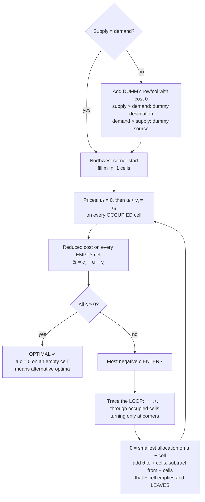
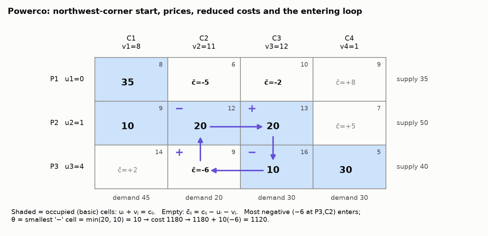

# 7. Transportation Problems

> **Recognise it:** sources with **supply**, destinations with **demand**, a **cost per unit** for each route.
> It's an LP (xᵢⱼ = amount from i to j), but every constraint is just a row or column sum, so we use a faster grid version of simplex.

## 7.1 The LP behind it (Powerco)

|  | C1 | C2 | C3 | C4 | Supply |
|---|---|---|---|---|---|
| P1 | 8 | 6 | 10 | 9 | 35 |
| P2 | 9 | 12 | 13 | 7 | 50 |
| P3 | 14 | 9 | 16 | 5 | 40 |
| Demand | 45 | 20 | 30 | 30 | 125 = 125 |

```
min z = Σ cᵢⱼ xᵢⱼ
s.t. Σⱼ xᵢⱼ ≤ sᵢ     (each plant: row sum ≤ supply)
     Σᵢ xᵢⱼ ≥ dⱼ     (each city: column sum ≥ demand)
     xᵢⱼ ≥ 0          → 12 variables, 7 constraints
```

**Balanced** (total supply = total demand) ⇒ all constraints become equalities.

## 7.2 The method = simplex on a grid



| Simplex idea | Transportation version |
|---|---|
| corner / BFS | **m + n − 1** occupied cells |
| starting corner | northwest corner plan |
| shadow prices (dual values) | **uᵢ, vⱼ** |
| reduced cost | **c̄ᵢⱼ = cᵢⱼ − uᵢ − vⱼ** |
| entering variable | most negative c̄ (minimising cost) |
| ratio test | **θ = smallest − cell** on the loop |
| stop when no improvement | all c̄ᵢⱼ ≥ 0 |

## 7.3 Step 1: Northwest corner

Start at top-left. Ship **min(remaining supply, remaining demand)**. Cross off whichever is used up, then move **right** if the column is still open or **down** if the row is finished. Repeat.

Powerco: 35 → (P1,C1); 10 → (P2,C1); 20 → (P2,C2); 20 → (P2,C3); 10 → (P3,C3); 30 → (P3,C4).
6 cells = 3 + 4 − 1 ✓. Cost = 280 + 90 + 240 + 260 + 160 + 150 = **1180**.
(NW corner ignores cost, so it's only a starting point.)

## 7.4 Steps 2–4 in one picture



**Prices** (u₁ = 0, then walk through occupied cells, each time using a cell with only one unknown):

```
(P1,C1): 0 + v₁ = 8  → v₁ = 8      (P2,C3): 1 + v₃ = 13 → v₃ = 12
(P2,C1): u₂ + 8 = 9  → u₂ = 1      (P3,C3): u₃ + 12 = 16 → u₃ = 4
(P2,C2): 1 + v₂ = 12 → v₂ = 11     (P3,C4): 4 + v₄ = 5  → v₄ = 1
```

**Reduced costs** of the empty cells: c̄₁₂ = 6 − 0 − 11 = **−5**, c̄₁₃ = **−2**, c̄₁₄ = +8, c̄₂₄ = +5, c̄₃₁ = +2, c̄₃₂ = 9 − 4 − 11 = **−6** ← most negative, so it enters.

**What c̄ means:** the change in total cost per unit shipped on that route, after rebalancing everything else. Check it around the loop: +9 − 12 + 13 − 16 = **−6** ✓.

**Loop** for (P3,C2): + at (P3,C2), − at (P2,C2), + at (P2,C3), − at (P3,C3), and back.
The − cells hold 20 and 10, so **θ = 10**. (P3,C3) empties and leaves. New cost = 1180 + 10(−6) = **1120**.

Repeat: (P1,C2) enters with θ = 10 → 1070. Then (P1,C3) enters with θ = 25 → **1020**. Now all c̄ ≥ 0, so stop.

**Optimal plan ($1020):** P1→C2 10, P1→C3 25, P2→C1 45, P2→C3 5, P3→C2 10, P3→C4 30.

### Loop rules

* Starts and ends at the entering cell; every **other** corner of the loop is an **occupied** cell.
* Moves alternate **horizontal / vertical**, turning only at those cells (you may pass straight over cells).
* Signs alternate + − + −, so every row and column total is unchanged.

## 7.5 Unbalanced problems (revision 2 Q6)

Supply 60 + 70 + 80 = 210, demand 50 + 80 = 130. **Add a dummy destination** with demand 80 and cost 0.
"Shipped" to the dummy = left at the source. (If demand > supply, add a dummy **source**: its shipments are demand that goes unmet.)

## 7.6 Testing a given plan (revision 2 Q7)

1. Check it has m + n − 1 occupied cells.
2. Compute u, v.
3. Compute c̄ for the empty cells. All ≥ 0 means optimal. A **c̄ = 0** on an empty cell means there's an **alternative optimal plan** with the same cost.

**Note:** u and v can be **negative**. That's fine.

---

## Quick self-check (revision 2 Q9)

<details><summary>Costs R1: (3, 6, 5), R2: (7, 4, 6). Supply 70, 80. Demand 50, 40, 60. NW corner, test, and one pivot.</summary>

NW: R1Z1 50, R1Z2 20, R2Z2 20, R2Z3 60. Cost 150 + 120 + 80 + 360 = **710**.
u = (0, −2), v = (3, 6, 8). c̄₁₃ = 5 − 0 − 8 = **−3**, c̄₂₁ = 7 + 2 − 3 = 6.
(R1,Z3) enters. Loop: R1Z3 +, R2Z3 −, R2Z2 +, R1Z2 −. θ = min(60, 20) = 20.
New plan: R1Z1 50, R1Z3 20, R2Z2 40, R2Z3 40. Cost **650**. Recheck: u = (0, 1), v = (3, 3, 5), c̄₁₂ = 3, c̄₂₁ = 3, so **optimal**.
</details>
