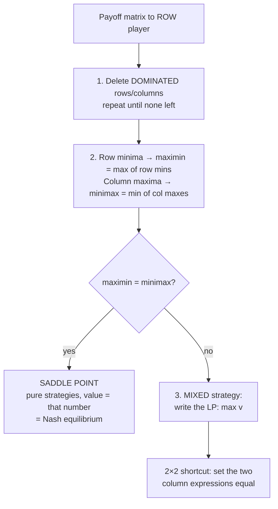
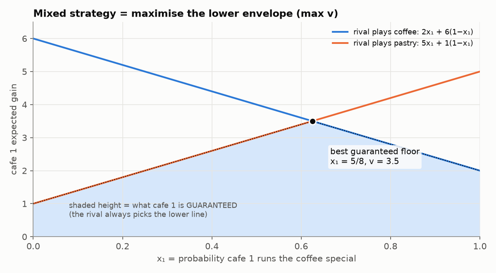

# 8. Two-Player Zero-Sum Games

> **Recognise it:** two opponents choose **at the same time**, with a **payoff matrix** (payoffs to the **row** player).
> **Zero-sum:** the row player's gain = the column player's loss. The **row player wants big** numbers and the **column player wants small** ones.

## 8.1 Procedure



## 8.2 Dominance

**Row** R1 dominates R2 if R1 ≥ R2 in **every** column (strictly better in at least one): the row player never picks R2.
**Column** C1 dominates C2 (for the column player) if C1 ≤ C2 in every row: the column player never picks C2. **Careful: the direction is opposite for columns.**

Politician game: Both = (1, 2, 4) vs Mega = (0, 1, −1). Both is better in every column, so **delete Mega**.

## 8.3 Saddle point (pure strategy)

|  | Both | Big | Mega | **row min** |
|---|---|---|---|---|
| Both | −3 | −2 | 6 | −3 |
| Big | 2 | **0** | 2 | **0** ← maximin |
| Mega | 5 | −2 | −4 | −4 |
| **col max** | 5 | **0** ← minimax | 6 | |

* **Row player:** assume the worst for each row and pick the best worst-case (maximin = 0, play Big).
* **Column player:** pick the column with the smallest maximum (minimax = 0, play Big).
* They're equal, so **(Big, Big) is a saddle point**, with **value 0**. Neither player gains by moving alone: a Nash equilibrium.

> **Saddle point check:** the cell is the **minimum of its row** AND the **maximum of its column**.

## 8.4 No saddle point: mixed strategy

If maximin < minimax, any pure choice can be exploited and the players cycle. **Randomise.**

**Cafe game (revision 2 Q2):** cafe 1's gain.

|  | rival coffee | rival pastry | row min |
|---|---|---|---|
| coffee (x₁) | 2 | 5 | 2 |
| pastry (x₂) | 6 | 1 | 1 |
| col max | 6 | 5 | |

Maximin 2 ≠ minimax 5, so there's no saddle point.

**LP (this is what the exam usually wants you to write):**

```
max v
s.t. 2x₁ + 6x₂ ≥ v      (expected gain if rival plays coffee)
     5x₁ + 1x₂ ≥ v      (expected gain if rival plays pastry)
     x₁ + x₂ = 1
     x₁, x₂ ≥ 0          (v unrestricted)
```

**Recipe:** one constraint **per column of the opponent**: (that column's payoffs weighted by your probabilities) ≥ v. Probabilities sum to 1. Maximise v.

### See it



* Each line is cafe 1's expected gain against one rival choice, as a function of x₁.
* The rival always picks the **lower** line, so cafe 1 is guaranteed the **lower envelope** (shaded).
* Maximise that floor: the **peak** is where the lines cross.

**2×2 shortcut:** set the two column expressions equal, with x₂ = 1 − x₁:
`2x₁ + 6(1 − x₁) = 5x₁ + (1 − x₁) ⇒ 6 − 4x₁ = 1 + 4x₁ ⇒ x₁ = 5/8`
So x = (5/8, 3/8) and **v = 2(5/8) + 6(3/8) = 3.5**.

## 8.5 Duality in games

The column player solves `min w s.t. (each ROW's payoffs weighted by y) ≤ w, Σy = 1`. This is the **dual** of the row player's LP, so strong duality gives **v = w**: the floor the row player can guarantee equals the ceiling the column player can force. That's the **value of the game**. Solving one LP gives both strategies.

---

## Quick self-check

<details><summary>Paper–Scissors–Rock (rows P, S, R vs columns P, S, R): P = (0, −1, 1), S = (1, 0, −1), R = (−1, 1, 0). Write the row LP.</summary>

There's no dominance, and maximin −1 < minimax 1, so play mixed.
max v s.t.
column P: 0xP + 1xS − 1xR ≥ v
column S: −1xP + 0xS + 1xR ≥ v
column R: 1xP − 1xS + 0xR ≥ v
xP + xS + xR = 1, x ≥ 0.
Solution: each 1/3, v = 0.
</details>

<details><summary>Revision 2 Q4: rows A = (5, 9, 3), B = (9, 8, 8), C = (4, 3, 6). Solve.</summary>

B dominates C (9 ≥ 4, 8 ≥ 3, 8 ≥ 6), so delete C. A is not dominated (9 > 8 in column 2).
Row mins: A 3, B 8, so maximin = 8. Column maxes: 9, 9, 8, so minimax = 8.
They're equal, so the **saddle point is (B, Angle 3), value 8**, in pure strategies.
</details>

<details><summary>Two children: rows (2, −3), (−3, 4). Saddle point? LP?</summary>

Row mins −3, −3 → maximin −3. Column maxes 2, 4 → minimax 2. **No saddle point.**
max v s.t. 2x₁ − 3x₂ ≥ v, −3x₁ + 4x₂ ≥ v, x₁ + x₂ = 1, x ≥ 0. (Solution x = (7/12, 5/12), v = −1/12.)
</details>
