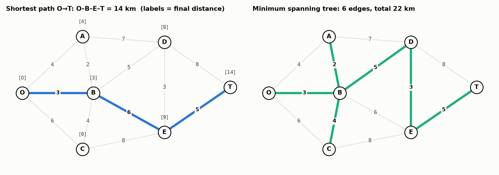

# 9. Networks: Shortest Path and Minimum Spanning Tree

> **In one sentence:** for points joined by roads or cables, the question decides the method. "Quickest route from A to B" → **shortest path**. "Connect everything with the least total length" → **minimum spanning tree**.

---

## 9.1 The big idea

A **network** is a set of points (**nodes**) joined by links (**edges**), each with a length or cost.

The same network can be asked two different questions:

| The question | Method | Output |
|---|---|---|
| "What's the **quickest route** from O to T?" | **shortest path** | one route |
| "Connect **every** point using the **least** total cable" | **minimum spanning tree (MST)** | a set of edges joining everything |

**Read the question carefully.** It's the only thing that tells you which one to use.

---

## 9.2 Seervada Park (lecture example)

Edges: O–A 4, O–B 3, O–C 6, A–B 2, A–D 7, B–C 4, B–D 5, B–E 6, C–E 8, D–E 3, D–T 8, E–T 5.



---

## 9.3 Shortest path: spread out from the start

### The idea

Start at O and spread outwards. At each step, **lock in** whichever unfinished node is **closest to O so far**. Once a node is locked in, its distance is final: nothing later can beat it, because every other path has to go through somewhere further away.

Each node gets a **label** = (best distance from O found so far, **via** which node).

> **This is Dijkstra's algorithm.** The lectures call it "label-setting", but it's the same method. A locked-in node has a "permanent" label (Dijkstra: visited), an unlocked label is "temporary" (tentative distance), and "via" is the predecessor. Like Dijkstra, it only works when no edge has a negative length.

### The steps

1. Lock in O with distance 0. Label its neighbours with their edge lengths.
2. Pick the **unlocked** node with the **smallest label**, and lock it in.
3. From that node, check each neighbour: is (its distance + edge) **smaller** than the neighbour's current label? If yes, replace the label and record "via".
4. Repeat 2–3 until the destination T is locked in.
5. Trace back through the "via" column to get the route.

### Dry run

| Round | Lock in | Checking its neighbours | Labels after this round |
|---|---|---|---|
| 1 | **O = 0** | A = 0 + 4 = 4, B = 0 + 3 = 3, C = 0 + 6 = 6 | A 4 (O), B 3 (O), C 6 (O) |
| 2 | **B = 3** (smallest) | A: 3 + 2 = 5, not better than 4. C: 3 + 4 = 7, not better than 6. D: 3 + 5 = **8**. E: 3 + 6 = **9** | A 4, C 6, D 8 (B), E 9 (B) |
| 3 | **A = 4** | D: 4 + 7 = 11, not better than 8 | no change |
| 4 | **C = 6** | E: 6 + 8 = 14, not better than 9 | no change |
| 5 | **D = 8** | E: 8 + 3 = 11, not better than 9. T: 8 + 8 = **16** | T 16 (D) |
| 6 | **E = 9** | T: 9 + 5 = **14**, better than 16 | T 14 (E) |
| 7 | **T = 14** | – | done |

**Trace back:** T came via E, E via B, B via O. **Route: O → B → E → T, length 14.**

**Answer in words:** the quickest route from O to T is O–B–E–T, **14 km**.

> **Trap:** the shortest route doesn't have to start with the cheapest edge. In revision 2 Q3, the cheapest edge out of P is P–R (2), but the shortest route P–Q–S–U–V doesn't use it. Always run the full method.

---

## 9.4 Minimum spanning tree: grow a tree greedily

### The idea

Start with one node. Keep adding the **cheapest edge that reaches a node you haven't connected yet**. Stop when everything is connected.

With n nodes you always need exactly **n − 1 edges**, and there are no loops (a loop would be wasted cable).

> This is **Prim's algorithm**: grow one tree from a starting node. (Kruskal's algorithm, which sorts all edges and adds the cheapest one that doesn't make a loop, gives the same total.)

### Dry run (start at O)

| Step | Connected so far | Edges reaching a new node | Add (cheapest) |
|---|---|---|---|
| 1 | O | O–A 4, O–B 3, O–C 6 | **O–B 3** |
| 2 | O, B | O–A 4, A–B 2, O–C 6, B–C 4, B–D 5, B–E 6 | **A–B 2** |
| 3 | O, A, B | O–C 6, B–C 4, A–D 7, B–D 5, B–E 6 | **B–C 4** |
| 4 | O, A, B, C | A–D 7, B–D 5, B–E 6, C–E 8 | **B–D 5** |
| 5 | O, A, B, C, D | B–E 6, C–E 8, D–E 3, D–T 8 | **D–E 3** |
| 6 | O, A, B, C, D, E | D–T 8, E–T 5 | **E–T 5** |

**Result:** 6 edges for 7 nodes ✓. Total 3 + 2 + 4 + 5 + 3 + 5 = **22 km**.

**Answer in words:** lay cable on O–B, A–B, B–C, B–D, D–E and E–T, a total of **22 km**.

Being greedy (always taking the cheapest option right now) gives the **best possible** tree here. That's unusual: for most problems greedy doesn't work.

---

## 9.5 Shortest path vs MST, side by side

| | Shortest path | MST |
|---|---|---|
| Question | one route A → B | connect **all** nodes |
| What you lock in each step | the closest unfinished **node** (by total distance from the start) | the cheapest **edge** reaching a new node |
| Output | a route | a tree of n − 1 edges |
| Seervada | O–B–E–T, 14 | 6 edges, 22 |

---

## 9.6 The LP underneath (conservation of flow)

Shortest path can also be written as an LP. You'll never solve it that way (section 9.3 is much faster), but you should understand the idea, because "flow in = flow out" is on the resource sheet.

### The idea: picture one person walking the route

Think of the route as **one person walking from O to T**. At every node, count how many times they **walk out** and how many times they **walk in**.

Take the shortest route **O → B → E → T**:

| Node | Walks out along | Walks in along | out − in | Why |
|---|---|---|---|---|
| **O** (start) | O→B (1) | – (0) | **+1** | you leave the start and never come back |
| **B** | B→E (1) | O→B (1) | **0** | you came in, so you must go out again |
| **E** | E→T (1) | B→E (1) | **0** | same: in once, out once |
| **T** (end) | – (0) | E→T (1) | **−1** | you arrive at the end and stop |
| A, C, D | – (0) | – (0) | **0** | not on the route: never in, never out |

**Reading it:** that's the whole rule.
* **start: +1**, because you only leave
* **end: −1**, because you only arrive
* **every other node: 0**, because whatever comes in goes out (or you never visit)

The "0 everywhere else" part is called **conservation of flow**: nobody gets stuck at a middle node, and nobody appears out of nowhere.

### Why the rule matters: it rules out broken routes

Suppose you pick just the two edges **O→B** and **E→T**, with a gap in the middle:

| Node | Out | In | out − in | Should be | |
|---|---|---|---|---|---|
| O | 1 | 0 | +1 | +1 | ✓ |
| B | 0 | 1 | **−1** | 0 | ✗ you arrive at B and get stuck |
| E | 1 | 0 | **+1** | 0 | ✗ you leave E without ever getting there |
| T | 0 | 1 | −1 | −1 | ✓ |

**Reading it:** B and E break the rule, so this isn't a real route. The rule only allows sets of edges that form a **connected walk from O to T**.

### The LP

Let **x_ij = 1** if the route uses the edge from i to j, and **0** if not. (Each road can be walked either way, so treat it as two one-way arrows, i→j and j→i.)

```
min  Σ (length of edge) × x_ij          total length of the edges used

s.t. at every node:
     (edges used out of it) − (edges used into it) = +1   at O
                                                     −1   at T
                                                      0   at every other node
     x_ij ≥ 0
```

**Reading it:** "out of all the sets of edges that form a proper route from O to T, pick the one with the smallest total length". For O → B → E → T the objective is 3 + 6 + 5 = **14**, the same answer as section 9.3.

Everything is a number × a variable, added up, so it's a linear program.

---

## Common mistakes

1. Using MST when the question asks for a route, or the other way round. Read the question.
2. In shortest path, locking in a node by its **edge** length instead of its **total** distance from the start.
3. In MST, adding an edge between two nodes that are both already connected. That makes a loop.
4. Not giving the total, or not writing out the route / list of edges.

---

## Check yourself

<details><summary>1. Revision 2 Q5: same network, but now "connect every node with the least cable". Which method, and why?</summary>

**Minimum spanning tree.** The question asks to connect **everything**, not to find a route between two points. Same picture, different question, different method.
</details>

<details><summary>2. In the shortest-path dry run, why isn't A's label changed to 5 in round 2?</summary>

Going O → B → A costs 3 + 2 = 5, but A already has the label 4 (straight from O). 5 isn't smaller, so A keeps 4.
</details>

<details><summary>3. A network has 10 nodes. How many edges are in its minimum spanning tree?</summary>

**9** (n − 1).
</details>
