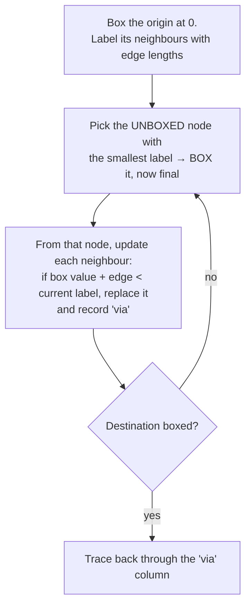

# 9. Network Problems: Shortest Path and Minimum Spanning Tree

> **Recognise it:** points (**nodes**) joined by weighted links (**edges**). **The question decides the algorithm:**
> "quickest route from A to B" → **shortest path**. "Connect everything with least total length" → **minimum spanning tree**.

## 9.1 Seervada Park (lecture example)

Edges: O–A 4, O–B 3, O–C 6, A–B 2, A–D 7, B–C 4, B–D 5, B–E 6, C–E 8, D–E 3, D–T 8, E–T 5.


## 9.2 Shortest path (label-setting)



| Round | Box | Updates (label, via) |
|---|---|---|
| 1 | O = 0 | A = 4 (O), B = 3 (O), C = 6 (O) |
| 2 | B = 3 | D = 3 + 5 = 8 (B), E = 3 + 6 = 9 (B). A via B = 5, not better than 4 |
| 3 | A = 4 | A–D: 4 + 7 = 11 > 8, no change |
| 4 | C = 6 | C–E: 6 + 8 = 14 > 9, no change |
| 5 | D = 8 | T = 8 + 8 = 16 (D). D–E: 11 > 9 |
| 6 | E = 9 | T = 9 + 5 = **14** (E), beats 16 |
| 7 | T = 14 | done |

Trace back: T ← E ← B ← O. **Route O–B–E–T = 14 km.**

**Trap:** the shortest route does **not** have to start with the cheapest edge out of the origin. In revision 2 Q3 the cheapest edge out of P is P–R (2), but the shortest route P–Q–S–U–V doesn't use it.

## 9.3 Minimum spanning tree (greedy)

1. Start with any node.
2. Of all edges joining the tree to a node **not yet in it**, add the **cheapest**.
3. Repeat until all n nodes are connected: exactly **n − 1 edges, no loops**.

From O: O–B (3), B–A (2), B–C (4), B–D (5), D–E (3), E–T (5). **Total 22 km**, 6 edges for 7 nodes.

Greedy is **provably optimal** for MST (unusual: for most problems greedy fails).

## 9.4 Shortest path vs MST

| | Shortest path | MST |
|---|---|---|
| Question | one route A → B | connect **all** nodes |
| Output | a path | a tree (n − 1 edges) |
| Seervada | O–B–E–T, 14 | 6 edges, 22 |
| Step rule | lock in the closest **unsolved node** (by total distance from the origin) | add the cheapest **edge** that reaches a new node |

## 9.5 The LP underneath (conservation of flow)

xᵢⱼ = 1 if the route uses edge (i, j), else 0. **min Σ dᵢⱼ xᵢⱼ** subject to, at each node k:

```
(flow out of k) − (flow into k) = +1  if k = origin
                                  −1  if k = destination
                                   0  otherwise       ← conservation of flow
```

Linear objective, linear constraints: an LP. But the specialised algorithm is much faster.

---

## Quick self-check (revision 2 Q5)

<details><summary>Same network, now "connect every node with least cable". Which algorithm and why?</summary>

**Minimum spanning tree (greedy)**: the question asks to connect **everything**, not to find a route between two points. Same picture, different question, different method.
</details>
