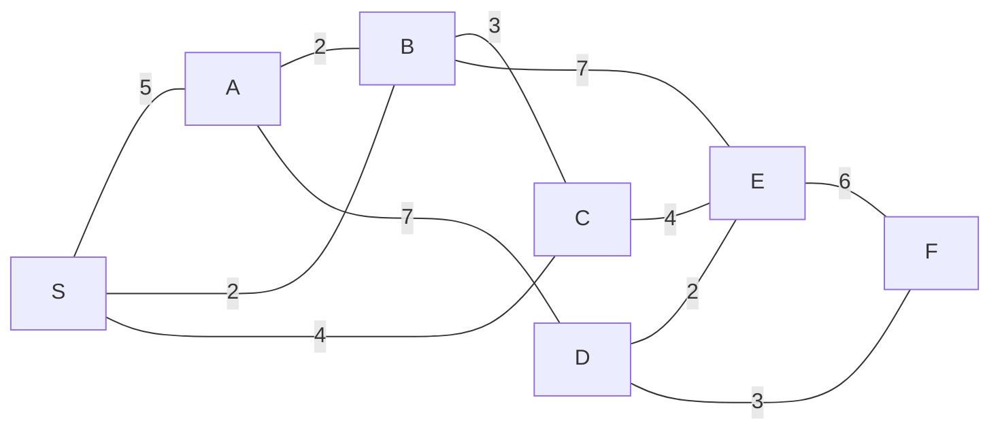

# MXB109 Practice Exam 1

**Total: 60 marks · Suggested time: 2 hours · Resource sheet allowed** (see [resource sheet](../notes/00_START_HERE.md#resource-sheet-given-in-the-exam))

Show all working. Marks go to the method and to interpreting the answer, not just the final number. For each question, **first say which kind of problem it is and why**.

Solutions: [Practice_Exam_1_Solutions.md](Practice_Exam_1_Solutions.md). Try the exam under timed conditions first.

---

## Question 1: Formulation and standard form (5 marks)

A bike workshop refurbishes **road bikes** and **mountain bikes** each week.

* A road bike takes 3 hours of labour and $20 of parts, and earns $60 profit.
* A mountain bike takes 4 hours of labour and $50 of parts, and earns $80 profit.
* There are 120 labour hours and a $1300 parts budget each week.
* A contract with a local school requires **at least 10 road bikes** per week.
* The owner insists that the number of mountain bikes is **no more than twice** the number of road bikes.

(a) Define decision variables (with units) and formulate an LP to maximise weekly profit. **(2)**

(b) Convert your LP to standard form. Name every new variable and say in words what it measures. State which constraint(s) would need an artificial variable for the simplex method, and why. **(2)**

(c) The owner proposes 20 road bikes and 12 mountain bikes. Show this plan is feasible and give the value of every slack/excess variable. Explain, without using the words "slack" or "binding", why this plan **cannot** be optimal. **(1)**

---

## Question 2: Graphical method (8 marks)

A wildlife sanctuary blends two feeds. Feed 1 costs $6/kg and feed 2 costs $4/kg.

* Each kg of feed 1 provides 3 units of protein and 1 unit of energy.
* Each kg of feed 2 provides 1 unit of protein and 2 units of energy.
* The daily blend must provide **at least 12 units of protein** and **at least 14 units of energy**.
* Storage limits feed 2 to **at most 9 kg** per day.

(a) Formulate the LP to minimise daily cost. **(1)**

(b) Sketch the feasible region and label every corner with its coordinates. **(2)**

(c) Find the optimal blend and cost. State the value of every slack/excess variable at the optimum and which constraints are binding. Explain why a minimisation has an optimum on this region even though it is unbounded. **(2)**

(d) Using graphical sensitivity analysis, find the range of the feed 1 price (feed 2 stays at $4) over which the optimal blend does not change. **(2)**

(e) By re-solving, find the shadow price of the energy requirement and interpret it in one sentence. **(1)**

---

## Question 3: Simplex method (8 marks)

A ceramics studio makes mugs (x₁) and bowls (x₂) each day:

```
max z = 3x₁ + 2x₂            ($ profit)
s.t. 2x₁ +  x₂ ≤ 18          kiln hours
      x₁ +  x₂ ≤ 12          clay (kg)
             x₂ ≤ 10          glaze for bowls (litres)
      x₁, x₂ ≥ 0
```

(a) After adding slack variables, how many variables and equations are there? How many variables must be zero at a basic solution? Find the basic solution with **x₁ = 0 and s₃ = 0** and say whether it is feasible. **(2)**

(b) Solve the LP using the simplex method. Show every tableau with the ratio column, and name the entering and leaving variable at each step. **(4)**

(c) State the optimal plan, the optimal basis, the profit, and which constraints are binding. Translate the answer into a sentence for the studio owner. **(2)**

---

## Question 4: Sensitivity analysis (6 marks)

Use your **final tableau from Question 3**.

(a) Read off the shadow price of each constraint and interpret each in one sentence. **(2)**

(b) Over what range of clay supply does the clay shadow price remain valid? Use it to predict the profit if clay is increased to 13 kg. Would the same method correctly predict the profit at 16 kg? Explain. **(2)**

(c) The studio considers a new product, **vases**, each using 1 kiln hour and 1 kg of clay (no glaze) and earning $2.50. Without re-solving, decide whether vases should be made. Show your calculation. **(2)**

---

## Question 5: Big M and tableau diagnosis (7 marks)

(a) Consider

```
min z = 2x₁ + 3x₂
s.t. x₁ +  x₂ ≥ 6
     x₁ + 3x₂ ≥ 12
     x₁       ≤ 8
     x₁, x₂ ≥ 0
```

  (i) Which constraints need an artificial variable? Justify using the origin. **(1)**
  (ii) Write the initial Big M tableau, with the M's cleared from the objective row so it is in proper form. **(2)**
  (iii) Identify the entering and leaving variables for the first pivot. **(1)**

(b) Each tableau below is from a **maximisation** solved by simplex (or Big M). For each, state what the tableau tells you and what you would report. **(3)**

**Tableau A**

| Basis | x₁ | x₂ | s₁ | s₂ | RHS |
|---|---|---|---|---|---|
| x₁ | 1 | −2 | 1 | 0 | 4 |
| s₂ | 0 | −1 | −1 | 1 | 3 |
| z | 0 | −3 | 2 | 0 | 8 |

**Tableau B**

| Basis | x₁ | x₂ | x₃ | s₁ | s₂ | RHS |
|---|---|---|---|---|---|---|
| x₁ | 1 | 0 | 2 | 1 | −1 | 4 |
| x₂ | 0 | 1 | −1 | −1 | 2 | 3 |
| z | 0 | 0 | 0 | 2 | 1 | 22 |

**Tableau C**

| Basis | x₁ | x₂ | s₁ | e₂ | a₂ | RHS |
|---|---|---|---|---|---|---|
| x₂ | 1 | 1 | 1 | 0 | 0 | 5 |
| a₂ | 0 | 0 | −1 | −1 | 1 | 2 |
| z | 1 | 0 | 2 + M | M | 0 | 10 − 2M |

---

## Question 6: Evaluating AI working (4 marks)

A staff member asked a chatbot to solve

```
max z = 5x₁ + 4x₂   s.t.  x₁ + x₂ ≤ 6,   2x₁ + x₂ ≤ 10,   x₁, x₂ ≥ 0
```

The chatbot returned:

> Initial tableau:
>
> | Basis | x₁ | x₂ | s₁ | s₂ | RHS |
> |---|---|---|---|---|---|
> | s₁ | 1 | 1 | 1 | 0 | 6 |
> | s₂ | 2 | 1 | 0 | 1 | 10 |
> | z | −5 | −4 | 0 | 0 | 0 |
>
> The most negative entry is −5, so x₁ enters. The ratios are 6/1 = 6 and 10/2 = 5. I'll pivot on the s₁ row, since its pivot element is already 1, which saves a step. Clearing the column with R₂ → R₂ − 2R₁ and z → z + 5R₁ gives:
>
> | Basis | x₁ | x₂ | s₁ | s₂ | RHS |
> |---|---|---|---|---|---|
> | x₁ | 1 | 1 | 1 | 0 | 6 |
> | s₂ | 0 | −1 | −2 | 1 | −2 |
> | z | 0 | 1 | 5 | 0 | 30 |
>
> No negative entries in the bottom row, so this is optimal: **x₁ = 6, x₂ = 0, profit $30.**

There is exactly one error, and the arithmetic after it is correct.

(a) Identify the error and the step of the algorithm that was applied incorrectly. **(1)**

(b) Give **two** independent signals in or about the final tableau that show something is wrong, without needing to find the error. (Hint: one of them uses duality, with y = (3, 1).) **(2)**

(c) State the correct optimal solution. **(1)**

---

## Question 7: Duality (5 marks)

Return to the ceramics LP in Question 3.

(a) Write down its dual. Define the dual variables and give them an economic meaning. **(2)**

(b) Without solving anything, show that the studio's profit can never exceed $36. **(1)**

(c) Show that y = (1, 1, 0) is dual-feasible, and use it to **certify** that your answer to Question 3 is optimal. **(1)**

(d) Using complementary slackness, explain why the third dual variable must be zero. **(1)**

---

## Question 8: Transportation (7 marks)

Three warehouses supply three stores. Costs are $ per pallet.

|  | Store 1 | Store 2 | Store 3 | Supply |
|---|---|---|---|---|
| W1 | 5 | 8 | 4 | 50 |
| W2 | 6 | 4 | 7 | 60 |
| W3 | 3 | 9 | 6 | 40 |
| **Demand** | 30 | 70 | 50 | |

(a) Is the problem balanced? Find a starting solution using the northwest corner method, and give its cost. Check the number of occupied cells. **(2)**

(b) Compute the prices uᵢ, vⱼ (take u₁ = 0) and the reduced cost of every empty cell. Is the starting solution optimal? **(2)**

(c) Perform one improvement step. Show the loop with + and − signs, state θ, give the new plan and its cost. **(2)**

(d) Without doing another full step, determine whether the new plan is optimal. **(1)**

---

## Question 9: Game theory (5 marks)

Two rival food trucks each choose a location. The payoff (extra customers per hour to Truck R) is:

|  | C1 | C2 | C3 |
|---|---|---|---|
| R1 | 3 | −1 | 4 |
| R2 | −2 | 2 | 1 |
| R3 | 1 | −2 | 3 |

(a) Remove all dominated strategies, explaining each deletion. **(2)**

(b) Determine whether the game has a saddle point. **(1)**

(c) Write the linear program for Truck R's optimal mixed strategy on the reduced game, then solve it. Give the value of the game. **(2)**

---

## Question 10: Networks (5 marks)

A park ranger station (S) is connected to six huts (A–F) by trails (lengths in km):



| Trail | S–A | S–B | S–C | A–B | A–D | B–C | B–E | C–E | D–E | D–F | E–F |
|---|---|---|---|---|---|---|---|---|---|---|---|
| km | 5 | 2 | 4 | 2 | 7 | 3 | 7 | 4 | 2 | 3 | 6 |

(a) A rescue team must reach hut F from S as quickly as possible. Name the problem type and algorithm, then find the route and its length, showing your labels. **(3)**

(b) The park wants to lay a radio cable along trails connecting **all** seven locations using the least total cable. Name the problem, apply the appropriate algorithm, and give the edges and the total length. **(2)**
