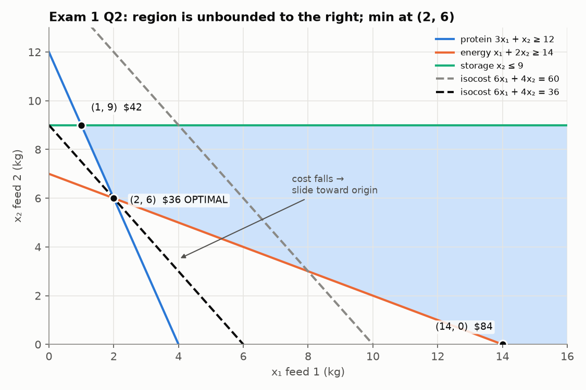

# MXB109 Practice Exam 1: Solutions

As in the revision prac solutions, each answer **starts with the diagnosis** (which method, and the cue in the wording that points to it).
Every number here was checked with an LP solver.

---

## Question 1: Formulation and standard form

**Diagnosis:** a plain LP to formulate. "At least 10" is a `≥`; "no more than twice" is a `≤` that must be rearranged so all variables are on the left.

**(a)** x₁ = road bikes refurbished per week, x₂ = mountain bikes refurbished per week (bikes/week).

```
max z = 60x₁ + 80x₂                 ($ per week)
s.t.  3x₁ +  4x₂ ≤ 120              labour (h)
     20x₁ + 50x₂ ≤ 1300             parts ($)
       x₁        ≥ 10               school contract (bikes)
     −2x₁ +   x₂ ≤ 0                x₂ ≤ 2x₁  (ratio rule)
      x₁, x₂ ≥ 0
```

**(b)**

```
max z = 60x₁ + 80x₂
s.t.  3x₁ +  4x₂ + s₁           = 120
     20x₁ + 50x₂      + s₂      = 1300
       x₁        − e₃ (+ a₃)    = 10
     −2x₁ +   x₂           + s₄ = 0
      all variables ≥ 0
```

* s₁ = unused labour hours; s₂ = unspent parts budget ($); e₃ = road bikes **above** the contract minimum of 10; s₄ = how far x₂ is **below** 2x₁ (room left in the ratio rule).
* **Artificial needed on the contract row only.** At the origin, 0 ≥ 10 is false (e₃ would be −10). The other rows hold at the origin: 0 ≤ 120, 0 ≤ 1300, 0 ≤ 0. The RHS 0 in the ratio row is fine; it just means s₄ starts at 0.

**(c)** (20, 12): labour 60 + 48 = 108 ≤ 120 ✓; parts 400 + 600 = 1000 ≤ 1300 ✓; 20 ≥ 10 ✓; −40 + 12 = −28 ≤ 0 ✓. **Feasible.**
s₁ = 12, s₂ = 300, e₃ = 10, s₄ = 28. Profit = $2160.

**Why not optimal:** at this plan there are spare labour hours, unspent parts money, more road bikes than the contract needs, and room under the ratio rule. Nothing is holding the workshop back, so it could make a few more bikes of either type and earn more. The best plan always uses up at least one limit completely, i.e. it sits at a **corner**.
*(For interest: the optimum is x ≈ (11.43, 21.43), z = $2400, where labour and the parts budget run out together.)*

---

## Question 2: Graphical method

**Diagnosis:** two variables, so use the graphical method. It's a minimisation with two "at least" (`≥`) requirements and one `≤` cap.

**(a)** x₁, x₂ = kg/day of feed 1 and feed 2.

```
min z = 6x₁ + 4x₂
s.t. 3x₁ +  x₂ ≥ 12   protein
      x₁ + 2x₂ ≥ 14   energy
            x₂ ≤ 9    storage
     x₁, x₂ ≥ 0
```

**(b)**



Corners: **(1, 9)** (protein ∩ storage), **(2, 6)** (protein ∩ energy), **(14, 0)** (energy ∩ x₂ = 0). The region is unbounded to the right.

**(c)**

| Corner | Cost 6x₁ + 4x₂ |
|---|---|
| (1, 9) | 42 |
| **(2, 6)** | **36** |
| (14, 0) | 84 |

Solve the binding pair exactly: 3x₁ + x₂ = 12 and x₁ + 2x₂ = 14. From the first, x₂ = 12 − 3x₁, so x₁ + 24 − 6x₁ = 14 and x₁ = 2, x₂ = 6.
**Optimal: 2 kg feed 1, 6 kg feed 2, cost $36/day.**

* Protein: 6 + 6 = 12, so e₁ = **0** (binding).
* Energy: 2 + 12 = 14, so e₂ = **0** (binding).
* Storage: s₃ = 9 − 6 = **3** (non-binding).

The region is unbounded in the direction of **higher** cost. When minimising, the isocost line slides **towards** the origin, and the region is closed off on that side by the ≥ lines, so there is a last point touched. A maximisation would slide off to infinity.

**(d)** The binding lines are protein (slope −3) and energy (slope −1/2). The isocost slope is −c₁/4.

```
−3 ≤ −c₁/4 ≤ −1/2   ⇒   2 ≤ c₁ ≤ 12
```

The blend (2, 6) stays optimal while feed 1 costs **between $2 and $12 per kg**. At c₁ = 2 it ties with (14, 0); at c₁ = 12 it ties with (1, 9).

**(e)** Energy 14 → 15: 3x₁ + x₂ = 12 and x₁ + 2x₂ = 15 give x₁ = 1.8, x₂ = 6.6, cost 10.8 + 26.4 = 37.2.
**Shadow price = 37.2 − 36 = +$1.20.** Each extra unit of energy required raises the minimum daily cost by $1.20.
(Protein, for comparison: +$1.60. Storage: $0, since it has slack.)

---

## Question 3: Simplex method

**Diagnosis:** a plain max LP, all `≤` with non-negative RHS, so the origin is feasible and ordinary simplex (no Big M) applies.

**(a)** 5 variables (x₁, x₂, s₁, s₂, s₃), 3 equations. **5 − 3 = 2** variables must be zero (C(5, 2) = 10 possible choices).
x₁ = 0, s₃ = 0: x₂ = 10, s₁ = 18 − 10 = 8, s₂ = 12 − 10 = 2. All ≥ 0, so **feasible**: the corner (0, 10), z = 20.

**(b)**

**Tableau 0**

| Basis | x₁ | x₂ | s₁ | s₂ | s₃ | RHS | Ratio |
|---|---|---|---|---|---|---|---|
| s₁ | **2** | 1 | 1 | 0 | 0 | 18 | 9 ← |
| s₂ | 1 | 1 | 0 | 1 | 0 | 12 | 12 |
| s₃ | 0 | 1 | 0 | 0 | 1 | 10 | – |
| z | **−3** | −2 | 0 | 0 | 0 | 0 | |

x₁ enters (−3), s₁ leaves (9). `R₁′ = R₁/2`, `R₂′ = R₂ − R₁′`, `Rz′ = Rz + 3R₁′`.

**Tableau 1** (corner (9, 0), z = 27)

| Basis | x₁ | x₂ | s₁ | s₂ | s₃ | RHS | Ratio |
|---|---|---|---|---|---|---|---|
| x₁ | 1 | 1/2 | 1/2 | 0 | 0 | 9 | 18 |
| s₂ | 0 | **1/2** | −1/2 | 1 | 0 | 3 | **6** ← |
| s₃ | 0 | 1 | 0 | 0 | 1 | 10 | 10 |
| z | 0 | **−1/2** | 3/2 | 0 | 0 | 27 | |

x₂ enters (−1/2), s₂ leaves (6). `R₂′ = 2R₂`, `R₁′ = R₁ − ½R₂′`, `R₃′ = R₃ − R₂′`, `Rz′ = Rz + ½R₂′`.

**Tableau 2** (optimal)

| Basis | x₁ | x₂ | s₁ | s₂ | s₃ | RHS |
|---|---|---|---|---|---|---|
| x₁ | 1 | 0 | 1 | −1 | 0 | 6 |
| x₂ | 0 | 1 | −1 | 2 | 0 | 6 |
| s₃ | 0 | 0 | 1 | −2 | 1 | 4 |
| z | 0 | 0 | 1 | 1 | 0 | 30 |

**(c)** No negatives, so optimal. **x₁ = 6, x₂ = 6, z = $30**, basis {x₁, x₂, s₃}.
Binding: kiln hours and clay (s₁ = s₂ = 0). Non-binding: glaze (s₃ = 4 litres spare).
*"Make 6 mugs and 6 bowls a day for $30 profit. This uses every kiln hour and all the clay, with 4 litres of glaze left over."*

---

## Question 4: Sensitivity analysis

**Diagnosis:** "shadow price", "range", "new product worth making?" are sensitivity questions, read off the final tableau.

**(a)** z-row entries under the slacks:
* Kiln hours: **$1**. One more kiln hour adds $1 profit.
* Clay: **$1**. One more kg of clay adds $1 profit.
* Glaze: **$0**. Glaze already has 4 L spare, so more glaze adds nothing.

**(b)** Clay is constraint 2, with s₂ column (−1, 2, −2). The new RHS = (6, 6, 4) + Δ(−1, 2, −2):

```
x₁ = 6 − Δ  ≥ 0  →  Δ ≤ 6
x₂ = 6 + 2Δ ≥ 0  →  Δ ≥ −3
s₃ = 4 − 2Δ ≥ 0  →  Δ ≤ 2
⇒ −3 ≤ Δ ≤ 2   ⇒   9 ≤ clay ≤ 14 kg
```

At 13 kg (Δ = 1, inside the range): **z = 30 + 1 × 1 = $31** (plan (5, 8)).
At 16 kg (Δ = 4): **no**, this is outside the range. Above 14 kg the glaze limit starts to bind, the basis changes, and the shadow price changes. The naive prediction of $34 is wrong; the true optimum is **$32** (plan (4, 10)).

**(c)** Value the vase's resources at the shadow prices:

```
1 kiln hour × $1 + 1 kg clay × $1 + 0 glaze × $0 = $2
reduced cost = $2 − $2.50 = −$0.50   (negative ⇒ improves profit)
```

A vase earns $2.50 but only uses $2 worth of resources, so **vases should be made**. Adding x₃ and re-solving gives (6, 0, 6) with z = $33.

---

## Question 5: Big M and tableau diagnosis

**(a)(i)** Origin: 0 ≥ 6 ✗, 0 ≥ 12 ✗, 0 ≤ 8 ✓. So **artificials on the first two rows**.

**(a)(ii)** Max z′ = −z = −2x₁ − 3x₂ − Ma₁ − Ma₂, so the objective row is `z′ + 2x₁ + 3x₂ + Ma₁ + Ma₂ = 0`. Clear with `Rz − M R₁ − M R₂`:

| Basis | x₁ | x₂ | e₁ | e₂ | s₃ | a₁ | a₂ | RHS |
|---|---|---|---|---|---|---|---|---|
| a₁ | 1 | 1 | −1 | 0 | 0 | 1 | 0 | 6 |
| a₂ | 1 | **3** | 0 | −1 | 0 | 0 | 1 | 12 |
| s₃ | 1 | 0 | 0 | 0 | 1 | 0 | 0 | 8 |
| z′ | 2 − 2M | **3 − 4M** | M | M | 0 | 0 | 0 | −18M |

**(a)(iii)** Most negative: **3 − 4M** (largest M coefficient), so **x₂ enters**. Ratios 6/1 = 6, 12/3 = **4**, s₃ row skipped (0), so **a₂ leaves**.
*(Continuing gives x = (3, 3), minimum cost $15.)*

**(b)**
* **A: unbounded.** x₂ should enter (−3), but its column (−2, −1) has no positive entry, so nothing stops it growing and z → ∞. Report: no finite optimum; a constraint is probably missing from the model.
* **B: optimal, with alternative optima.** No negatives: x₁ = 4, x₂ = 3, z = 22. But x₃ is non-basic with a **0** in the z row, so bringing it in changes the plan without changing z. Pivoting (ratio 4/2 gives x₁ leaving) gives another optimal corner, x₃ = 2, x₂ = 5. Every point between the two corners is optimal.
* **C: infeasible.** The z row has no negatives so simplex has stopped, but the **artificial a₂ is still basic at 2**. The constraints can't all be met.

---

## Question 6: Evaluating AI working

**(a)** **Ratio test (leaving variable) error.** The smallest ratio is 5 (the s₂ row), so s₂ must leave. The chatbot chose the s₁ row (ratio 6) because its pivot was "already 1". Choosing the larger ratio lets x₁ grow past the point where s₂ hits zero.

**(b)**
1. **Negative RHS:** s₂ = −2 in the final tableau. Every variable must be ≥ 0, so this "solution" is **infeasible**: 2(6) + 0 = 12 > 10 breaks the second constraint.
2. **Weak duality violated:** y = (3, 1) is dual-feasible (1·3 + 2·1 = 5 ≥ 5 and 3 + 1 = 4 ≥ 4) and gives a bound 6(3) + 10(1) = **28**. No feasible plan can earn more than 28, so a claimed profit of **30** is impossible.

**(c)** Correct solve: x₁ enters, s₂ leaves, then x₂ enters, s₁ leaves. **x₁ = 4, x₂ = 2, z = $28**, with final z row (0, 0, 3, 1 | 28). The dual bound of 28 is exactly achieved (strong duality).

---

## Question 7: Duality

**Diagnosis:** "write the dual", "show profit can never exceed", "certify" → duality.

**(a)** y₁, y₂, y₃ = the value ($ per unit) of a kiln hour, a kg of clay and a litre of glaze (prices a buyer would offer for the studio's resources).

```
min w = 18y₁ + 12y₂ + 10y₃
s.t. 2y₁ +  y₂       ≥ 3     (mug: resources must be worth at least its $3 profit)
      y₁ +  y₂ + y₃  ≥ 2     (bowl: at least $2)
     y₁, y₂, y₃ ≥ 0
```

**(b)** y = (2, 0, 0) is dual-feasible: 4 ≥ 3 ✓ and 2 ≥ 2 ✓. Weak duality gives profit ≤ 18(2) = **$36**.
(Equivalently: 3x₁ + 2x₂ ≤ 4x₁ + 2x₂ = 2(2x₁ + x₂) ≤ 2(18) = 36.)

**(c)** y = (1, 1, 0): 2 + 1 = 3 ≥ 3 ✓ and 1 + 1 + 0 = 2 ≥ 2 ✓, so it's feasible, with w = 18 + 12 = **30**.
The plan (6, 6) is feasible with z = 30. Since z = w for a feasible pair, by weak duality **both are optimal**. This certifies the Question 3 answer independently of the simplex working.

**(d)** At the optimum the glaze constraint has slack (only 6 of 10 litres used). A resource that isn't used up is worth nothing at the margin, so its dual variable (shadow price) **y₃ = 0**. This matches the 0 under s₃ in the final tableau.

---

## Question 8: Transportation

**Diagnosis:** warehouses with supplies, stores with demands and a cost grid → transportation problem.

**(a)** Supply 50 + 60 + 40 = 150 = demand 30 + 70 + 50 → **balanced**.

Northwest corner:

|  | S1 | S2 | S3 | Supply |
|---|---|---|---|---|
| W1 | **30** | **20** | | 50 |
| W2 | | **50** | **10** | 60 |
| W3 | | | **40** | 40 |
| Demand | 30 | 70 | 50 | |

Cost = 30(5) + 20(8) + 50(4) + 10(7) + 40(6) = 150 + 160 + 200 + 70 + 240 = **$820**.
Occupied cells = 5 = m + n − 1 = 3 + 3 − 1 ✓.

**(b)** u₁ = 0:
(W1,S1): v₁ = 5. (W1,S2): v₂ = 8. (W2,S2): u₂ = 4 − 8 = −4. (W2,S3): v₃ = 7 + 4 = 11. (W3,S3): u₃ = 6 − 11 = −5.

| Empty cell | c̄ = c − u − v |
|---|---|
| (W1,S3) | 4 − 0 − 11 = **−7** |
| (W2,S1) | 6 + 4 − 5 = 5 |
| (W3,S1) | 3 + 5 − 5 = 3 |
| (W3,S2) | 9 + 5 − 8 = 6 |

There's a negative, so the plan is **not optimal**. The most negative, (W1,S3), enters.

**(c)** Loop: (W1,S3) **+** → (W2,S3) **−** → (W2,S2) **+** → (W1,S2) **−** → back.
− cells hold 10 and 20, so **θ = 10**. (W2,S3) empties and leaves.

|  | S1 | S2 | S3 |
|---|---|---|---|
| W1 | 30 | 10 | 10 |
| W2 | | 60 | |
| W3 | | | 40 |

Cost = 820 + 10(−7) = **$750** (check: 150 + 80 + 40 + 240 + 240 = 750 ✓).

**(d)** New prices (u₁ = 0): v₁ = 5, v₂ = 8, v₃ = 4, u₂ = −4, u₃ = 2.
c̄(W3,S1) = 3 − 2 − 5 = **−4** < 0, so **not optimal yet**; (W3,S1) would enter next.
*(Continuing reaches the optimum, $620.)*

---

## Question 9: Game theory

**Diagnosis:** two rivals, simultaneous choice, payoff matrix, zero-sum → game.

**(a)**
* **R3 is dominated by R1:** 3 ≥ 1, −1 ≥ −2, 4 ≥ 3. R1 is better whatever the column player does, so delete R3.
* On the remaining rows, **C3 is dominated by C1** for the column player, who wants small numbers: C1 = (3, −2) ≤ C3 = (4, 1). Delete C3.
* Reduced game: R1 = (3, −1), R2 = (−2, 2). No further dominance.

**(b)** Row minima: R1 −1, R2 −2 → **maximin = −1**. Column maxima: C1 3, C2 2 → **minimax = 2**. −1 ≠ 2, so **no saddle point**. A mixed strategy is needed.

**(c)** x₁, x₂ = probabilities of R1, R2.

```
max v
s.t. 3x₁ − 2x₂ ≥ v      (if column plays C1)
     −x₁ + 2x₂ ≥ v      (if column plays C2)
     x₁ + x₂ = 1,  x₁, x₂ ≥ 0
```

Set the two equal with x₂ = 1 − x₁: 5x₁ − 2 = 2 − 3x₁, so **x₁ = 1/2, x₂ = 1/2**, and **v = 5(½) − 2 = 1/2**.
Truck R picks R1 and R2 with equal probability (never R3) and expects **+0.5 customers/hour**. (The column player's optimal mix is C1 3/8, C2 5/8, never C3, which gives the same value 1/2.)

---

## Question 10: Networks

**(a)** **Shortest path** ("as quickly as possible from S to F"), using label-setting.

| Round | Box | Label updates |
|---|---|---|
| 1 | S = 0 | A 5 (S), B 2 (S), C 4 (S) |
| 2 | B = 2 | A 2+2 = **4** (B); C 2+3 = 5 ✗; E 2+7 = 9 (B) |
| 3 | A = 4 | D 4+7 = 11 (A) |
| 4 | C = 4 | E 4+4 = **8** (C) |
| 5 | E = 8 | D 8+2 = **10** (E); F 8+6 = 14 (E) |
| 6 | D = 10 | F 10+3 = **13** (D) |
| 7 | F = 13 | done |

(A and C tie at 4; boxing them in either order gives the same result.)
Trace back F ← D ← E ← C ← S: **S–C–E–D–F, 4 + 4 + 2 + 3 = 13 km.**

**(b)** **Minimum spanning tree** ("connect all … least total cable"), using the greedy algorithm. Starting at S:
S–B (2), B–A (2), B–C (3), C–E (4), E–D (2), D–F (3).
**6 edges for 7 nodes, total = 16 km.**
(The tree and the route differ because the route only needs to get from S to F, while the cable must reach every hut.)
