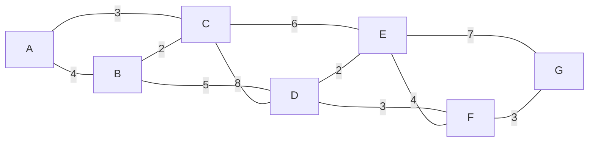

# MXB109 Practice Exam 2

**Total: 60 marks · Suggested time: 2 hours · Resource sheet allowed** (see [resource sheet](../notes/00_START_HERE.md#resource-sheet-given-in-the-exam))

Show all working. For each question, **first say which kind of problem it is and why**.

Solutions: [Practice_Exam_2_Solutions.md](Practice_Exam_2_Solutions.md).

---

## Question 1: Formulation and standard form (6 marks)

An animal shelter mixes **exactly 100 kg** of dry food each week from three brands, A, B and C, costing $2, $3 and $4 per kg.

| per kg | A | B | C |
|---|---|---|---|
| Protein (kg) | 0.20 | 0.30 | 0.50 |
| Fat (kg) | 0.15 | 0.10 | 0.05 |

The mix must contain **at least 30 kg of protein** and **at most 12 kg of fat**. The vet also requires **at least 20 kg of brand C** (it contains a supplement).

(a) Define decision variables and formulate an LP to minimise the weekly cost. **(2)**

(b) Write the LP in standard form, ready for the Big M method. Name each new variable and say what it measures. How many artificial variables are needed, and why? **(2)**

(c) A volunteer suggests 40 kg of A, 30 kg of B and 30 kg of C. Check feasibility, give the value of every slack and excess variable, and the cost. Which requirements are met with room to spare? **(2)**

---

## Question 2: Graphical method (6 marks)

A market stall bakes trays of muffins (x₁) and cookies (x₂), with profit $4 and $2 per tray.

```
max z = 4x₁ + 2x₂
s.t. 2x₁ + x₂ ≤ 16     oven hours
      x₁       ≤ 6      muffin pans
            x₂ ≤ 10     cookie dough
      x₁, x₂ ≥ 0
```

(a) Sketch the feasible region and list all corner points with their z values. **(2)**

(b) Find **all** optimal solutions. Explain geometrically why there is more than one, and say what this means for the stall owner. **(2)**

(c) Cookie profit rises to $3 per tray. Find the new optimal solution. **(1)**

(d) Return to the original profits. By re-solving with oven hours increased to 17, find the shadow price of oven hours. **(1)**

---

## Question 3: Big M method (8 marks)

A landholder splits up to 8 ha between a crop (x₁ ha, profit $200/ha) and native plantings (x₂ ha, profit $400/ha from carbon credits). A grant requires a biodiversity score of **at least 12**, where each ha of crop scores 1 and each ha of planting scores 3.

```
max z = 2x₁ + 4x₂          ($100s)
s.t. x₁ +  x₂ ≤ 8          land
     x₁ + 3x₂ ≥ 12         biodiversity
     x₁, x₂ ≥ 0
```

(a) Explain why the ordinary simplex method cannot start at the origin. Set up the initial Big M tableau with the M's cleared from the objective row. **(2)**

(b) Solve using the Big M method, showing every tableau and the entering/leaving variables. **(4)**

(c) Interpret the final tableau: the optimal plan and profit, the value and meaning of the excess variable, the shadow price of each constraint, and the reduced cost of the crop. **(2)**

---

## Question 4: Sensitivity from a final tableau (9 marks)

A furniture workshop makes chairs (x₁), tables (x₂) and shelves (x₃), with profit $500, $400 and $300 each (z in $100s):

```
max z = 5x₁ + 4x₂ + 3x₃
s.t. 2x₁ + 3x₂ +  x₃ ≤ 50     timber (m³)
     4x₁ +  x₂ + 2x₃ ≤ 110    labour (days)
     3x₁ + 4x₂ + 2x₃ ≤ 80     finishing (hours)
     x₁, x₂, x₃ ≥ 0
```

The final simplex tableau is:

| Basis | x₁ | x₂ | x₃ | s₁ | s₂ | s₃ | RHS |
|---|---|---|---|---|---|---|---|
| x₁ | 1 | 2 | 0 | 2 | 0 | −1 | 20 |
| s₂ | 0 | −5 | 0 | −2 | 1 | 0 | 10 |
| x₃ | 0 | −1 | 1 | −3 | 0 | 2 | 10 |
| z | 0 | 3 | 0 | 1 | 0 | 1 | 130 |

(a) State the optimal production plan and profit. Which resources are fully used, and how much of each other resource is left over? **(2)**

(b) Give the shadow price of each resource **in dollars**, and interpret each. **(2)**

(c) What is the reduced cost of tables? Verify it using the shadow prices, and state how much a table's profit would have to rise before tables are worth making. **(2)**

(d) Find the range of timber supply over which the timber shadow price is valid. Predict the profit if timber is increased to 52 m³. **(2)**

(e) A supplier offers **10 extra finishing hours for $800 in total**. Should the workshop accept? Justify, including a range check. **(1)**

---

## Question 5: Evaluating AI working (5 marks)

A council needs **at least 5 tonnes** of gravel. Gravel A costs $4/t (at most 8 t available) and gravel B costs $5/t. A chatbot was asked to solve

```
min z = 4x₁ + 5x₂   s.t.   x₁ + x₂ ≥ 5,   x₁ ≤ 8,   x₁, x₂ ≥ 0
```

and returned:

> Convert to a maximisation, max z′ = −4x₁ − 5x₂ − Ma₁, and add excess, artificial and slack variables:
>
> | Basis | x₁ | x₂ | e₁ | s₂ | a₁ | RHS |
> |---|---|---|---|---|---|---|
> | a₁ | 1 | 1 | −1 | 0 | 1 | 5 |
> | s₂ | 1 | 0 | 0 | 1 | 0 | 8 |
> | z′ | 4 | 5 | 0 | 0 | M | 0 |
>
> Every entry in the objective row is non-negative, so the tableau is already optimal. The non-basic variables x₁ and x₂ are zero. **Recommendation: buy no gravel, total cost $0.**

(a) Identify the error, and the step of the Big M method that was skipped. **(2)**

(b) Give two signals that the recommendation is wrong, without fixing the error. **(1)**

(c) Correct the working and solve. Give the optimal purchase, the cost, and the meaning of the final objective-row entry under e₁. **(2)**

---

## Question 6: Duality (6 marks)

Use the furniture LP from Question 4.

(a) Write down the dual. Give the dual variables an economic meaning. **(2)**

(b) Read the optimal dual solution from the Question 4 tableau, and verify strong duality. **(2)**

(c) Without solving anything, show that y = (2, 0, 1) is dual-feasible and state what it tells you about the workshop's maximum profit. **(1)**

(d) Use complementary slackness to explain (i) why y₂ = 0 and (ii) the gap in the tables' dual constraint at the optimum. **(1)**

---

## Question 7: Unbalanced transportation (7 marks)

Three quarries supply three building sites. Costs are $ per truckload.

|  | Site 1 | Site 2 | Site 3 | Supply |
|---|---|---|---|---|
| Q1 | 7 | 4 | 6 | 40 |
| Q2 | 5 | 6 | 8 | 60 |
| Q3 | 6 | 9 | 5 | 50 |
| **Demand** | 50 | 40 | 30 | |

(a) Show the problem is unbalanced and fix it. Explain what your fix means physically. **(1)**

(b) Find the northwest corner starting solution and its cost. Check the cell count. **(2)**

(c) Compute u, v (u₁ = 0) and the reduced costs of all empty cells. Which cell enters? **(2)**

(d) Trace the loop for the entering cell, find θ, and give the new plan and cost. **(2)**

---

## Question 8: Game theory (5 marks)

(a) Two TV networks schedule a show. Payoffs (rating points gained by Network R):

|  | C1 | C2 | C3 |
|---|---|---|---|
| R1 | 4 | 2 | 5 |
| R2 | 3 | 1 | 6 |
| R3 | 6 | 0 | 2 |

Find the maximin and minimax values. Does the game have a saddle point? If so, give the optimal strategies and the value. **(2)**

(b) A second game:

|  | C1 | C2 | C3 |
|---|---|---|---|
| R1 | 1 | 4 | −1 |
| R2 | 3 | −2 | 2 |

Show there is no saddle point. Use dominance to remove one column, then write and solve the LP for R's optimal mixed strategy, and give the value of the game. **(3)**

---

## Question 9: Networks (4 marks)

A delivery depot A serves locations B–G. Road lengths (km):



| Road | A–B | A–C | B–C | B–D | C–D | C–E | D–E | D–F | E–F | E–G | F–G |
|---|---|---|---|---|---|---|---|---|---|---|---|
| km | 4 | 3 | 2 | 5 | 8 | 6 | 2 | 3 | 4 | 7 | 3 |

(a) Find the shortest route from A to G and its length, showing your labels. **(2)**

(b) Fibre is to be laid along roads so that all seven locations are connected. Find the minimum total length and the roads used. **(2)**

---

## Question 10: Short answers (4 marks, 1 each)

(a) Why is the optimal solution of an LP always found at a corner of the feasible region?

(b) A Solver sensitivity report gives a shadow price of 0 for a constraint. What does this tell you about that constraint at the optimum, and why?

(c) In an optimal simplex tableau, a non-basic decision variable has 0 in the objective row. What does this mean, and what should you report?

(d) A company makes 400 products using 3 resources. Why might it be smarter to solve the dual LP instead of the primal?
