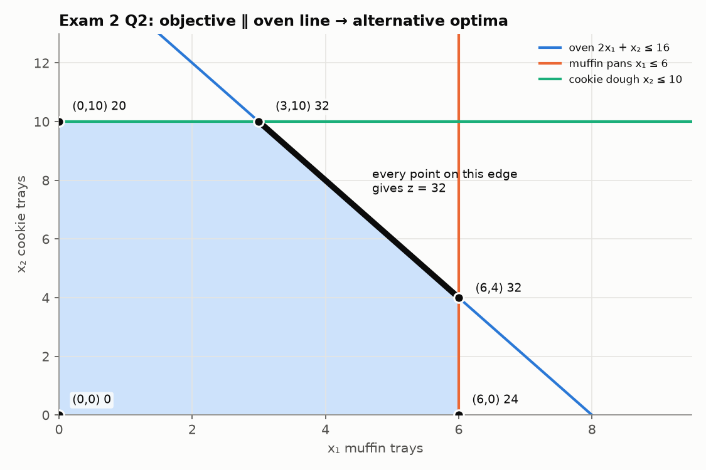
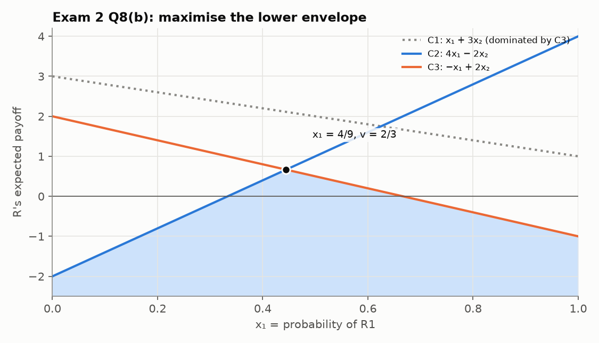

# MXB109 Practice Exam 2: Solutions

Each answer starts with the **diagnosis**. Every number was checked with an LP solver.

---

## Question 1: Formulation and standard form

**Diagnosis:** a blending (min-cost) LP. "At least" gives `≥`, "at most" gives `≤`, and "exactly 100 kg" gives `=`.

**(a)** x₁, x₂, x₃ = kg of brands A, B, C in the weekly mix.

```
min z = 2x₁ + 3x₂ + 4x₃                    ($)
s.t. 0.20x₁ + 0.30x₂ + 0.50x₃ ≥ 30         protein (kg)
     0.15x₁ + 0.10x₂ + 0.05x₃ ≤ 12         fat (kg)
         x₁ +     x₂ +     x₃ = 100        total (kg)
                           x₃ ≥ 20         brand C (kg)
     x₁, x₂, x₃ ≥ 0
```

**(b)** Max z′ = −z:

```
max z′ = −2x₁ − 3x₂ − 4x₃ − Ma₁ − Ma₃ − Ma₄
s.t. 0.20x₁ + 0.30x₂ + 0.50x₃ − e₁ + a₁ = 30
     0.15x₁ + 0.10x₂ + 0.05x₃ + s₂      = 12
         x₁ +     x₂ +     x₃      + a₃ = 100
                           x₃ − e₄ + a₄ = 20
     all variables ≥ 0
```

* e₁ = protein **above** 30 kg; s₂ = fat **below** the 12 kg cap; e₄ = brand C **above** 20 kg.
* **3 artificials** (a₁, a₃, a₄). The origin violates the protein row (0 ≥ 30), the equality (0 = 100) and the brand C row (0 ≥ 20). The fat row holds at the origin, so s₂ can start the basis.

**(c)** (40, 30, 30):
* protein 8 + 9 + 15 = 32 ≥ 30 ✓ → **e₁ = 2**
* fat 6 + 3 + 1.5 = 10.5 ≤ 12 ✓ → **s₂ = 1.5**
* total 100 = 100 ✓ (an equality has no slack)
* C = 30 ≥ 20 ✓ → **e₄ = 10**

**Feasible**, with cost 80 + 90 + 120 = **$290**. All three inequality requirements are met with room to spare, so it can't be optimal. *(The optimum is about 66.7 kg A and 33.3 kg C, costing $266.67.)*

---

## Question 2: Graphical method

**Diagnosis:** two variables, so use the graphical method. Spot that the objective is a multiple of a constraint: 4x₁ + 2x₂ = **2(2x₁ + x₂)**.

**(a)**



| Corner | z = 4x₁ + 2x₂ |
|---|---|
| (0, 0) | 0 |
| (6, 0) | 24 |
| (6, 4) | **32** |
| (3, 10) | **32** |
| (0, 10) | 20 |

**(b)** Maximum **z = 32**, achieved by **every point on the segment from (3, 10) to (6, 4)**, i.e. {(x₁, x₂) : 2x₁ + x₂ = 16, 3 ≤ x₁ ≤ 6}.
The isoprofit line 4x₁ + 2x₂ = c has the same slope (−2) as the oven edge, so as it slides out it lands on the **whole edge** at once instead of a single corner.
*For the owner:* there are many equally profitable plans (e.g. 3 muffins + 10 cookies, or 6 muffins + 4 cookies, or 4.5 + 7), so they can choose on other grounds (demand, effort) at no cost. In a simplex tableau this shows up as a **0 under a non-basic variable** at the optimum.

**(c)** z = 4x₁ + 3x₂: (6, 4) → 36, **(3, 10) → 42**, (0, 10) → 30. The new optimum is **(3, 10), z = $42**, now unique (the slope −4/3 is no longer parallel to any edge).

**(d)** Oven 17: z = 2(2x₁ + x₂) ≤ 2(17) = 34, achieved e.g. at (3.5, 10). **Shadow price = 34 − 32 = $2 per oven hour.**

---

## Question 3: Big M method

**Diagnosis:** a max problem with a `≥` constraint. The origin fails it (0 ≥ 12 is false), so use **Big M**.

**(a)** At the origin, x₁ + 3x₂ − e₂ = 12 forces e₂ = −12 < 0, so the origin isn't a feasible starting corner. Add an artificial: x₁ + 3x₂ − e₂ + a₂ = 12, and penalise it: max z = 2x₁ + 4x₂ − Ma₂.
The z row starts as `z − 2x₁ − 4x₂ + Ma₂ = 0`. Clear the M with `Rz − M·R₂`:

| Basis | x₁ | x₂ | s₁ | e₂ | a₂ | RHS | Ratio |
|---|---|---|---|---|---|---|---|
| s₁ | 1 | 1 | 1 | 0 | 0 | 8 | 8 |
| a₂ | 1 | **3** | 0 | −1 | 1 | 12 | **4** ← |
| z | −2 − M | **−4 − 3M** | 0 | M | 0 | −12M | |

**(b)** **Pivot 1:** x₂ enters (−4 − 3M), a₂ leaves (4).
`R₂′ = R₂/3`, `R₁′ = R₁ − R₂′`, `Rz′ = Rz + (4 + 3M)R₂′`

| Basis | x₁ | x₂ | s₁ | e₂ | a₂ | RHS | Ratio |
|---|---|---|---|---|---|---|---|
| s₁ | 2/3 | 0 | 1 | **1/3** | −1/3 | 4 | **12** ← |
| x₂ | 1/3 | 1 | 0 | −1/3 | 1/3 | 4 | – (negative) |
| z | −2/3 | 0 | 0 | **−4/3** | M + 4/3 | 16 | |

The artificial is gone, so we're at a real corner (0, 4). But −4/3 under e₂ says it pays to go **beyond** the biodiversity minimum.
**Pivot 2:** e₂ enters (−4/3). Only the s₁ row has a positive entry: 4 ÷ 1/3 = 12, so s₁ leaves.
`R₁′ = 3R₁`, `R₂′ = R₂ + ⅓R₁′`, `Rz′ = Rz + (4/3)R₁′`

| Basis | x₁ | x₂ | s₁ | e₂ | a₂ | RHS |
|---|---|---|---|---|---|---|
| e₂ | 2 | 0 | 3 | 1 | −1 | 12 |
| x₂ | 1 | 1 | 1 | 0 | 0 | 8 |
| z | 2 | 0 | 4 | 0 | M | 32 |

No negatives (ignoring the artificial column), so this is **optimal**.

**(c)**
* **Plan:** x₁ = 0, x₂ = 8. Plant all 8 ha as native plantings, for profit **$3200**.
* **e₂ = 12:** the biodiversity score is 3 × 8 = 24, which is **12 above** the grant's minimum. The requirement is **non-binding**.
* **Shadow prices:** land **$400 per ha** (4 under s₁; land is binding). Biodiversity requirement **$0** (e₂ is basic, so it has excess and raising the requirement a little costs nothing).
* **Reduced cost of crop = 2 → $200/ha.** Each ha of crop forces out a ha of planting: +$200 − $400 = −$200. Crop would need to earn more than $400/ha to be worth planting.

---

## Question 4: Sensitivity from a final tableau

**Diagnosis:** reading a final tableau. The z row under slacks gives shadow prices; under decision variables, reduced costs.

**(a)** Basic: x₁ = 20, s₂ = 10, x₃ = 10. Non-basic: x₂, s₁, s₃ = 0.
**Make 20 chairs, 0 tables, 10 shelves for z = 130, i.e. $13,000.**
Timber and finishing are **fully used** (s₁ = s₃ = 0). Labour has **10 days spare** (s₂ = 10).

**(b)** (z is in $100s.)
* Timber: **$100 per m³**. Each extra m³ adds $100 of profit.
* Labour: **$0**. 10 days are already idle, so more labour is worthless at the margin.
* Finishing: **$100 per hour**. Each extra finishing hour adds $100.

**(c)** **Reduced cost of tables = 3, i.e. $300.** Forcing one table into the plan lowers profit by $300.
Check: a table uses 3 m³ timber, 1 labour day and 4 finishing hours. Valued at the shadow prices: 3(1) + 1(0) + 4(1) = 7, i.e. $700 of resources, against a $400 profit, so −$300 ✓.
A table's profit would have to rise from $400 to **at least $700** before tables are worth making.

**(d)** The s₁ column is (2, −2, −3). New basic values = (20, 10, 10) + Δ(2, −2, −3):

```
x₁ = 20 + 2Δ ≥ 0  →  Δ ≥ −10
s₂ = 10 − 2Δ ≥ 0  →  Δ ≤ 5
x₃ = 10 − 3Δ ≥ 0  →  Δ ≤ 10/3
⇒ −10 ≤ Δ ≤ 10/3   ⇒   40 ≤ timber ≤ 53⅓ m³
```

At 52 m³ (Δ = 2, inside the range): z = 130 + 2 × 1 = **132 → $13,200** (plan x₁ = 24, x₃ = 4).

**(e)** The s₃ column is (−1, 0, 2): x₁ = 20 − Δ ≥ 0 gives Δ ≤ 20, and x₃ = 10 + 2Δ ≥ 0 gives Δ ≥ −5. So the range is **75 ≤ finishing ≤ 100 hours**.
+10 hours (to 90) is inside the range, so the extra profit is 10 × $100 = **$1000 > $800**. **Accept**, for a net gain of $200 (z = 140).

---

## Question 5: Evaluating AI working

**Diagnosis:** Big M on a min problem, with a suspicious "already optimal at the origin".

**(a)** **Step skipped: clearing M from the objective row.** a₁ is basic, so its column must be a unit column with **0 in the z′ row**. The tableau shows M there, so it isn't in proper form, and the "no negatives" test isn't valid yet. The chatbot should have done `Rz′ → Rz′ − M·R₁` before testing optimality.

**(b)** Any two of:
* The "final" basis still contains the **artificial a₁ = 5 > 0**, which isn't a real solution.
* The plan (0, 0) **violates** x₁ + x₂ ≥ 5: buying no gravel can't supply 5 tonnes.
* A cost of $0 is impossible when at least 5 t must be bought at ≥ $4/t (the cost must be at least $20).

**(c)** After clearing:

| Basis | x₁ | x₂ | e₁ | s₂ | a₁ | RHS |
|---|---|---|---|---|---|---|
| a₁ | **1** | 1 | −1 | 0 | 1 | 5 |
| s₂ | 1 | 0 | 0 | 1 | 0 | 8 |
| z′ | **4 − M** | 5 − M | M | 0 | 0 | −5M |

x₁ enters (4 − M is more negative than 5 − M). Ratios 5/1 = **5** and 8/1 = 8, so a₁ leaves.
`R₂′ = R₂ − R₁`, `Rz′ = Rz′ − (4 − M)R₁`:

| Basis | x₁ | x₂ | e₁ | s₂ | a₁ | RHS |
|---|---|---|---|---|---|---|
| x₁ | 1 | 1 | −1 | 0 | 1 | 5 |
| s₂ | 0 | −1 | 1 | 1 | −1 | 3 |
| z′ | 0 | 1 | 4 | 0 | M − 4 | −20 |

Optimal: z′ = −20, so **buy 5 t of gravel A and none of B, for $20** (3 t of A capacity unused).
**Entry 4 under e₁:** the shadow price of the "at least 5 t" requirement. Each extra tonne required raises the minimum cost by **$4** (the price of the next tonne of A). The 1 under x₂ is B's reduced cost: B costs $1/t more than A.

---

## Question 6: Duality

**(a)** y₁, y₂, y₃ = the value (in $100s) of one m³ of timber, one labour day and one finishing hour, i.e. what a buyer would have to offer for the workshop's resources.

```
min w = 50y₁ + 110y₂ + 80y₃
s.t. 2y₁ + 4y₂ + 3y₃ ≥ 5    (chair)
     3y₁ +  y₂ + 4y₃ ≥ 4    (table)
      y₁ + 2y₂ + 2y₃ ≥ 3    (shelf)
     y₁, y₂, y₃ ≥ 0
```

**(b)** The dual values are the **shadow prices** in the primal's final z row under s₁, s₂, s₃: **y* = (1, 0, 1)**.
Check feasibility: 2 + 0 + 3 = 5 ≥ 5 ✓; 3 + 0 + 4 = 7 ≥ 4 ✓; 1 + 0 + 2 = 3 ≥ 3 ✓.
w = 50(1) + 110(0) + 80(1) = **130 = z***. Strong duality ✓.

**(c)** y = (2, 0, 1): 4 + 3 = 7 ≥ 5 ✓; 6 + 4 = 10 ≥ 4 ✓; 2 + 2 = 4 ≥ 3 ✓, so it's feasible.
w = 100 + 80 = 180. By weak duality the workshop's profit can **never exceed 180 ($18,000)**. It's a valid but loose bound.

**(d)**
* (i) Labour has 10 days of slack at the optimum. A resource that isn't used up is worth nothing extra, so **y₂ = 0**.
* (ii) Tables aren't made (x₂ = 0), so their dual constraint may be slack: 3y₁ + y₂ + 4y₃ = 7 vs 4, a gap of **3** = the **reduced cost of tables** from Q4(c). (Chairs and shelves are made, so their constraints are tight: 5 = 5 and 3 = 3.)

---

## Question 7: Unbalanced transportation

**Diagnosis:** quarries with supply, sites with demand, a cost grid → transportation. The totals differ, so balance first.

**(a)** Supply 40 + 60 + 50 = 150; demand 50 + 40 + 30 = 120. Supply exceeds demand by 30, so add a **dummy Site 4** with demand 30 and cost 0. Loads "sent" to the dummy are **left at the quarry**.

**(b)**

|  | S1 | S2 | S3 | Dummy | Supply |
|---|---|---|---|---|---|
| Q1 | **40** | | | | 40 |
| Q2 | **10** | **40** | **10** | | 60 |
| Q3 | | | **20** | **30** | 50 |
| Demand | 50 | 40 | 30 | 30 | |

Cost = 40(7) + 10(5) + 40(6) + 10(8) + 20(5) + 30(0) = 280 + 50 + 240 + 80 + 100 = **$750**.
Cells = 6 = m + n − 1 = 3 + 4 − 1 ✓.

**(c)** u₁ = 0:
(Q1,S1) v₁ = 7; (Q2,S1) u₂ = −2; (Q2,S2) v₂ = 8; (Q2,S3) v₃ = 10; (Q3,S3) u₃ = −5; (Q3,D) v₄ = 5.

| Empty cell | c̄ |
|---|---|
| (Q1,S2) | 4 − 0 − 8 = −4 |
| (Q1,S3) | 6 − 0 − 10 = −4 |
| **(Q1,D)** | 0 − 0 − 5 = **−5** ← enters |
| (Q2,D) | 0 + 2 − 5 = −3 |
| (Q3,S1) | 6 + 5 − 7 = 4 |
| (Q3,S2) | 9 + 5 − 8 = 6 |

**(d)** This loop has **six** cells:
(Q1,D) **+** → (Q3,D) **−** → (Q3,S3) **+** → (Q2,S3) **−** → (Q2,S1) **+** → (Q1,S1) **−** → back.
− cells hold 30, 10 and 40, so **θ = 10**. (Q2,S3) empties and leaves.

|  | S1 | S2 | S3 | Dummy |
|---|---|---|---|---|
| Q1 | 30 | | | 10 |
| Q2 | 20 | 40 | | |
| Q3 | | | 30 | 20 |

Cost = 750 + 10(−5) = **$700** (check: 210 + 0 + 100 + 240 + 150 + 0 ✓).
*(Not required: this plan isn't optimal yet, since (Q1,S2) has c̄ = −4. The optimum is $560: Q1→S2 40, Q2→S1 50, Q3→S3 30, with 10 loads left at Q2 and 20 at Q3.)*

---

## Question 8: Game theory

**(a)** Row minima: R1 2, R2 1, R3 0 → **maximin = 2** (R1). Column maxima: C1 6, C2 2, C3 6 → **minimax = 2** (C2).
They're equal, so there's a **saddle point at (R1, C2), value 2**. The entry 2 is the smallest in its row and the largest in its column.
Network R always plays R1, network C always plays C2, and R gains 2 rating points. Neither benefits from switching alone.

**(b)** Row minima: −1, −2 → maximin −1. Column maxima: 3, 4, 2 → minimax 2. −1 ≠ 2, so **no saddle point**.
**Dominance:** for the column player (who wants small numbers), C3 = (−1, 2) ≤ C1 = (1, 3) in both rows, so **C1 is dominated by C3**. Delete C1.

```
max v
s.t. 4x₁ − 2x₂ ≥ v     (vs C2)
     −x₁ + 2x₂ ≥ v     (vs C3)
     x₁ + x₂ = 1,  x₁, x₂ ≥ 0
```



Equalise with x₂ = 1 − x₁: 6x₁ − 2 = 2 − 3x₁, so **x₁ = 4/9, x₂ = 5/9**, and **v = 6(4/9) − 2 = 2/3**.
(Check against the deleted C1: 4/9 + 3(5/9) = 19/9 ≥ 2/3, so C1 really is worse for the column player.)

---

## Question 9: Networks

**(a)** **Shortest path**, using label-setting from A:

| Round | Box | Updates |
|---|---|---|
| 1 | A = 0 | B 4 (A), C 3 (A) |
| 2 | C = 3 | B 5 ✗; D 11 (C); E 9 (C) |
| 3 | B = 4 | D 4+5 = **9** (B) |
| 4 | D = 9 | E 11 ✗; F 12 (D) |
| 5 | E = 9 | F 13 ✗; G 16 (E) |
| 6 | F = 12 | G 12+3 = **15** (F) |
| 7 | G = 15 | done |

Trace: G ← F ← D ← B ← A. **Route A–B–D–F–G = 4 + 5 + 3 + 3 = 15 km.**
(The cheapest road out of A is A–C (3), but the shortest route doesn't use it.)

**(b)** **Minimum spanning tree**, greedy from A: A–C (3), C–B (2), B–D (5), D–E (2), D–F (3), F–G (3).
**6 roads, total 18 km.**

---

## Question 10: Short answers

**(a)** The objective is linear, i.e. a **flat plane** with no peak in the interior. From any interior point you can always move "uphill" until a constraint stops you, then along that edge until another stops you. So the best value is reached at a **corner** (or along a whole edge if the objective is parallel to it). That's why simplex only checks corners.

**(b)** The constraint is (almost certainly) **non-binding**: it has slack or excess at the optimum. Since some of that resource is already unused, one more unit can't improve the objective. (Complementary slackness: slack > 0 ⇒ shadow price = 0.)

**(c)** **Alternative optimal solutions.** Bringing that variable into the basis changes the plan but not z, so there is a whole edge of optimal solutions. Report both optimal corners (pivot that variable in to find the second) and say that every point between them is also optimal.

**(d)** The primal has 400 variables and 3 constraints; the **dual has 3 variables and 400 constraints**. LPs get hard quickly as the number of variables grows, but only mildly as constraints grow. A 3-variable dual is much easier, and by strong duality it gives the same optimal value, plus the shadow prices directly.
