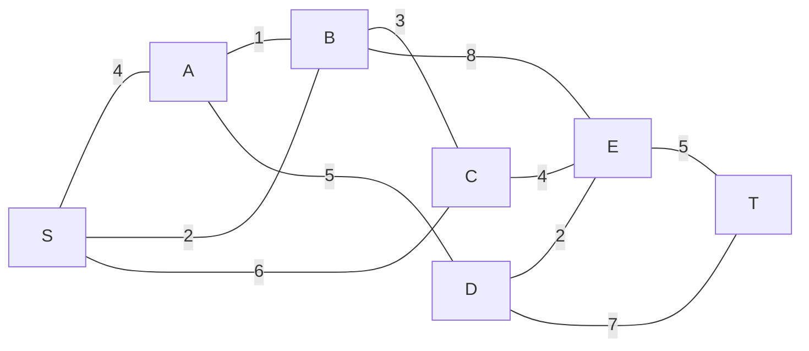

# MXB109 Practice Exam 3

**Total: 60 marks · Suggested time: 2 hours · Resource sheet allowed** (see [resource sheet](../notes/00_START_HERE.md#the-resource-sheet-you-get-this-in-the-exam))

Show all working. For each question, **first say which kind of problem it is and why**.

Solutions: [Practice_Exam_3_Solutions.md](Practice_Exam_3_Solutions.md).

---

## Question 1: Formulation and standard form (5 marks)

A community fund has **up to $50,000** to invest in three local projects. Amounts are in **$1000s**.

| Project | Annual return |
|---|---|
| Solar panels (x₁) | 8% |
| Social housing (x₂) | 6% |
| Parks (x₃) | 4% |

The fund's rules:
* at least **$10,000** must go to parks;
* housing must receive **at least as much as** solar;
* solar may be **at most 40% of the total amount invested**.

(a) Formulate an LP to maximise the annual return. Write every constraint with all variables on the left-hand side. **(2)**

(b) Write the LP in standard form, ready for the Big M method. How many artificial variables are needed? Justify by checking each constraint. **(1)**

(c) The treasurer proposes $15,000 in solar, $25,000 in housing and $10,000 in parks. Show the plan is feasible, give the value of every slack and excess variable, and the annual return in dollars. Explain, **without using the words "slack", "surplus" or "binding"**, why this plan cannot be optimal. **(2)**

---

## Question 2: Graphical method (6 marks)

A small farm plants x₁ ha of pumpkins and x₂ ha of strawberries. Profit is $300 and $400 per ha (z in **$100s**).

```
max z = 3x₁ + 4x₂
s.t.  x₁ +  x₂ ≤ 8      land (ha)
      x₁ + 3x₂ ≤ 18     labour (days)
      x₁       ≤ 6      pumpkin seed (ha)
      x₁ +  x₂ ≥ 3      market contract (ha planted)
      x₁, x₂ ≥ 0
```

(a) Sketch the feasible region and list all corner points with their z values. **(2)**

(b) State the optimal plan and the profit in dollars. Which constraints are binding, and how much room is left in each of the others? **(1)**

(c) Over what range of **pumpkin profit (in $ per ha)** does the optimal plan stay the same? What happens at each end of the range? **(2)**

(d) The market now requires **at least 9 ha** to be planted. What happens to the problem? Say what the Big M method would show if you ran it. **(1)**

---

## Question 3: Simplex method (7 marks)

A boat workshop builds kayaks (x₁), canoes (x₂) and paddleboards (x₃) each month, with profit $400, $600 and $500 each (z in **$100s**).

```
max z = 4x₁ + 6x₂ + 5x₃
s.t. 2x₁ + 2x₂ +  x₃ ≤ 110     moulding (hours)
     4x₁ + 3x₂ + 2x₃ ≤ 120     fibreglass (kg)
     3x₁ + 2x₂ + 2x₃ ≤ 90      finishing (hours)
     x₁, x₂, x₃ ≥ 0
```

(a) Write the initial simplex tableau. What plan does it represent? **(1)**

(b) Solve using the simplex method. Show every tableau with the ratio column, the entering and leaving variables, and the row operations. **(4)**

(c) State the optimal plan, the profit in dollars and the optimal basis. Which resources are fully used, and how much of each other resource is left over? Write one sentence for the workshop owner. **(2)**

---

## Question 4: Sensitivity analysis (7 marks)

Use your **final tableau from Question 3**.

(a) Give the shadow price of each resource **in dollars** and interpret each. **(2)**

(b) Find the range of finishing hours over which the finishing shadow price is valid. A supplier offers **20 extra finishing hours for $2,500 in total**. Should the workshop accept? **(2)**

(c) A second supplier offers **40 extra finishing hours for $5,000**. A colleague says: *"40 × $150 = $6,000 of extra profit, which is more than $5,000, so accept."* Is the colleague's reasoning valid? Find the true extra profit and make a recommendation. **(1)**

(d) Find the reduced cost of kayaks in dollars. Verify it using the shadow prices, and state the profit a kayak would need to earn before kayaks are worth building. **(1)**

(e) The workshop could also build **surfboards**: each uses 1 moulding hour, 2 kg of fibreglass and 1 finishing hour, and earns $380. Without re-solving, should surfboards be built? **(1)**

---

## Question 5: Big M method (7 marks)

A nursery blends fertiliser from two products. Product A costs $2 per kg and product B costs $3 per kg.

```
min z = 2x₁ + 3x₂             ($)
s.t. x₁ +  x₂ ≥ 6              nitrogen (units)
     x₁ + 3x₂ ≥ 12             phosphorus (units)
     x₁       ≤ 5              product A in stock (kg)
     x₁, x₂ ≥ 0
```

(a) Explain why Big M is needed and how many artificial variables are required. Convert to a maximisation, write the standard form, and set up the initial tableau with the M's cleared from the objective row. **(2)**

(b) Solve using the Big M method, showing every tableau and the entering and leaving variables. **(3)**

(c) Interpret the final tableau: the optimal blend and cost, the value and meaning of every excess and slack variable, and the shadow price of each nutrient requirement (with its sign and meaning). **(2)**

---

## Question 6: Evaluating AI working (5 marks)

A brewery makes lager (x₁), pale ale (x₂) and stout (x₃), with profit $300, $200 and $500 per kL (z in **$100s**):

```
max z = 3x₁ + 2x₂ + 5x₃
s.t.  x₁ + 3x₂ +  x₃ ≤ 20     hops (kg)
     2x₁ + 2x₂ + 4x₃ ≤ 80     malt (kg)
      x₁ + 3x₂ + 3x₃ ≤ 50     brewing (hours)
     x₁, x₂, x₃ ≥ 0
```

The final simplex tableau is:

| Basis | x₁ | x₂ | x₃ | s₁ | s₂ | s₃ | RHS |
|---|---|---|---|---|---|---|---|
| x₁ | 1 | 3 | 0 | 3/2 | 0 | −1/2 | 5 |
| s₂ | 0 | −4 | 0 | −1 | 1 | −1 | 10 |
| x₃ | 0 | 0 | 1 | −1/2 | 0 | 1/2 | 15 |
| z | 0 | 7 | 0 | 2 | 0 | 1 | 90 |

A chatbot was asked to summarise the sensitivity analysis. It wrote:

> 1. Malt is fully used: the objective-row entry under s₂ is 0, so malt has no slack.
> 2. The shadow price of hops is 2, so each extra kg of hops is worth $2.
> 3. Buying 30 extra kg of hops would raise profit by 30 × 2 = 60, to z = 150, i.e. $15,000.
> 4. Pale ale isn't brewed. Its profit would have to rise by $700 per kL before it's worth brewing.

(a) For each of the four statements, say whether it is correct. Correct every statement that is wrong. **(4)**

(b) For statement 3, find the largest number of extra kg of hops for which the shadow price method is valid, the profit at that point, and what changes beyond it. **(1)**

---

## Question 7: Duality (6 marks)

A print shop makes batches of posters (x₁), flyers (x₂) and cards (x₃), with profit $80, $50 and $40 per batch (z in **$10s**):

```
max z = 8x₁ + 5x₂ + 4x₃
s.t. 4x₁ + 2x₂ + 2x₃ ≤ 56     printer (hours)
     2x₁ + 2x₂ + 2x₃ ≤ 44     finishing (hours)
     x₁, x₂, x₃ ≥ 0
```

(a) Write down the dual. Give the dual variables an economic meaning. **(2)**

(b) The manager's plan is 6 batches of posters, 16 of flyers and no cards. Use **complementary slackness** to find the dual values. Then use them to **certify** that the manager's plan is optimal. **(2)**

(c) Using the dual, explain why no cards are made, and how much a batch of cards would need to earn before cards are worth making. **(1)**

(d) A consultant claims better scheduling could lift profit to **$1,500**. **Without using your answer to (b)**, show that y = (1, 2) is dual-feasible and use it to refute the claim. **(1)**

---

## Question 8: Transportation with a shortage (7 marks)

Three warehouses supply three stores. Costs are $ per pallet.

|  | Store 1 | Store 2 | Store 3 | Supply |
|---|---|---|---|---|
| W1 | 3 | 3 | 8 | 60 |
| W2 | 6 | 12 | 5 | 40 |
| W3 | 9 | 4 | 8 | 20 |
| **Demand** | 20 | 50 | 90 | |

(a) Show the problem is unbalanced and fix it. Explain what your fix means physically. **(1)**

(b) Find the northwest corner starting solution and its cost. Check the cell count. **(2)**

(c) Compute u, v (u₁ = 0) and the reduced costs of all empty cells. Which cell enters? **(2)**

(d) Trace the loop, find θ, and give the new plan and cost. Show that the new plan is optimal, and say which store goes short and by how much. **(2)**

---

## Question 9: Game theory (5 marks)

(a) Two delivery apps choose a promotion each week. Payoffs are market-share points gained by App R:

|  | C1 | C2 | C3 |
|---|---|---|---|
| R1 | 5 | 3 | 4 |
| R2 | 2 | 1 | 6 |
| R3 | 3 | 0 | 7 |

Find the maximin and minimax. Does the game have a saddle point? A classmate says *"(R3, C1) is also a saddle point, because its entry equals the value of the game."* Are they right? **(2)**

(b) A second game:

|  | C1 | C2 | C3 |
|---|---|---|---|
| R1 | 4 | −1 | 5 |
| R2 | −2 | 3 | 4 |
| R3 | 1 | −2 | 0 |

Show there is no saddle point. Use dominance to reduce the game to 2 × 2. Write and solve the LP for R's optimal mixed strategy, find C's optimal mixed strategy, and give the value of the game. **(3)**

---

## Question 10: Networks (5 marks)

A courier starts at depot S and must reach T. Road lengths (km):



| Road | S–A | S–B | S–C | A–B | A–D | B–C | B–E | C–E | D–E | D–T | E–T |
|---|---|---|---|---|---|---|---|---|---|---|---|
| km | 4 | 2 | 6 | 1 | 5 | 3 | 8 | 4 | 2 | 7 | 5 |

(a) Find the shortest route from S to T and its length, showing your labels. **(2)**

(b) Power cables are to be laid along roads so that all seven locations are connected. Find the minimum total length and the roads used. **(2)**

(c) The shortest-path problem can be written as an LP with x_ij = 1 if the route uses the road from i to j. Write the **conservation-of-flow** constraint at node **B** and at node **S**. **(1)**
