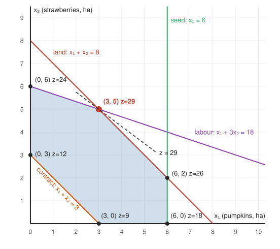

# MXB109 Practice Exam 3: Solutions

Each answer starts with the **diagnosis**. Every number was checked with an exact (fraction) LP solver.

This exam deliberately targets the traps from the [cheat sheet](../notes/10_Cheat_Sheet.md#13-your-personal-traps): **units** ($100s, $10s, $1000s), **binding vs non-binding**, **clearing M**, **shadow prices outside their range**, **reading a dual**, and **fake saddle points**.

---

## Question 1: Formulation and standard form

**Diagnosis:** a plain LP to formulate (max return). "At least" → `≥`, "at most" → `≤`, "at least as much as" and "at most 40% of the total" → move everything to the left.

**(a)** x₁, x₂, x₃ = amount invested in solar, housing, parks ($1000s).

```
max z = 0.08x₁ + 0.06x₂ + 0.04x₃                   (annual return, $1000s)
s.t.        x₁ +      x₂ +      x₃ ≤ 50             total budget
                                x₃ ≥ 10             parks minimum
          −x₁ +      x₂             ≥ 0              housing ≥ solar      (x₂ ≥ x₁)
         0.6x₁ −  0.4x₂ −  0.4x₃ ≤ 0               solar ≤ 40% of total (x₁ ≤ 0.4(x₁ + x₂ + x₃))
     x₁, x₂, x₃ ≥ 0
```

**(b)** Check the origin in each row:

| Constraint | At the origin | Needs an artificial? |
|---|---|---|
| total ≤ 50 | 0 ≤ 50 ✓ | no, + s₁ |
| parks ≥ 10 | 0 ≥ 10 ✗ | **yes**, − e₂ + a₂ |
| −x₁ + x₂ ≥ 0 | 0 ≥ 0 ✓ | **no**: RHS is 0. Multiply by −1: x₁ − x₂ ≤ 0, + s₃ |
| solar ≤ 40% | 0 ≤ 0 ✓ | no, + s₄ |

Reading it: a `≥` with RHS **0** is already satisfied at the origin, so it doesn't need an artificial. **Only 1 artificial.**

```
max z = 0.08x₁ + 0.06x₂ + 0.04x₃ − Ma₂
s.t.    x₁ +    x₂ +    x₃ + s₁           = 50
                        x₃ − e₂ + a₂      = 10
        x₁ −    x₂                 + s₃   = 0
     0.6x₁ − 0.4x₂ − 0.4x₃              + s₄ = 0
     all ≥ 0
```

**(c)** (x₁, x₂, x₃) = (15, 25, 10):

| Constraint | Calculation | Holds? | Slack / excess |
|---|---|---|---|
| total ≤ 50 | 15 + 25 + 10 = 50 | ✓ | s₁ = 0 |
| parks ≥ 10 | 10 | ✓ | e₂ = 0 |
| x₁ − x₂ ≤ 0 | 15 − 25 = −10 | ✓ | s₃ = **10** (housing gets $10,000 more than solar) |
| 0.6x₁ − 0.4x₂ − 0.4x₃ ≤ 0 | 9 − 10 − 4 = −5 | ✓ | s₄ = **5** (solar could take $5,000 more) |

Reading it: **feasible.** Return = 0.08(15) + 0.06(25) + 0.04(10) = 1.2 + 1.5 + 0.4 = 3.1 → **$3,100 per year**.

*Why it can't be optimal (no forbidden words):* solar may take up to 40% of $50,000 = $20,000, but only $15,000 is in solar. Moving **$5,000 from housing to solar** still follows every rule (housing $20,000 ≥ solar $20,000), and that money earns 8% instead of 6%: **+$100 a year**. A plan that can be improved by a legal move isn't the best. *(The optimum is (20, 20, 10), returning $3,200.)*

---

## Question 2: Graphical method

**Diagnosis:** 2 variables → graphical. The contract is a `≥`, so the region doesn't touch the origin.

**(a)**



| Corner | Lines that meet there | z = 3x₁ + 4x₂ |
|---|---|---|
| (3, 0) | contract, x₂ = 0 | 9 |
| (6, 0) | seed, x₂ = 0 | 18 |
| (6, 2) | seed, land | 26 |
| **(3, 5)** | land, labour | **29** |
| (0, 6) | labour, x₁ = 0 | 24 |
| (0, 3) | contract, x₁ = 0 | 12 |

Reading it: (3, 5) has the largest z. It's where land and labour cross: x₁ + x₂ = 8 and x₁ + 3x₂ = 18 → 2x₂ = 10 → x₂ = 5, x₁ = 3.

**(b)** **Plant 3 ha of pumpkins and 5 ha of strawberries: z = 29 → $2,900.**
* **Binding:** land (3 + 5 = 8) and labour (3 + 15 = 18).
* **Seed:** 6 − 3 = **3 ha** of pumpkin seed spare.
* **Contract:** 8 ha planted vs at least 3 required → **5 ha** above the requirement.

**(c)** The binding lines at (3, 5) are land and labour. Slope of ax + by = c is −a/b:

| Line | Slope |
|---|---|
| land: x₁ + x₂ = 8 | −1 |
| profit: c₁x₁ + 4x₂ = z | −c₁/4 |
| labour: x₁ + 3x₂ = 18 | −1/3 |

```
−1 ≤ −c₁/4 ≤ −1/3
multiply by −4 (flips both):   4 ≥ c₁ ≥ 4/3
⇒  4/3 ≤ c₁ ≤ 4   ⇒   $133.33 ≤ pumpkin profit ≤ $400 per ha
```

Reading it: anywhere in that range, the plan stays (3, 5). Only the profit changes.
* **At $400/ha:** the profit line is parallel to land, so (3, 5) and (6, 2) tie (both $3,200). Above $400, switch to **(6, 2)** (more pumpkins).
* **At $133.33/ha:** parallel to labour, so (3, 5) and (0, 6) tie (both $2,400). Below, switch to **(0, 6)** (strawberries only).

**(d)** x₁ + x₂ ≥ 9 contradicts land x₁ + x₂ ≤ 8: no point satisfies both, so the feasible region is **empty** and the problem is **infeasible**. Big M would stop with the contract's **artificial still in the basis at a positive value** (here a = 1: the best you can plant is 8 ha, 1 ha short).

---

## Question 3: Simplex method

**Diagnosis:** max, all `≤`, RHS ≥ 0 → the origin is feasible, so ordinary simplex (no Big M).

**(a)**

| Basis | x₁ | x₂ | x₃ | s₁ | s₂ | s₃ | RHS |
|---|---|---|---|---|---|---|---|
| s₁ | 2 | 2 | 1 | 1 | 0 | 0 | 110 |
| s₂ | 4 | 3 | 2 | 0 | 1 | 0 | 120 |
| s₃ | 3 | 2 | 2 | 0 | 0 | 1 | 90 |
| z | −4 | −6 | −5 | 0 | 0 | 0 | 0 |

Reading it: this is the origin. Build nothing, all 110 moulding hours, 120 kg fibreglass and 90 finishing hours unused, profit $0.

**(b)** **Pivot 1:** x₂ enters (−6 is the most negative).

| Basis | x₁ | x₂ | x₃ | s₁ | s₂ | s₃ | RHS | Ratio |
|---|---|---|---|---|---|---|---|---|
| s₁ | 2 | 2 | 1 | 1 | 0 | 0 | 110 | 110/2 = 55 |
| s₂ | 4 | **3** | 2 | 0 | 1 | 0 | 120 | 120/3 = **40** ← |
| s₃ | 3 | 2 | 2 | 0 | 0 | 1 | 90 | 90/2 = 45 |
| z | −4 | **−6** | −5 | 0 | 0 | 0 | 0 | |

s₂ leaves (40). `R₂′ = R₂/3`, `R₁′ = R₁ − 2R₂′`, `R₃′ = R₃ − 2R₂′`, `Rz′ = Rz + 6R₂′`

**Tableau 1** (0 kayaks, 40 canoes, 0 paddleboards; z = 240)

| Basis | x₁ | x₂ | x₃ | s₁ | s₂ | s₃ | RHS | Ratio |
|---|---|---|---|---|---|---|---|---|
| s₁ | −2/3 | 0 | −1/3 | 1 | −2/3 | 0 | 30 | – (negative) |
| x₂ | 4/3 | 1 | 2/3 | 0 | 1/3 | 0 | 40 | 40 ÷ 2/3 = 60 |
| s₃ | 1/3 | 0 | **2/3** | 0 | −2/3 | 1 | 10 | 10 ÷ 2/3 = **15** ← |
| z | 4 | 0 | **−1** | 0 | 2 | 0 | 240 | |

Reading it: −1 under x₃ says paddleboards still improve profit. x₃ enters, s₃ leaves (15).
`R₃′ = (3/2)R₃`, `R₁′ = R₁ + (1/3)R₃′`, `R₂′ = R₂ − (2/3)R₃′`, `Rz′ = Rz + R₃′`

**Tableau 2** (optimal)

| Basis | x₁ | x₂ | x₃ | s₁ | s₂ | s₃ | RHS |
|---|---|---|---|---|---|---|---|
| s₁ | −1/2 | 0 | 0 | 1 | −1 | 1/2 | 35 |
| x₂ | 1 | 1 | 0 | 0 | 1 | −1 | 30 |
| x₃ | 1/2 | 0 | 1 | 0 | −1 | 3/2 | 15 |
| z | 9/2 | 0 | 0 | 0 | 1 | 3/2 | 255 |

No negatives in the z row, so **optimal**.

**(c)** Basis **{s₁, x₂, x₃}**. **0 kayaks, 30 canoes, 15 paddleboards: z = 255 → $25,500 per month.**

| Resource | Used | Of | Left over |
|---|---|---|---|
| moulding | 2(0) + 2(30) + 15 = 75 | 110 | **35 hours** (s₁ = 35 is basic) |
| fibreglass | 4(0) + 3(30) + 2(15) = 120 | 120 | 0: **fully used** |
| finishing | 3(0) + 2(30) + 2(15) = 90 | 90 | 0: **fully used** |

*"Build 30 canoes and 15 paddleboards a month, and no kayaks, for $25,500 profit. This uses all the fibreglass and finishing time, leaving 35 moulding hours spare."*

---

## Question 4: Sensitivity analysis

**Diagnosis:** read the final tableau. z row under slacks = shadow prices, under non-basic decision variables = reduced costs. **z is in $100s.**

The final tableau again, so you don't have to look back:

| Basis | x₁ | x₂ | x₃ | s₁ | s₂ | s₃ | RHS |
|---|---|---|---|---|---|---|---|
| s₁ | −1/2 | 0 | 0 | 1 | −1 | 1/2 | 35 |
| x₂ | 1 | 1 | 0 | 0 | 1 | −1 | 30 |
| x₃ | 1/2 | 0 | 1 | 0 | −1 | 3/2 | 15 |
| z | 9/2 | 0 | 0 | 0 | 1 | 3/2 | 255 |

**(a)** z row under s₁, s₂, s₃ = 0, 1, 3/2:
* **Moulding: $0.** 35 hours are already idle, so an extra hour adds nothing. (Losing up to 35 hours to maintenance wouldn't cost anything either.)
* **Fibreglass: $100 per kg.** Each extra kg adds $100 profit.
* **Finishing: $150 per hour.** Each extra hour adds $150 profit.

**(b)** Finishing → s₃ column (1/2, −1, 3/2):
```
s₁ = 35 + ½Δ  ≥ 0  →  Δ ≥ −70
x₂ = 30 −  Δ  ≥ 0  →  Δ ≤ 30
x₃ = 15 + 3/2Δ ≥ 0  →  Δ ≥ −10
⇒ −10 ≤ Δ ≤ 30   ⇒   80 ≤ finishing ≤ 120 hours
```
+20 hours (to 110) is **inside** the range. Gain = 20 × $150 = **$3,000 > $2,500**, so **accept**, net +$500 (z = 285 → $28,500).
*Check by plugging in:* x₂ = 30 − 20 = 10, x₃ = 15 + 30 = 45 → fibreglass 30 + 90 = 120 ✓, finishing 20 + 90 = 110 ✓, z = 60 + 225 = 285 ✓.

**(c)** **Not valid.** +40 hours (to 130) is **outside** the range (at most +30). The $150 rate only holds up to 120 hours.

| Finishing hours | Plan (x₂, x₃) | z ($100s) | Extra profit |
|---|---|---|---|
| 90 (now) | (30, 15) | 255 | – |
| 120 (+30, edge of range) | (0, 60) | 255 + 30 × 1.5 = **300** | $4,500 |
| 130 (+40) | (0, 60) | **300** (re-solved) | **$4,500** |

Reading it: at 120 hours, 60 paddleboards use all 120 kg of fibreglass. After that **fibreglass** is the limit, and extra finishing hours sit idle. The true gain is **$4,500 < $5,000**, so **reject** (it would lose $500). Buying only 30 hours for less than $4,500 would be worth it.

**(d)** **Reduced cost of kayaks = 9/2 → $450.**
Check: a kayak uses 2 moulding hours, 4 kg fibreglass and 3 finishing hours, worth 2(0) + 4(1) + 3(3/2) = 8.5 → **$850** at shadow prices. It earns $400, so 400 − 850 = **−$450** ✓.
A kayak must earn **at least $850** before kayaks are worth building.

**(e)** Value a surfboard's resources at the shadow prices:
```
1 moulding × $0 + 2 kg fibreglass × $100 + 1 finishing × $150 = $350
reduced cost = $350 − $380 = −$30      (negative in a max ⇒ worth making)
```
A surfboard earns $380 but only uses $350 worth of resources, so **build surfboards**. *(Re-solving: 30 paddleboards + 30 surfboards, $26,400, +$900.)*

---

## Question 5: Big M method

**Diagnosis:** a min with two `≥` requirements. The origin fails both, so use **Big M**.

**(a)** At the origin, nitrogen gives 0 ≥ 6 ✗ and phosphorus 0 ≥ 12 ✗, so neither has a starting basic variable (the excess would be negative). They need **2 artificials**. The stock limit 0 ≤ 5 ✓ starts with its slack.

Max z′ = −z:
```
max z′ = −2x₁ − 3x₂ − Ma₁ − Ma₂
s.t. x₁ +  x₂ − e₁ + a₁      = 6
     x₁ + 3x₂ − e₂      + a₂ = 12
     x₁                + s₃  = 5
```
The z′ row starts as `z′ + 2x₁ + 3x₂ + Ma₁ + Ma₂ = 0`, so there's M under both artificials. Clear with **`Rz′ − M·R₁ − M·R₂`**:

| Basis | x₁ | x₂ | e₁ | e₂ | s₃ | a₁ | a₂ | RHS | Ratio |
|---|---|---|---|---|---|---|---|---|---|
| a₁ | 1 | 1 | −1 | 0 | 0 | 1 | 0 | 6 | 6/1 = 6 |
| a₂ | 1 | **3** | 0 | −1 | 0 | 0 | 1 | 12 | 12/3 = **4** ← |
| s₃ | 1 | 0 | 0 | 0 | 1 | 0 | 0 | 5 | – (0) |
| z′ | 2 − 2M | **3 − 4M** | M | M | 0 | 0 | 0 | −18M | |

Reading it: −4M beats −2M, so x₂ enters, even though its plain number (3) is bigger than x₁'s (2).

**(b)** **Pivot 1:** x₂ enters, a₂ leaves (4).
`R₂′ = R₂/3`, `R₁′ = R₁ − R₂′`, `Rz′ = Rz′ − (3 − 4M)R₂′`

| Basis | x₁ | x₂ | e₁ | e₂ | s₃ | a₁ | a₂ | RHS | Ratio |
|---|---|---|---|---|---|---|---|---|---|
| a₁ | **2/3** | 0 | −1 | 1/3 | 0 | 1 | −1/3 | 2 | 2 ÷ 2/3 = **3** ← |
| x₂ | 1/3 | 1 | 0 | −1/3 | 0 | 0 | 1/3 | 4 | 4 ÷ 1/3 = 12 |
| s₃ | 1 | 0 | 0 | 0 | 1 | 0 | 0 | 5 | 5/1 = 5 |
| z′ | **1 − (2/3)M** | 0 | M | 1 − (1/3)M | 0 | 0 | (4/3)M − 1 | −12 − 2M | |

Reading it: a₁ is still basic, so this isn't a real plan yet. Under x₁, −(2/3)M beats −(1/3)M under e₂, so x₁ enters.

**Pivot 2:** x₁ enters, a₁ leaves (3).
`R₁′ = (3/2)R₁`, `R₂′ = R₂ − (1/3)R₁′`, `R₃′ = R₃ − R₁′`, `Rz′ = Rz′ − (1 − (2/3)M)R₁′`

| Basis | x₁ | x₂ | e₁ | e₂ | s₃ | a₁ | a₂ | RHS |
|---|---|---|---|---|---|---|---|---|
| x₁ | 1 | 0 | −3/2 | 1/2 | 0 | 3/2 | −1/2 | 3 |
| x₂ | 0 | 1 | 1/2 | −1/2 | 0 | −1/2 | 1/2 | 3 |
| s₃ | 0 | 0 | 3/2 | −1/2 | 1 | −3/2 | 1/2 | 2 |
| z′ | 0 | 0 | 3/2 | 1/2 | 0 | M − 3/2 | M − 1/2 | −15 |

Both artificials are gone and there are no negatives, so **optimal**.

**(c)**
* **Blend:** 3 kg of A and 3 kg of B. z′ = −15, so **cost = $15**.
* **e₁ = 0, e₂ = 0:** nitrogen (3 + 3 = 6) and phosphorus (3 + 9 = 12) are met **exactly**; both requirements are binding.
* **s₃ = 2:** 2 kg of product A stay in stock (3 of 5 used).
* **Shadow prices** (min, `≥` requirements, so cost **rises**):
  * nitrogen **$1.50 per unit** (3/2 under e₁): requiring 7 units instead of 6 raises the minimum cost to $16.50.
  * phosphorus **$0.50 per unit** (1/2 under e₂): requiring 13 units raises it to $15.50.
* Stock of A: shadow price **$0**, since 2 kg are already unused.

---

## Question 6: Evaluating AI working

**Diagnosis:** sensitivity from a final tableau, checking someone else's reading of it. z is in $100s.

**(a)**

| # | Claim | Verdict | Correction |
|---|---|---|---|
| 1 | malt fully used because z-row entry under s₂ is 0 | **wrong** | s₂ is **basic**, with value **10**: 10 kg of malt are **spare**. Every basic variable has 0 in the z row; here that 0 means malt's **shadow price is $0**, not that malt is used up. |
| 2 | hops shadow price 2 → $2 per kg | **wrong (units)** | z is in $100s, so **$200 per kg** of hops. |
| 3 | +30 kg hops → +60 → $15,000 | **wrong (range)** | The shadow price only holds up to **+10 kg** (see (b)). Re-solving at 50 kg gives z = 120 → **$12,000**, not $15,000. |
| 4 | pale ale must rise by $700/kL | **correct** | Check: pale ale uses 3 kg hops, 2 kg malt, 3 hours, worth 3(2) + 2(0) + 3(1) = 9 against profit 2, a gap of **7 → $700**. At exactly +$700 it ties; above that it's worth brewing. |

**(b)** Hops → s₁ column (3/2, −1, −1/2):
```
x₁ = 5 + 3/2Δ ≥ 0  →  Δ ≥ −10/3
s₂ = 10 − Δ   ≥ 0  →  Δ ≤ 10
x₃ = 15 − ½Δ  ≥ 0  →  Δ ≤ 30
⇒ −10/3 ≤ Δ ≤ 10   ⇒   16⅔ ≤ hops ≤ 30 kg
```
At most **10 extra kg**: z = 90 + 10 × 2 = **110 → $11,000** (20 kL lager, 10 kL stout).
At that point s₂ = 0: **malt runs out** and becomes binding. The basis changes, and each further kg of hops is worth less (the next 20 kg add only $1,000 in total).

---

## Question 7: Duality

**Diagnosis:** duality. Write the dual by reading **down columns**; use complementary slackness to get y from x.

**(a)** y₁ = value of one printer hour, y₂ = value of one finishing hour (in $10s): what a buyer would have to offer the shop for each hour.

```
min w = 56y₁ + 44y₂
s.t. 4y₁ + 2y₂ ≥ 8     (posters)
     2y₁ + 2y₂ ≥ 5     (flyers)
     2y₁ + 2y₂ ≥ 4     (cards)
     y₁, y₂ ≥ 0
```

**(b)** First check the plan x = (6, 16, 0):

| Resource | Used | Of | Spare? |
|---|---|---|---|
| printer | 4(6) + 2(16) + 2(0) = 56 | 56 | none |
| finishing | 2(6) + 2(16) + 2(0) = 44 | 44 | none |

Reading it: both resources are fully used, so complementary slackness doesn't force either y to 0.

Posters and flyers **are made**, so their dual constraints must be **tight**:
```
4y₁ + 2y₂ = 8
2y₁ + 2y₂ = 5      subtract:  2y₁ = 3  →  y₁ = 3/2,  y₂ = 1
```

Check y = (3/2, 1) is dual-feasible:

| Product | Resources worth at y = (3/2, 1) | Profit | OK? |
|---|---|---|---|
| Posters | 4(3/2) + 2(1) = 8 | 8 | ✓ (tight) |
| Flyers | 2(3/2) + 2(1) = 5 | 5 | ✓ (tight) |
| Cards | 2(3/2) + 2(1) = 5 | 4 | ✓ (gap 1) |

**Certify:** z = 8(6) + 5(16) = 48 + 80 = **128**; w = 56(3/2) + 44(1) = 84 + 44 = **128**. A feasible plan and a feasible dual with **z = w**, so by weak duality no plan can beat 128. **The manager's plan is optimal: $1,280.** (Shadow prices: $15 per printer hour, $10 per finishing hour.)

**(c)** A batch of cards uses resources worth 2(3/2) + 2(1) = 5 → **$50**, but earns only **$40**. The gap of **$10** is the reduced cost of cards. By complementary slackness, a dual constraint with a gap means **x₃ = 0**. Cards need to earn **more than $50** a batch (at exactly $50 they tie).

**(d)** y = (1, 2): posters 4 + 4 = 8 ≥ 8 ✓; flyers 2 + 4 = 6 ≥ 5 ✓; cards 2 + 4 = 6 ≥ 4 ✓; y ≥ 0 ✓. **Feasible.**
w = 56(1) + 44(2) = 144 → **$1,440**. By **weak duality**, every plan's profit is at most $1,440 < $1,500, so the claim is **impossible**.

---

## Question 8: Transportation with a shortage

**Diagnosis:** warehouses with supply, stores with demand, cost per pallet → transportation. Demand exceeds supply, so balance first.

**(a)** Supply 60 + 40 + 20 = 120; demand 20 + 50 + 90 = 160. Demand exceeds supply by 40, so add a **dummy warehouse W4** with supply 40 and cost $0 to every store. Pallets "sent" from W4 are **demand that isn't met**: that store goes short.

**(b)** Northwest corner:

|  | Store 1 | Store 2 | Store 3 | Supply |
|---|---|---|---|---|
| W1 | $3 → **20** | $3 → **40** | $8 | 60 |
| W2 | $6 | $12 → **10** | $5 → **30** | 40 |
| W3 | $9 | $4 | $8 → **20** | 20 |
| W4 (dummy) | $0 | $0 | $0 → **40** | 40 |
| Demand | 20 | 50 | 90 | |

Cost = 20(3) + 40(3) + 10(12) + 30(5) + 20(8) + 40(0) = 60 + 120 + 120 + 150 + 160 + 0 = **$610**.
Cells = 6 = m + n − 1 = 4 + 3 − 1 ✓.

**(c)** u₁ = 0, using **used** cells only (u + v = cost):
W1S1: v₁ = 3 → W1S2: v₂ = 3 → W2S2: u₂ = 12 − 3 = 9 → W2S3: v₃ = 5 − 9 = −4 → W3S3: u₃ = 8 + 4 = 12 → W4S3: u₄ = 0 + 4 = 4.

|  | S1 (v=3) | S2 (v=3) | S3 (v=−4) |
|---|---|---|---|
| W1 (u=0) | $3 → 20 | $3 → 40 | $8 [8 − 0 + 4 = **12**] |
| W2 (u=9) | $6 [6 − 9 − 3 = **−6**] | $12 → 10 | $5 → 30 |
| W3 (u=12) | $9 [9 − 12 − 3 = **−6**] | $4 [4 − 12 − 3 = **−11**] ← | $8 → 20 |
| W4 (u=4) | $0 [0 − 4 − 3 = **−7**] | $0 [**−7**] | $0 → 40 |

Reading it: the most negative is **(W3, S2), −11**, so it enters. Every pallet moved onto it saves $11.

**(d)** Loop: (W3,S2) **+** → (W3,S3) **−** → (W2,S3) **+** → (W2,S2) **−** → back.
*Why:* W3 sends 1 more to S2, so W3 sends 1 less to S3; S3 is short, so W2 sends 1 more to S3; W2 is over, so it sends 1 less to S2, which balances. Cost per pallet: +4 − 8 + 5 − 12 = **−11** ✓.

|  | S1 | S2 | S3 |
|---|---|---|---|
| W1 | $3 → 20 | $3 → 40 | |
| W2 | | $12 → 10 **−** | $5 → 30 **+** |
| W3 | | $4 **+** | $8 → 20 **−** |
| W4 | | | $0 → 40 |

θ = smallest **−** cell = min(10, 20) = **10**. (W2, S2) empties and leaves.

New plan, with new u, v (u₁ = 0: v₁ = 3, v₂ = 3 → u₃ = 4 − 3 = 1 → v₃ = 8 − 1 = 7 → u₂ = 5 − 7 = −2, u₄ = 0 − 7 = −7):

|  | S1 (v=3) | S2 (v=3) | S3 (v=7) |
|---|---|---|---|
| W1 (u=0) | $3 → 20 | $3 → 40 | $8 [**1**] |
| W2 (u=−2) | $6 [**5**] | $12 [**11**] | $5 → 40 |
| W3 (u=1) | $9 [**5**] | $4 → 10 | $8 → 10 |
| W4 (u=−7) | $0 [**4**] | $0 [**4**] | $0 → 40 |

Cost = 610 + 10(−11) = **$500** (check: 60 + 120 + 200 + 40 + 80 + 0 = 500 ✓).
Reading it: every reduced cost is **positive**, so this plan is **optimal** (and unique, since none is 0).
**Store 3 goes short by 40 pallets** (it receives 40 + 10 = 50 of its 90).

---

## Question 9: Game theory

**(a)**

|  | C1 | C2 | C3 | Row min |
|---|---|---|---|---|
| R1 | 5 | **3** | 4 | **3** ← max |
| R2 | 2 | 1 | 6 | 1 |
| R3 | 3 | 0 | 7 | 0 |
| Col max | 5 | **3** ← min | 7 | |

**maximin = 3 = minimax**, so there's a **saddle point at (R1, C2), value 3**. App R always plays R1, App C always plays C2, and R gains 3 points.

**The classmate is wrong.** A saddle point must be the **smallest in its row and the largest in its column**. (R3, C1) = 3, but R3's smallest entry is 0 and C1's largest is 5. If C plays C1, R would switch to R1 (5 > 3); if R plays R3, C would switch to C2 (0 < 3). Neither player is happy there, so it isn't an equilibrium. Matching the value is a coincidence.

**(b)** Row minima −1, −2, −2 → maximin −1. Column maxima 4, 3, 5 → minimax 3. −1 ≠ 3, so **no saddle point**.

**Dominance:**
* **R3 = (1, −2, 0) ≤ R1 = (4, −1, 5)** in every column. R wants big numbers, so R never plays R3. **Delete R3.**
* In the remaining rows, **C3 = (5, 4) ≥ C2 = (−1, 3)** in every row. C wants small numbers, so C never plays C3. **Delete C3.**

|  | C1 | C2 |
|---|---|---|
| R1 | 4 | −1 |
| R2 | −2 | 3 |

x₁, x₂ = probability R plays R1, R2:
```
max v
s.t. 4x₁ − 2x₂ ≥ v     (vs C1)
    −x₁ + 3x₂ ≥ v     (vs C2)
     x₁ + x₂ = 1,  x₁, x₂ ≥ 0
```
Equalise with x₂ = 1 − x₁: 6x₁ − 2 = 3 − 4x₁ → **x₁ = 1/2, x₂ = 1/2**, **v = 6(1/2) − 2 = 1**.

C's mix, y₁ = P(C1), y₂ = 1 − y₁: vs R1: 4y₁ − (1 − y₁) = 5y₁ − 1; vs R2: −2y₁ + 3(1 − y₁) = 3 − 5y₁. Equal → **y₁ = 2/5, y₂ = 3/5**, value 5(2/5) − 1 = **1** ✓ (same value, as duality says).

*Checks:* deleted R3 against C's mix: 1(2/5) − 2(3/5) = −4/5 ≤ 1 ✓. Deleted C3 against R's mix: 5(1/2) + 4(1/2) = 4.5 ≥ 1 ✓.
**R plays R1 and R2 half the time each; C plays C1 40% and C2 60% of the time; R gains 1 point per week on average.**

---

## Question 10: Networks

**(a)** **Shortest path**, label-setting from S:

| Round | Box (final) | Updates from it |
|---|---|---|
| 1 | S = 0 | A 4 (S), B 2 (S), C 6 (S) |
| 2 | B = 2 | A 2+1 = **3** (B); C 2+3 = **5** (B); E 2+8 = 10 (B) |
| 3 | A = 3 | D 3+5 = 8 (A) |
| 4 | C = 5 | E 5+4 = **9** (C) |
| 5 | D = 8 | E 8+2 = 10 ✗ (keep 9); T 8+7 = 15 (D) |
| 6 | E = 9 | T 9+5 = **14** (E) |
| 7 | T = 14 | done |

Trace back: T ← E ← C ← B ← S. **Route S–B–C–E–T = 2 + 3 + 4 + 5 = 14 km.**
(The direct roads S–A and S–C are both beaten by going through B.)

**(b)** **Minimum spanning tree** (Prim, from S; always add the shortest road to a new location):

| Step | Connected so far | Cheapest road to a new location |
|---|---|---|
| 1 | S | S–B (2) |
| 2 | S, B | A–B (1) |
| 3 | S, B, A | B–C (3) (S–A 4 would close a loop) |
| 4 | S, B, A, C | C–E (4) |
| 5 | + E | D–E (2) |
| 6 | + D | E–T (5) (D–T is 7) |

**6 roads: S–B, A–B, B–C, C–E, D–E, E–T. Total 2 + 1 + 3 + 4 + 2 + 5 = 17 km.**

**(c)** Each road can be used either way. Roads at B go to S, A, C and E:
```
at B (not start or end):   (x_BS + x_BA + x_BC + x_BE) − (x_SB + x_AB + x_CB + x_EB) = 0
at S (start):              (x_SA + x_SB + x_SC) − (x_AS + x_BS + x_CS) = 1
```
Reading it: the route enters and leaves B the same number of times; it leaves S once more than it enters.
