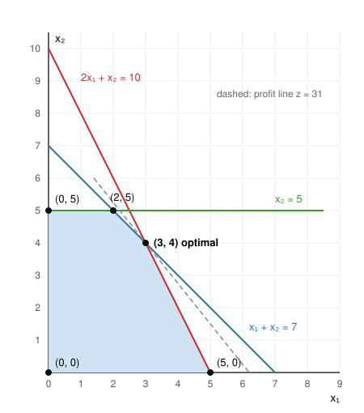

# MXB109 Practice Exam 4 (short): Solutions

Every number was checked with an exact (fraction) LP solver.

---

## Question 1: Formulation

x₁ = Berry smoothies made per day, x₂ = Green smoothies made per day.

```
max z = 4x₁ + 3x₂                 (daily profit, $)
s.t. 2x₁ +  x₂ ≤ 100              fruit (cups)
      x₁ +  x₂ ≤ 80               yoghurt (scoops)
            x₂ ≥ 10               at least 10 Greens
      x₁ − 2x₂ ≤ 0                Berries ≤ twice Greens   (x₁ ≤ 2x₂)
      x₁, x₂ ≥ 0
```

Reading it: "no more than twice as many" means x₁ ≤ 2x₂. Move every variable to the left so the RHS is a plain number.

---

## Question 2: Standard form

**Before you start:**
* Row 4 has a **negative RHS**, so multiply it by −1: −x₁ + x₃ ≤ 2 (the `≥` flips to `≤`).
* It's a **min**, so use max z′ = −z.

Check the origin in each row:

| Row | At the origin | Add |
|---|---|---|
| x₁ + x₂ + x₃ ≥ 10 | 0 ≥ 10 ✗ | − e₁ + a₁ |
| 2x₁ − x₂ = 4 | 0 = 4 ✗ | + a₂ (an `=` has no slack) |
| x₂ + 2x₃ ≤ 16 | 0 ≤ 16 ✓ | + s₃ |
| −x₁ + x₃ ≤ 2 | 0 ≤ 2 ✓ | + s₄ |

```
max z′ = −3x₁ − 2x₂ − 4x₃ − Ma₁ − Ma₂
s.t.  x₁ +  x₂ +  x₃ − e₁ + a₁                = 10
     2x₁ −  x₂                + a₂            = 4
            x₂ + 2x₃                + s₃      = 16
     −x₁       +  x₃                     + s₄ = 2
     all variables ≥ 0
```

**2 artificial variables** (rows 1 and 2).

---

## Question 3: Graphical method

**(a)**



| Corner | Lines that meet there | z = 5x₁ + 4x₂ |
|---|---|---|
| (0, 0) | x₁ = 0, x₂ = 0 | 0 |
| (5, 0) | 2x₁ + x₂ = 10, x₂ = 0 | 25 |
| **(3, 4)** | x₁ + x₂ = 7, 2x₁ + x₂ = 10 | **31** |
| (2, 5) | x₁ + x₂ = 7, x₂ = 5 | 30 |
| (0, 5) | x₂ = 5, x₁ = 0 | 20 |

(3, 4): subtract x₁ + x₂ = 7 from 2x₁ + x₂ = 10 → x₁ = 3, x₂ = 4.

**(b)** **x₁ = 3, x₂ = 4, z = 31.** Binding: x₁ + x₂ ≤ 7 and 2x₁ + x₂ ≤ 10. Not binding: x₂ ≤ 5 (1 unit spare).

---

## Question 4: Simplex method

**(a)** **Tableau 0** (origin, z = 0)

| Basis | x₁ | x₂ | s₁ | s₂ | RHS | Ratio |
|---|---|---|---|---|---|---|
| s₁ | **2** | 1 | 1 | 0 | 8 | 8/2 = **4** ← |
| s₂ | 1 | 2 | 0 | 1 | 10 | 10/1 = 10 |
| z | **−4** | −3 | 0 | 0 | 0 | |

x₁ enters (−4), s₁ leaves (4). `R₁′ = R₁/2`, `R₂′ = R₂ − R₁′`, `Rz′ = Rz + 4R₁′`

**Tableau 1** (x = (4, 0), z = 16)

| Basis | x₁ | x₂ | s₁ | s₂ | RHS | Ratio |
|---|---|---|---|---|---|---|
| x₁ | 1 | 1/2 | 1/2 | 0 | 4 | 4 ÷ 1/2 = 8 |
| s₂ | 0 | **3/2** | −1/2 | 1 | 6 | 6 ÷ 3/2 = **4** ← |
| z | 0 | **−1** | 2 | 0 | 16 | |

x₂ enters (−1), s₂ leaves (4). `R₂′ = (2/3)R₂`, `R₁′ = R₁ − (1/2)R₂′`, `Rz′ = Rz + R₂′`

**Tableau 2**

| Basis | x₁ | x₂ | s₁ | s₂ | RHS |
|---|---|---|---|---|---|
| x₁ | 1 | 0 | 2/3 | −1/3 | 2 |
| x₂ | 0 | 1 | −1/3 | 2/3 | 4 |
| z | 0 | 0 | 5/3 | 2/3 | 20 |

No negatives in the z row, so **optimal**.

**(b)** **x₁ = 2, x₂ = 4, z = 20.** Shadow prices (z row under the slacks): constraint 1 **5/3**, constraint 2 **2/3**. Both constraints are binding.

---

## Question 5: Big M method

**(a)** Both rows fail at the origin, so each needs an excess and an artificial. Max z′ = −z:
```
max z′ = −4x₁ − 5x₂ − Ma₁ − Ma₂
s.t. 2x₁ +  x₂ − e₁ + a₁      = 8
      x₁ + 2x₂ − e₂      + a₂ = 7
```
The z′ row starts with +M under a₁ and a₂. Clear with **`Rz′ − M·R₁ − M·R₂`**:

| Basis | x₁ | x₂ | e₁ | e₂ | a₁ | a₂ | RHS | Ratio |
|---|---|---|---|---|---|---|---|---|
| a₁ | **2** | 1 | −1 | 0 | 1 | 0 | 8 | 8/2 = **4** ← |
| a₂ | 1 | 2 | 0 | −1 | 0 | 1 | 7 | 7/1 = 7 |
| z′ | **4 − 3M** | 5 − 3M | M | M | 0 | 0 | −15M | |

Reading it: x₁ and x₂ both have −3M, a tie on M. Then compare the plain numbers: 4 − 3M is smaller than 5 − 3M, so **x₁ enters**.

**(b)** **Pivot 1:** x₁ enters, a₁ leaves (4). `R₁′ = R₁/2`, `R₂′ = R₂ − R₁′`, `Rz′ = Rz′ − (4 − 3M)R₁′`

| Basis | x₁ | x₂ | e₁ | e₂ | a₁ | a₂ | RHS | Ratio |
|---|---|---|---|---|---|---|---|---|
| x₁ | 1 | 1/2 | −1/2 | 0 | 1/2 | 0 | 4 | 4 ÷ 1/2 = 8 |
| a₂ | 0 | **3/2** | 1/2 | −1 | −1/2 | 1 | 3 | 3 ÷ 3/2 = **2** ← |
| z′ | 0 | **3 − (3/2)M** | 2 − (1/2)M | M | (3/2)M − 2 | 0 | −16 − 3M | |

Reading it: −(3/2)M under x₂ beats −(1/2)M under e₁, so x₂ enters.

**Pivot 2:** x₂ enters, a₂ leaves (2). `R₂′ = (2/3)R₂`, `R₁′ = R₁ − (1/2)R₂′`, `Rz′ = Rz′ − (3 − (3/2)M)R₂′`

| Basis | x₁ | x₂ | e₁ | e₂ | a₁ | a₂ | RHS |
|---|---|---|---|---|---|---|---|
| x₁ | 1 | 0 | −2/3 | 1/3 | 2/3 | −1/3 | 3 |
| x₂ | 0 | 1 | 1/3 | −2/3 | −1/3 | 2/3 | 2 |
| z′ | 0 | 0 | 1 | 2 | M − 1 | M − 2 | −22 |

Both artificials are gone and there are no negatives, so **optimal**.

**(c)** **3 kg of feed A and 2 kg of feed B. z′ = −22, so the cost is $22.** Protein (6 + 2 = 8) and fibre (3 + 4 = 7) are met exactly.
*(Shadow prices: each extra unit of protein required adds $1 to the cost, and each extra unit of fibre adds $2.)*

---

## Question 6: Sensitivity analysis

The final tableau again:

| Basis | x₁ | x₂ | x₃ | s₁ | s₂ | s₃ | RHS |
|---|---|---|---|---|---|---|---|
| s₃ | 0 | 0 | 0 | 2 | −1 | 1 | 10 |
| x₂ | 0 | 1 | 1 | 3 | −1 | 0 | 30 |
| x₁ | 1 | 0 | 0 | −2 | 1 | 0 | 20 |
| z | 0 | 0 | 1 | 3 | 1 | 0 | 270 |

The plan is 20 desks and 30 shelves: z = 270 → **$27,000**.

**(a)** z row under s₁, s₂, s₃ = 3, 1, 0. **z is in $100s:**
* **Labour: $300 per hour.** Fully used (s₁ is not basic, so s₁ = 0).
* **Machine: $100 per hour.** Fully used (s₂ = 0).
* **Desk kits: $0.** s₃ = **10** is basic: 10 kits are spare, so more kits are worth nothing.

**(b)** Labour → s₁ column (2, 3, −2):
```
s₃ = 10 + 2Δ ≥ 0  →  Δ ≥ −5
x₂ = 30 + 3Δ ≥ 0  →  Δ ≥ −10
x₁ = 20 − 2Δ ≥ 0  →  Δ ≤ 10
⇒ −5 ≤ Δ ≤ 10   ⇒   45 ≤ labour ≤ 60 hours
```
+8 hours (to 58) is **inside the range**. Gain = 8 × $300 = **$2,400 > $2,000**, so **yes, buy them** (net +$400; z = 294 → $29,400).

**(c)** **Reduced cost of stools = 1 → $100.** A stool uses 1 labour hour and 2 machine hours, worth 1($300) + 2($100) = $500 at the shadow prices, but it earns only $400. Each stool would lose $100, so none are made. A stool must earn **more than $500** to be worth making (at exactly $500 it ties).

---

## Question 7: Duality

**(a)** One dual variable per constraint. Read **down** each column:
```
min w = 10y₁ + 14y₂
s.t.  y₁ + 2y₂ ≥ 3      (x₁ column)
     2y₁ + 2y₂ ≥ 4      (x₂ column)
      y₁, y₂ ≥ 0
```

**(b)**

| Check | Analyst A: x = (4, 3) | Analyst B: y = (1, 1) |
|---|---|---|
| Constraint 1 | 4 + 2(3) = 10 ≤ 10 ✓ | 1 + 2(1) = 3 ≥ 3 ✓ |
| Constraint 2 | 2(4) + 2(3) = 14 ≤ 14 ✓ | 2(1) + 2(1) = 4 ≥ 4 ✓ |
| Non-negative | ✓ | ✓ |
| Objective | z = 3(4) + 4(3) = **24** | w = 10(1) + 14(1) = **24** |

Both are feasible and **z = w = 24**. By weak duality no plan can have z above 24, and no dual solution can have w below 24. So both answers are **optimal**: both analysts are right.

---

## Question 8: Transportation

**(a)** Supply 50 + 70 = 120. Demand 30 + 40 + 20 = 90. Supply exceeds demand by 30, so add a **dummy destination D4** with demand 30 and cost $0 on both routes. Units sent to D4 stay at the plant.

**(b)** Northwest corner:

|  | D1 | D2 | D3 | D4 (dummy) | Supply |
|---|---|---|---|---|---|
| P1 | $4 → **30** | $6 → **20** | $8 | $0 | 50 |
| P2 | $5 | $3 → **20** | $7 → **20** | $0 → **30** | 70 |
| Demand | 30 | 40 | 20 | 30 | |

Cost = 30(4) + 20(6) + 20(3) + 20(7) + 30(0) = 120 + 120 + 60 + 140 + 0 = **$440**.
Cells = 5 = m + n − 1 = 2 + 4 − 1 ✓.

**(c)** u₁ = 0. On used cells u + v = cost: v₁ = 4, v₂ = 6 → u₂ = 3 − 6 = −3 → v₃ = 7 + 3 = 10, v₄ = 0 + 3 = 3.

|  | D1 (v=4) | D2 (v=6) | D3 (v=10) | D4 (v=3) |
|---|---|---|---|---|
| P1 (u=0) | $4 → 30 | $6 → 20 **−** | $8 [8 − 0 − 10 = **−2**] | $0 [0 − 0 − 3 = **−3**] **+** ← |
| P2 (u=−3) | $5 [5 + 3 − 4 = **4**] | $3 → 20 **+** | $7 → 20 | $0 → 30 **−** |

The most negative is **(P1, D4), −3**, so it enters.
Loop: (P1,D4) + → (P2,D4) − → (P2,D2) + → (P1,D2) −. θ = min(30, 20) = **20**, so (P1, D2) leaves.
New cost = 440 + 20(−3) = **$380**.

New plan, with new u and v (u₁ = 0: v₁ = 4, v₄ = 0 → u₂ = 0 → v₂ = 3, v₃ = 7):

|  | D1 (v=4) | D2 (v=3) | D3 (v=7) | D4 (v=0) |
|---|---|---|---|---|
| P1 (u=0) | $4 → 30 | $6 [**3**] | $8 [**1**] | $0 → 20 |
| P2 (u=0) | $5 [**1**] | $3 → 40 | $7 → 20 | $0 → 10 |

Check: 30(4) + 20(0) + 40(3) + 20(7) + 10(0) = 120 + 120 + 140 = $380 ✓.
Every reduced cost is positive, so this is **optimal**.

**P1 sends 30 to D1. P2 sends 40 to D2 and 20 to D3. Cost $380.** P1 keeps 20 units and P2 keeps 10 (the dummy).

---

## Question 9: Game theory

**(a)**

|  | C1 | C2 | C3 | Row min |
|---|---|---|---|---|
| R1 | 3 | −1 | 4 | **−1** ← max |
| R2 | −2 | 2 | 1 | −2 |
| Col max | 3 | **2** ← min | 4 | |

maximin = −1, minimax = 2. They aren't equal, so there is **no saddle point**.

**(b)** **Dominance:** C wants small numbers. C3 = (4, 1) ≥ C1 = (3, −2) in both rows, so C never plays C3. **Delete C3.**

|  | C1 | C2 |
|---|---|---|
| R1 | 3 | −1 |
| R2 | −2 | 2 |

**R's mix**, p = P(R1):
```
vs C1:  3p − 2(1 − p) = 5p − 2
vs C2: −p + 2(1 − p) = 2 − 3p
equal:  5p − 2 = 2 − 3p  →  p = 1/2,   v = 5(1/2) − 2 = 1/2
```
**C's mix**, q = P(C1):
```
vs R1:  3q − (1 − q) = 4q − 1
vs R2: −2q + 2(1 − q) = 2 − 4q
equal:  4q − 1 = 2 − 4q  →  q = 3/8,   v = 4(3/8) − 1 = 1/2 ✓
```
**R plays R1 and R2 half the time each. C plays C1 3/8 of the time, C2 5/8, and never C3. The value is 1/2.**
*Check:* C3 against R's mix gives 4(1/2) + 1(1/2) = 5/2 ≥ 1/2, so C is right never to play it.

---

## Question 10: Networks

**(a)** Shortest path (label-setting):

| Round | Box | Updates |
|---|---|---|
| 1 | S = 0 | A 3 (S), B 5 (S) |
| 2 | A = 3 | B 3 + 1 = **4** (A); C 3 + 6 = 9 (A) |
| 3 | B = 4 | C 4 + 3 = **7** (B); D 4 + 7 = 11 (B) |
| 4 | C = 7 | D 7 + 2 = **9** (C); T 7 + 5 = **12** (C) |
| 5 | D = 9 | T 9 + 4 = 13 ✗ (keep 12) |
| 6 | T = 12 | done |

Trace back: T ← C ← B ← A ← S. **S–A–B–C–T, length 3 + 1 + 3 + 5 = 12.**

**(b)** Prim from S (add the shortest edge to a new node each time): S–A 3, A–B 1, B–C 3, C–D 2, D–T 4.
**5 edges, total 3 + 1 + 3 + 2 + 4 = 13.**
